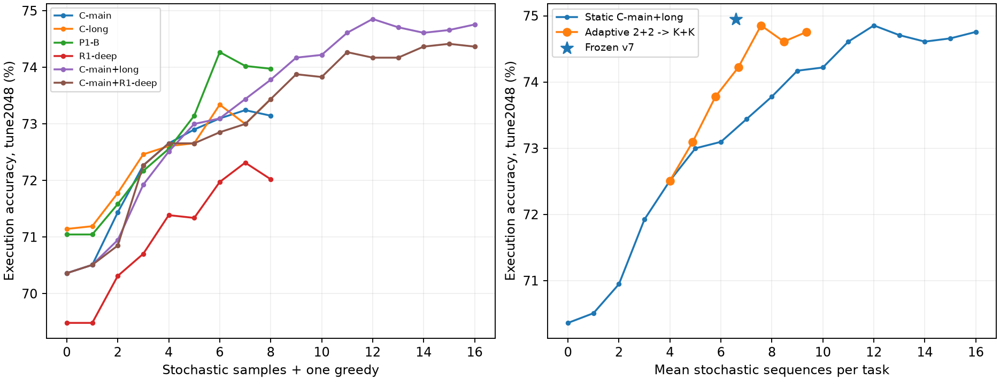

# ДЗ2: выбор архитектуры с учётом голосования за 180 секунд

**Рекомендация после T4: не запускать две новые модели на40 GPU-ч каждая.** Все13 форм измерены; более широкий decoder дешевле прежнего FLOPs-прогноза, но перенос кривой C и реального adaptive voting всё ещё не обещает устойчивого выигрыша над нынешними≈74,4–74,95% tune /77,92% public. Короткие исследовательские пилоты, если нужна проверка архитектуры: **6+6/d768 (113,42M)** и **8+4/d768 (108,69M)**. Это условный план проверки, не рекомендация расходовать80 GPU-ч.

Текущие **77,92% public — сообщение пользователя**, не результат этого анализа. Текущий диапазон tune≈74,4–74,95% также задан пользователем; frozen v7 replay —1535/2048=74,95%. Public и tune — разные выборки; к прогнозу нельзя прибавлять разницу77,92−74,95. Производственный предел — все1919 ответов за180с на однойT4, включая cold load/tokenizer/encode/generation/restore/execution/write. Планируем по guard160с, оставляя20с. Это исследование не меняет v6/v7, B1 или проверку переобучения.

## Что говорит литература

| Источник | Содержание источника | Перенос на ДЗ и ограничение |
|---|---|---|
| [Ghorbani et al.,2021/ICLR2022][ghorbani],§2.2–2.3,§4 | Loss зависит отдельно от encoder и decoder; во всех исследованных наборах показатель decoder больше. CE может снижаться после плато BLEU. | Аргумент против универсального «всё в encoder». Измерены near-converged NMT, d1024/FFN8192 и большие данные; наши runtime/exec/% из статьи не следуют. |
| [Kasai et al.,ICLR2021][kasai],§2.2–2.3,§4–5 | Глубокий encoder/мелкий AR decoder улучшает speed–quality frontier; важны throughput и latency при реальном batching. | Мотивация8+4. Значительная часть результатов использует sequence distillation, запрещённую в ДЗ; обещание качества12+1 напрямую не переносится. |
| [Kaplan et al.,2020][kaplan],§1,§3 | Для LM loss сильнее зависит от N/D/compute, чем от разумного соотношения width/depth; большие модели эффективнее по данным. | Это не равенство hardware wall-time и не закон execution accuracy. Более поздние работы уточняют shape/data allocation. |
| [Tay et al.,ICLR2022, Scale Efficiently][tay-efficient],§4.1–4.4 | Shape влияет на downstream; DeepNarrow может улучшать Pareto frontier, а serial depth ограничивает скорость. | Нельзя выбирать ширину только по FLOPs. У них T5 pretrain→finetune, у нас supervised seq2seq с нуля. |
| [Tay et al.,2022 preprint/2023 Findings][tay-architectures],§3–4 | Scaling exponents и лидирующая архитектура зависят от inductive bias и масштаба. | Один хороший большой Transformer не доказывает преимущество такого же соотношения глубин при100M. |
| [Sardana & Frankle,2023 v1][sardana],§2–3 | Учёт массового serving сдвигает optimum к меньшим, дольше обученным моделям; FLOPs и деньги дают разные optimum. | Переносим принцип учитывать inference; их миллиарды запросов и lifetime objective отличаются от нашего одного180с батча. Поздняя версия расширяет авторов/эксперименты; здесь ссылка именно на двухавторскуюv1. |
| [Brown et al.,2024, Large Language Monkeys][monkeys],§2,§4 | Coverage растёт при repeated sampling, но majority/reward selection может насыщаться гораздо раньше oracle. | Execution числа не является oracle correctness verifier: неверная программа часто возвращает finite число. Важна кривая **выбранного** ответа, не pass@k. |
| [Snell et al.,2024][snell],§3–5,App.C | Полезно адаптировать test-time compute к сложности; лучший способ расходовать budget зависит от задачи. | Берём дешёвое disagreement/unanimity. Их difficulty/verifier и частично неучтённая цена оценки сложности не дают бесплатного4× здесь. |
| [Wu et al.,2024][wu],§3–4 | При фиксированном inference FLOPs меньшая модель с sampling/search может быть выгоднее большой; есть saturation/crossovers. | Обосновывает совместный выбор model+policy. Модели7B/34B с math tuning/верификатором — не наши100M и T4 wall-time. |
| [Hoffmann et al.,2022, Chinchilla][chinchilla],§3 | Баланс роста N и training tokens; исходные70M–16B и5–500B tokens. | Размер100M попадает в нижний диапазон, но20tokens/parameter — ориентир для других данных/loss, не команда выбрать100M. Source условный, loss только target; вычисления encoder/decoder различаются. |
| [Muennighoff et al.,2023][muennighoff],§3,§5–6 | До≈4 эпох повторы могут быть близки к новым данным по loss; затем отдача убывает, есть saturation. | При фиксированном корпусе счётчики предъявленных и уникальных токенов различать. Порог4 не универсален для нашего шума/weighted order. Добавлять внешние данные/таргеты по статье здесь нельзя. |

В NMT закон имеет вид $L=\alpha(\bar N_e/N_e)^{p_e}(\bar N_d/N_d)^{p_d}+L_\infty$ [Ghorbani,Eq.2][ghorbani]. $N_e,N_d$ — параметры соответствующих блоков без embeddings/head; черта — базовая модель, $p_e,p_d$ — чувствительность loss, $\alpha$ — масштаб, $L_\infty$ — остаток. При фиксированном числе параметров optimum $N_e:N_d=p_e:p_d$, но при ограничении времени нужно также учитывать decoder cost. **Это объяснение источника, а не fitted law нашей accuracy.**

Наши данные:9 725 737 пар, **494 009 513 source +540 535 346 target/EOS =1 034 544 859 токенов/эпоху**. Около106,37токена на пару, target55,58. За40ч модель увидит несколько повторных эпох, а не40ч новых данных. Оценка90,06% из [data-research-ceiling](data-research-ceiling.md) — мода finite-дублей, не установленный test ceiling. Потолок90% ниже используется лишь как сценарий.

## Измеренная кривая голосования

CPU прочитаны **384 K8 журнала** L3/P1/R1,98 304 samples,6 моделей×2048 задач. SHA, IDs/question SHA/references, saved K8 winners проверены; нового sampling, исполнения программ, train или GPU нет. Все графики — fixed tune2048/T0,7/seed270042. Greedy — один дополнительный голос; selector frozen count→greedy→meanLP→order, numeric graph-isclose1e-6, без gold в выборе. Сохранены повторные голоса одинаковых программ.

Числа ниже — **matches из2048**, k — число stochastic samples. Single использует свой greedy, смеси — L3 C-main greedy. Для смеси k пополам, нечётный лишний sample — main; исходный порядок моделей сохраняется. Single k9–16 **не наблюдались**, обозначены«—»; дублировать те же8 samples было бы ошибкой.

| k | C-main | C-long | P1-B | R1 deep | R1 control | Main+long | Main+deep |
|---:|---:|---:|---:|---:|---:|---:|---:|
| 0 | 1441 | 1457 | 1455 | 1423 | 1427 | 1441 | 1441 |
| 1 | 1444 | 1458 | 1455 | 1423 | 1429 | 1444 | 1444 |
| 2 | 1463 | 1470 | 1466 | 1440 | 1445 | 1453 | 1451 |
| 3 | 1480 | 1484 | 1478 | 1448 | 1451 | 1473 | 1480 |
| 4 | 1488 | 1487 | 1486 | 1462 | 1459 | 1485 | 1488 |
| 5 | 1493 | 1488 | 1498 | 1461 | 1472 | 1495 | 1488 |
| 6 | 1497 | 1502 | 1521 | 1474 | 1476 | 1497 | 1492 |
| 7 | 1500 | 1495 | 1516 | 1481 | 1480 | 1504 | 1495 |
| 8 | 1498 | 1504 | 1515 | 1475 | 1488 | 1511 | 1504 |
| 9 | — | — | — | — | — | 1519 | 1513 |
| 10 | — | — | — | — | — | 1520 | 1512 |
| 11 | — | — | — | — | — | 1528 | 1521 |
| 12 | — | — | — | — | — | 1533 | 1519 |
| 13 | — | — | — | — | — | 1530 | 1519 |
| 14 | — | — | — | — | — | 1528 | 1523 |
| 15 | — | — | — | — | — | 1529 | 1524 |
| 16 | — | — | — | — | — | 1531 | 1523 |



C-main:70,36→72,66→73,14% приk0/4/8. Main+long:73,78/74,85/74,76% приk8/12/16. K12→16 не улучшает результат этого prefix-пула; это не доказательство отрицательного ожидаемого эффекта новых случайных samples. P1-B меняется немонотонно; единичный training seed и фиксированный пул не дают надёжного asymptote.

Описательный fit прироста $g(k)=a k/(b+k)$, $g$ в п.п., k — stochastic samples, $a$ — предельный прирост, b — число samples для половины него. **C-main a=5.92,b=7.45,RMSE=0.26п.п.; смесь a=8.11,b=11.54,RMSE=0.27п.п.** Это удобная интерполяция, не физический закон; single k>8 — прогноз с дополнительной неопределённостью. P1-B fit упирается в границу b=100: её предельный прирост не идентифицирован. В JSON сохранены наблюдения0…16, fits и парные CI каждого k к собственному greedy. CI условны на weights/pool; tune многократно использован.

Адаптивный v6: greedy+2+2, ранняя остановка1133/2048 задач; остальные получают доK2 на каждую модель. K2=4/6/8 даёт1511/1533/1531 matches при среднем5,787/7,574/9,361 stochastic samples. **v7 greedy+1/1/1→3/5/4:**1535=74,95%,1232 остановки, среднее6,586; прирост к main greedy **+4,59п.п., парный95% CI[3,45;5,73]**,120 gains/26 losses. Это описательный CI после выбора политики, без поправки на tuning.

## Сколько стоит более дорогой decoder

Масштабируются только variable generation phases v5→v6/v7; cold load, CPU execution/tail/write сохранены. Цена округлённых priority waves — прежний worst proxy9,590с×1,10/1,6, profile `all` measured sampling speedup1,641. Реальные v6/v7 complete timers пока не измерены. r — отношение стоимости **генерации**, а не total parameters. Таблица предполагает замену всех генераторов на r-дорогие; одна новая модель с дешёвыми C отдельно ниже.

| r | v6 K2 / mean samples | Время / потеря к v6, п.п. | v7 K2 / mean samples | Время / потеря к v7, п.п. |
|---:|---|---|---|---|
| 1 | 8+8 / 9.36 | 152.8с / 0.10 | 3/5/4 / 6.59 | 139.3с / 0.00 |
| 1.5 | 5+5 / 6.68 | 158.2с / 0.63 | 3/3/3 / 5.39 | 147.7с / 0.73 |
| 2 | 3+3 / 4.89 | 154.0с / 1.76 | 2/2/2 / 4.20 | 148.6с / 1.07 |
| 2.5 | 2+2 / 4.00 | 157.1с / 2.34 | 1/1/1 / 3.00 | 132.7с / 3.37 |

В v6 колонке baseline — frozen K6, поэтомуK8 приr1 случайно хуже на0,10п.п. В v7 — объявленная лесенка3/5/4→3/3/3→2/2/2→1/1/1, без поиска по gold. При бюджете строго180с r1,5 позволяет v6K6 лишь за178,0с: потери0, но запас2с непригоден. Дляr2 и2,5 v6 прежниеK3/K2; дляv7 указанная лесенка та же и при180с. При других K/моделях frontier может быть лучше; таблица — численный сценарий, не lower bound.

Следовательно, decoder×2 должен дать хотя бы **≈1,1–1,8п.п. greedy** сверх соответствующего C, прежде чем компенсировать потерю голосов; с целью ещё+0,7п.п. итогового выигрыша порог≈1,8–2,5п.п. Перенос greedy→vote не обязательно1:1; систематические ошибки могут усилиться.

## Реальные измерения одной T4

Пользовательский **thisarivson/nlp-hw02-shape-bench/v1: COMPLETE,13/13 complete,332,46с (0,092 GPU-ч)**. Torch2.11.0+cu128/CUDA12.8, random-init/no weights saved; CPU-пересчёт не запускал GPU, sampling или исполнение программ. Проверены SHA summary,6 модулей против скачанных **и текущих** исходников, lengths payload и параметры реального SimpleTransformer. Полная компактная [квитанция замеров](../results/architecture-shape-bench.json) подготовлена для Git; исходный скачанный output остаётся в ignored `results/kaggle-runs/nlp-hw02-shape-bench/1/`.

Training —8 одинаковых effective128 bucket batches, AMP/GradScaler/fused AdamW/clip, synchronized wall после warmup. Probe на128 самых длинных строк выбирает micro64→32 с93% headroom; это не поиск самого быстрого micro. **A/R — peak allocated/reserved выбранных measured batches**, а не максимум probe. Разброс8 batches отражает разные длины, не независимые повторы throughput. Probe/OOM и все времена сохранены в квитанции.

Generation — frozen v6 decoder all, greedy1024 вопросов и sample256×K4; принудительный EOS по общему расписанию реальных source/output lengths C-main (max148), capacity512. seq/s включает encoder/cross-KV/H2D/D2H, исключает исполнение программ. Encoder1919 — FP16, median3, batch256, без tokenizer/H2D. **Это измерение форм, полного холодного180с таймера ещё нет.** Обученная новая модель может иметь другие длины и хвост512.

| Форма E+D/d | Train pairs/s | micro | Train A/R, GiB | Gen R greedy/sample, GiB | Greedy/sample, seq/s | Encoder1919, с | r train / greedy / sample |
|---|---:|---:|---:|---:|---:|---:|---:|
| e6-d6-w512 | 422.6 | 64 | 4.14/4.98 | 9.52/9.99 | 263.1/337.2 | 0.379 | 1.00 / 1.00 / 1.00 |
| e6-d8-w640 | 246.7 | 32 | 3.98/4.17 | 9.37/9.85 | 183.3/226.7 | 0.552 | 1.71 / 1.44 / 1.49 |
| e6-d6-w768 | 229.4 | 32 | 4.29/4.54 | 14.23/8.89 | 168.3/250.4 | 0.785 | 1.84 / 1.56 / 1.35 |
| e6-d6-w640 | 291.7 | 64 | 5.18/5.72 | 11.90/12.48 | 193.3/251.2 | 0.641 | 1.45 / 1.36 / 1.34 |
| e12-d6-w640 | 202.0 | 32 | 4.61/4.75 | 12.03/12.60 | 160.2/241.2 | 1.208 | 2.09 / 1.64 / 1.40 |
| e10-d4-w768 | 212.2 | 32 | 4.59/4.94 | 10.81/10.29 | 182.1/281.1 | 1.302 | 1.99 / 1.44 / 1.20 |
| e8-d6-w640 | 249.2 | 32 | 3.82/4.09 | 11.94/12.52 | 185.1/250.4 | 0.818 | 1.70 / 1.42 / 1.35 |
| e6-d10-w512 | 248.3 | 32 | 3.45/3.70 | 9.11/9.74 | 166.3/200.3 | 0.442 | 1.70 / 1.58 / 1.68 |
| e4-d4-w768 | 334.8 | 64 | 4.57/5.56 | 10.66/10.13 | 242.2/309.6 | 0.525 | 1.26 / 1.09 / 1.09 |
| e8-d8-w640 | 213.2 | 32 | 4.35/4.60 | 9.41/9.89 | 176.8/221.9 | 0.807 | 1.98 / 1.49 / 1.52 |
| e8-d4-w768 | 246.7 | 64 | 5.95/6.66 | 10.78/10.25 | 195.6/286.6 | 1.069 | 1.71 / 1.35 / 1.18 |
| e6-d5-w768 | 244.2 | 32 | 3.94/4.29 | 12.26/12.68 | 188.2/250.1 | 0.800 | 1.73 / 1.40 / 1.35 |
| e7-d7-w640 | 241.9 | 32 | 3.90/4.13 | 13.84/8.63 | 171.6/246.3 | 0.711 | 1.75 / 1.53 / 1.37 |

r — **стоимость** относительно C, то есть C throughput / shape throughput; меньше лучше. В таблице generation R — peak reserved. 6+8/640,6+10/512,8+8/640 ушли на512lanes для greedy/sample;6+6/768 и7+7/640 — для sample, greedy остался1024; остальные1024/1024. Эта цена уже внутри r, повторно умножать её на2 нельзя. Greedy6+6/768 reserved14,23GiB оставляет мало места для одновременных весов C: hybrid требует unloading/lane fallback и отдельного memory gate. Micro64 OOM у6+8/640,6+6/768,12+6/640,8+8/640,7+7/640; headroom fallback у10+4/768,8+6/640,6+10/512,6+5/768. Ни одна форма не провалила micro32.

Точные параметры — проверка реального `SimpleTransformer` на meta device и независимой формулы:

| Форма E+D/d | Encoder | Decoder | Embeddings | Head | Всего |
|---|---:|---:|---:|---:|---:|
| e6-d6-w512 | 18 944 032 | 25 253 920 | 5 244 416 | 4 204 035 | 53 646 403 |
| e6-d8-w640 | 29 609 024 | 52 616 192 | 6 555 520 | 5 252 995 | 94 033 731 |
| e6-d6-w768 | 42 534 912 | 56 718 336 | 7 866 624 | 6 301 955 | 113 421 827 |
| e6-d6-w640 | 29 609 024 | 39 462 464 | 6 555 520 | 5 252 995 | 80 880 003 |
| e12-d6-w640 | 59 216 768 | 39 462 464 | 6 555 520 | 5 252 995 | 110 487 747 |
| e10-d4-w768 | 70 890 496 | 37 812 736 | 7 866 624 | 6 301 955 | 122 871 811 |
| e8-d6-w640 | 39 478 272 | 39 462 464 | 6 555 520 | 5 252 995 | 90 749 251 |
| e6-d10-w512 | 18 944 032 | 42 089 184 | 5 244 416 | 4 204 035 | 70 481 667 |
| e4-d4-w768 | 28 357 120 | 37 812 736 | 7 866 624 | 6 301 955 | 80 338 435 |
| e8-d8-w640 | 39 478 272 | 52 616 192 | 6 555 520 | 5 252 995 | 103 902 979 |
| e8-d4-w768 | 56 712 704 | 37 812 736 | 7 866 624 | 6 301 955 | 108 694 019 |
| e6-d5-w768 | 42 534 912 | 47 265 536 | 7 866 624 | 6 301 955 | 103 969 027 |
| e7-d7-w640 | 34 543 648 | 46 039 328 | 6 555 520 | 5 252 995 | 92 391 491 |

4+4/d768 и6+6/d640≈80M,6+10/d512≈70M;10+4/d768=122,87M. Они оставлены по запросу как контроли вне90–120M. Добавлены8+8/d640,8+4/d768,6+5/d768 и7+7/d640. GPU сохранил `shape-bench/timings.csv`: **форма→pairs/s,seconds/effective128,micro,greedy_seq/s,sample_seq/s,encoder1919_s**, плюс память/подробные batches в summary.json.

## Прогноз40 GPU-ч: каркас и текущие сценарии

В40ч включены checkpoints/eval/cooldowns; основной main budget **36ч=129600с**. Предъявленные target-токены $D_t=129600\,v\,\bar\ell_t$, pair-токены $D_p=129600\,v(\bar\ell_s+\bar\ell_t)$, v — pairs/s, средние длины измерены по кешу. Около20tokens/N для Chinchilla относится к иным LM loss; наши $D_p$ и $D_t$ показываем раздельно. В fit C-main токены **точно** просуммированы по cyclic ordinary order/offsets до attempted updates×128; AMP skips не уменьшают предъявления. Main_s исключает cooldown/eval/I/O.

| C-main point | main_s | Target / pair tokens, млрд | Cooldown, мин | Greedy heldout4k, % |
|---|---:|---:|---:|---:|
| t009000 | 9000 | 0.173 / 0.330 | 15 | 62.87 |
| l2-10800 | 28370 | 0.555 / 1.063 | 15 | 67.50 |
| l2-21600 | 39170 | 0.762 / 1.458 | 15 | 68.36 |
| l2-28800 | 46370 | 0.900 / 1.722 | 50 | 70.02 |
| l2-45540 | 63110 | 1.209 / 2.314 | 15 | 69.04 |
| l2-62280 | 79851 | 1.518 / 2.905 | 50 | 70.75 |

Для времени/data slope используются C-main точки с15/50мин cooldown, с отдельным offset50. При сценарных asymptotes85/90/95% fitted beta≈0,175/0,138/0,113, RMSE≈0,33–0,37п.п. Это шесть наблюдений, не оценка потолка. Long2x L2/L3 и P1/R1 сохранены в исходных results и stress-блоке JSON: другой order/objective/cooldown нельзя выдать за дополнительные точки одной time curve. P1 даёт ещё≈4,02M предъявлений cooldown, **не main**; R1 stable дополнительно9,5ч main при q10%. Их ухудшение запрещает уверенную монотонную экстраполяцию.

| Stress point | main_s | Main target / pair, млрд | Cooldown target, млрд / мин | Greedy4k, % |
|---|---:|---:|---:|---:|
| L3-long | 79850 | 1.605 / 3.021 | 0.059 / 50 | 71.36 |
| P1-A | 79850 | 1.605 / 3.021 | 0.246 / 217 | 71.63 |
| P1-B | 79850 | 1.605 / 3.021 | 0.246 / 220 | 72.07 |
| deep | 113748 | 2.072 / 3.896 | 0.016 / 20 | 70.17 |
| control | 113759 | 2.284 / 4.295 | 0.024 / 20 | 70.02 |

Stress-токены также точно просуммированы по ordinary L1-prefix+weighted cyclic order, с SHA и проверенным reset cursor. Это предъявления, **до q10% удаления части loss**; cooldown показан отдельно и не превращается в main_s. Для intermediate long L2/L3 точек исходные метрики доступны в [l3-results](l3-results.md); в size fit они не добавляют независимой архитектуры.

**Собственная модель, привязанная к кривой C** (не опубликованный scaling law accuracy):

$$\widehat A_{4k}=F-(F-A_0)(D_t/D_0)^{-\beta}n^{-\gamma},\qquad
n=(N_e/N_{e0})^\eta(N_d/N_{d0})^{1-\eta}.$$

$A_0=70,752\%$ — C-main L3/50мин, $D_0=1,518$ млрд main target/EOS tokens; $F$ — сценарный предел85/90/95%, $N_e,N_d$ — параметры блоков, $n$ — относительная ёмкость, $\eta$ — доля encoder. Центрально F90,γ0,17,η0,25,β=0.138; сетка γ=λ·α при λ0…0,75/α0,2…0,5/η0…1. γ — предполагаемая эластичность reducible error к ёмкости; β — fitted эластичность к target tokens. λ ослабляет предполагаемый эффект размера α, используется только их произведениеγ. **C не определяет γ и η.** В прежней аддитивной модели λ0,5 вдвое ослабляла уже fitted C slope. Здесь при n=1 точно сохраняется fitted зависимость от токенов и якорь A0. Это исправление калибровки, не новые доказательства пользы размера.

C в benchmark **422,62 pairs/s**, историческая поздняя C —**332,36 pairs/s**, отношение **0,7864**. Основной прогноз использует $v_{prod}=v_{bench}\times0,7864$; число предъявлений за36ч main —$D_t=129600\,v_{prod}\,55,578$. Это собственная поправка на pipeline/распределение batches/оборудование; одна короткая серия не измеряет40ч. Прямой bench-прогноз в скобках и в sensitivity grid — верхний сценарий. Резерв4ч на setup/cooldown/eval/I/O не считается main; повторные эпохи не являются новыми данными. Например, C≈4,58/2,39 млрд pair/target (bench5,83/3,04); 6+6/768≈2,49/1,30 (bench3,16/1,65).

Для сопоставления с tune переносим **full4k→tune сдвиг C =−0,3906п.п.**, затем добавляем uplift **одной** модели по сохранённому adaptive replay C-main. Это предположение о переносе между подвыборками; full4k прогноз показан отдельно. Не прибавляем весь ensemble uplift v7 к single greedy. Uncertainty включает F/γ/η, прямую и откалиброванную скорость, recipe/cooldown/seed±1,5п.п. и перенос voting; нижний сценарий включает полное плато обучения. Это сценарии, **не prediction CI**; до pilot нет измеренной size elasticity.

### Single: одна новая модель, greedy+2→K2

На сохранённой C-main проверяем frozen unanimity-stop по greedy+2 samples, затем только несогласным добавляем доK2. Production v7 поддерживает2–4 модели: single — **исследовательская политика**, её runtime код здесь не меняется. Таблица выбирает наибольший K2≤8, помещающийся в160с, без выбора по gold. Uplift берётся из реального prefix-replay, а не из g(mean K); K2>8 по качеству не наблюдались. Скорость раздельно масштабирует greedy и sample; неизменными оставлены cold load, executor/tail/write v5 и reserve2с, rounded waves и10% worst-batch запас из v6/v7. Для single сохранён даже overhead загрузки двух C: оценка осторожная.

| Форма | Токены pair/target, млрд: calibrated (bench) | Greedy full4k / tune, % | K2 / mean при160с | Время, с | Vote Δ, п.п. | Итог tune, % | Сценарии, % |
|---|---:|---:|---:|---:|---:|---:|---:|
| e6-d6-w512 | 4.58/2.39 (5.83/3.04) | 71.92 / 71.53 | 8 / 4.09 | 81.7 | +2.78 | 74.32 | 69.6…78.5 |
| e6-d8-w640 | 2.67/1.40 (3.40/1.78) | 72.60 / 72.21 | 8 / 4.09 | 114.3 | +2.78 | 75.00 | 69.4…82.8 |
| e6-d6-w768 | 2.49/1.30 (3.16/1.65) | 72.86 / 72.47 | 8 / 4.09 | 108.9 | +2.78 | 75.25 | 69.2…83.2 |
| e6-d6-w640 | 3.16/1.65 (4.02/2.10) | 72.37 / 71.98 | 8 / 4.09 | 105.2 | +2.78 | 74.76 | 69.6…81.1 |
| e12-d6-w640 | 2.19/1.14 (2.78/1.45) | 71.99 / 71.60 | 8 / 4.09 | 113.0 | +2.78 | 74.38 | 68.9…85.0 |
| e10-d4-w768 | 2.30/1.20 (2.93/1.53) | 72.15 / 71.76 | 8 / 4.09 | 98.9 | +2.78 | 74.54 | 69.0…86.1 |
| e8-d6-w640 | 2.70/1.41 (3.44/1.80) | 72.20 / 71.81 | 8 / 4.09 | 106.5 | +2.78 | 74.59 | 69.4…82.8 |
| e6-d10-w512 | 2.69/1.41 (3.42/1.79) | 71.77 / 71.38 | 8 / 4.09 | 127.4 | +2.78 | 74.17 | 69.4…81.2 |
| e4-d4-w768 | 3.63/1.90 (4.62/2.41) | 72.57 / 72.18 | 8 / 4.09 | 86.9 | +2.78 | 74.96 | 69.6…81.1 |
| e8-d8-w640 | 2.31/1.21 (2.94/1.54) | 72.47 / 72.07 | 8 / 4.09 | 117.0 | +2.78 | 74.86 | 69.0…82.5 |
| e8-d4-w768 | 2.67/1.40 (3.40/1.78) | 72.35 / 71.96 | 8 / 4.09 | 96.0 | +2.78 | 74.74 | 69.4…85.1 |
| e6-d5-w768 | 2.65/1.38 (3.37/1.76) | 72.61 / 72.22 | 8 / 4.09 | 106.2 | +2.78 | 75.00 | 69.4…83.3 |
| e7-d7-w640 | 2.62/1.37 (3.34/1.74) | 72.37 / 71.98 | 8 / 4.09 | 109.6 | +2.78 | 74.77 | 69.4…81.8 |

### Сколько адаптивных samples помещается

В ячейке **K2; среднее stochastic samples/задачу; весь pipeline секунд**. Два значения — guard160 / hard180. Single timing-only ограничен сеткойK2≤16; выше8 это прогноз времени без наблюдений качества. В single quality-таблице выше используются толькоK2≤8. v6 иv7 — **аналоги замены всех генераторов на данную форму**, с наблюдёнными stop rates C-пула; они требуют двух/трёх разных моделей, не выдаются за качество одной новой модели. Для v6 перебраныK2=2…8 каждой модели; дляv7 заранее объявленная лесенка1/1/1→2/2/2→3/3/3→3/5/4. Неопределённость stop rate/длин новой модели не измерена.

| Форма | Single timing-only160 /180 | v6:160 /180 | v7:160 /180 |
|---|---|---|---|
| e6-d6-w512 | 16; 6.87; 121.2с / 16; 6.87; 121.2с | 8/8; 9.36; 152.8с / 8/8; 9.36; 152.8с | 3/5/4; 6.59; 139.3с / 3/5/4; 6.59; 139.3с |
| e6-d8-w640 | 14; 6.17; 153.5с / 16; 6.87; 168.3с | 5/5; 6.68; 156.3с / 6/6; 7.57; 175.9с | 3/3/3; 5.39; 146.0с / 3/3/3; 5.39; 146.0с |
| e6-d6-w768 | 16; 6.87; 158.2с / 16; 6.87; 158.2с | 5/5; 6.68; 147.4с / 6/6; 7.57; 165.2с | 3/3/3; 5.39; 138.3с / 3/3/3; 5.39; 138.3с |
| e6-d6-w640 | 16; 6.87; 155.0с / 16; 6.87; 155.0с | 5/5; 6.68; 144.3с / 7/7; 8.47; 179.7с | 3/3/3; 5.39; 135.2с / 3/3/3; 5.39; 135.2с |
| e12-d6-w640 | 15; 6.52; 159.0с / 16; 6.87; 163.6с | 5/5; 6.68; 152.4с / 6/6; 7.57; 170.8с | 3/3/3; 5.39; 142.8с / 3/3/3; 5.39; 142.8с |
| e10-d4-w768 | 16; 6.87; 144.1с / 16; 6.87; 144.1с | 6/6; 7.57; 150.3с / 7/7; 8.47; 166.2с | 3/3/3; 5.39; 126.8с / 3/5/4; 6.59; 168.8с |
| e8-d6-w640 | 16; 6.87; 156.2с / 16; 6.87; 156.2с | 5/5; 6.68; 145.4с / 6/6; 7.57; 163.2с | 3/3/3; 5.39; 136.3с / 3/3/3; 5.39; 136.3с |
| e6-d10-w512 | 12; 5.48; 153.5с / 14; 6.17; 171.8с | 4/4; 5.79; 151.7с / 5/5; 6.68; 173.9с | 2/2/2; 4.20; 127.9с / 3/3/3; 5.39; 161.1с |
| e4-d4-w768 | 16; 6.87; 129.9с / 16; 6.87; 129.9с | 7/7; 8.47; 149.9с / 8/8; 9.36; 164.3с | 3/5/4; 6.59; 150.6с / 3/5/4; 6.59; 150.6с |
| e8-d8-w640 | 14; 6.17; 157.0с / 16; 6.87; 171.7с | 5/5; 6.68; 159.6с / 6/6; 7.57; 179.6с | 3/3/3; 5.39; 148.9с / 3/3/3; 5.39; 148.9с |
| e8-d4-w768 | 16; 6.87; 140.8с / 16; 6.87; 140.8с | 6/6; 7.57; 146.9с / 8/8; 9.36; 177.9с | 3/3/3; 5.39; 123.9с / 3/5/4; 6.59; 164.6с |
| e6-d5-w768 | 16; 6.87; 156.0с / 16; 6.87; 156.0с | 5/5; 6.68; 145.2с / 6/6; 7.57; 163.0с | 3/3/3; 5.39; 136.2с / 3/3/3; 5.39; 136.2с |
| e7-d7-w640 | 16; 6.87; 159.6с / 16; 6.87; 159.6с | 5/5; 6.68; 148.7с / 6/6; 7.57; 166.7с | 3/3/3; 5.39; 139.4с / 3/3/3; 5.39; 139.4с |

Encoder уже входит в paired generation ratio; отдельно encoder1919 к времени не прибавляется. Fixed CPU cost не ускоряется вслед заGPU. Добавление samples может удлинить очередь исполнителя: сохранённый fixed overhead и профиль с workers — proxy, **выполнение всех новых программ в180с не установлено**. JSON даёт stress+15% к variable generation, обе исходные test/tune оценки и отдельные hybrid grids. Прогнозный запас до160с обязателен; cold real-weight T4 gate должен проверить memory, length drift и исполнитель.

R1 особенно важна: encoder6→12 стоил1,456×/update и31,3% данных, greedy deep−control+0,15п.п.[−0,86;+1,15]. Поздний function-preserving рост с q10%/20мин cooldown **не эквивалентен fresh8+4/768**, но опровергает сильный prior «encoder почти бесплатно решит задачу». D8+8/640 из L1 закончилась наNaN и не даёт валидного converged100M calibration point. Уменьшение CE нельзя автоматически переводить в execution gain: P1 это непосредственно показала.

### Гибрид: новая greedy и дешёвые C samples

Проверен реальный аналог с greedy **новой** модели, а не прежним main tie-anchor: K1large/C=1/1→K2=2/6. R1deep+C:1507/2048,mean4,18; P1-B+C:1520,mean4,04; L3long+C:1517,mean4,14. Все ниже нынешнегоv7. Пулы4/4,4/8,8/8 и1/4,2/8 тоже сохранены; увеличение total K и комплементарность нельзя смешивать.

Центральный прогноз переносит аналогP1-B1520/2048=74,22% и **половину** изменения будущего full4k greedy относительно её72,07%. Это уже согласование с observed tune anchor гибрида; повторно сдвиг−0,3906 не добавляется. Таймер — тот же rounded-wave v6/v7 proxy, но greedy/large samples масштабированы по форме, C samples остаются дешёвыми;+4с reserve загрузки. Сохраняется реальное среднее1,340large+2,702C samples, не максимальные8 для всех задач. Остановка1351/2048 — свойство аналога, не новой модели.

| Новая форма + C: 1/1→2/6 | Время / +15% generation, с | Прогноз tune, % | Сценарии, % |
|---|---:|---:|---:|
| e6-d6-w512 | 112.0 / 124.8 | 74.15 | 71.1…77.5 |
| e6-d8-w640 | 135.3 / 151.6 | 74.49 | 70.4…79.6 |
| e6-d6-w768 | 132.1 / 147.8 | 74.61 | 70.3…79.8 |
| e6-d6-w640 | 129.2 / 144.5 | 74.37 | 70.7…78.8 |
| e12-d6-w640 | 135.0 / 151.2 | 74.18 | 70.2…80.7 |
| e10-d4-w768 | 125.2 / 139.9 | 74.26 | 70.2…81.3 |
| e8-d6-w640 | 130.1 / 145.6 | 74.28 | 70.5…79.7 |
| e6-d10-w512 | 144.3 / 161.9 | 74.07 | 70.5…78.9 |
| e4-d4-w768 | 116.4 / 129.8 | 74.47 | 70.8…78.8 |
| e8-d8-w640 | 137.2 / 153.7 | 74.42 | 70.2…79.5 |
| e8-d4-w768 | 123.1 / 137.4 | 74.36 | 70.4…80.8 |
| e6-d5-w768 | 129.9 / 145.3 | 74.49 | 70.4…79.9 |
| e7-d7-w640 | 132.5 / 148.3 | 74.37 | 70.4…79.2 |

В JSON есть также1+C4,2+C8,4+C4,4+C8,8+C8 для каждой формы с исходным replay. Таблица фиксирует2+C6 заранее, **не выбирает лучший по tune**. Пример: исходный8+C8 аналог74,41% против2+C6 74,22% — это ещё не доказательство полезности более дорогого пула. Все hybrid quality estimates имеют широкую неопределённость корреляций; временная допустимость не доказывает memory feasibility.

Чтобы2+C6 превысил v7 хотя бы на+0,7п.п., при половинном переносе нужен full4k greedy новой модели≈**74,94%**; при переносе1:1≈73,50%. Центральные прогнозы этого не достигают. Сохранить C голоса и добавлять новую модель только на disagreement разумно проверить pilot-replay, но нельзя целиком складывать new greedy gain и нынешний+4,59п.п. v7.

### Что обещает ненаблюдавшийся хвост single K9…16

Чтобы не потерять потенциальную пользу свободного времени, отдельно продлеваем наблюдённый adaptive uplift приK8: $g_{adapt}(K)=g_{adapt}(8)+g_{fit}(K)-g_{fit}(8)$. Здесь gfit — описательная static C-main кривая выше; её прирост переносится на adaptive policy. Это **двойная экстраполяция**: single samples>8 отсутствуют, а unanimity-stop может закрепить ошибку. Среднее K считается по прежним1336/2048 остановкам. Сетка ограниченаK16; уC может поместиться больше, это не измерялось. Выбираем максимальныйK по времени, без gold. Колонка+15% — запас к variable generation в тех же160с.

| Форма | Номинал160: K2/mean; vote Δ; итог | +15%generation,160: K2/mean; vote Δ; итог | Сценарии итога +15%, % |
|---|---:|---:|---:|
| e6-d6-w512 | 16/6.87; +3.76; 75.29% | 16/6.87; +3.76; 75.29% | 69.1…81.0 |
| e6-d8-w640 | 14/6.17; +3.58; 75.79% | 12/5.48; +3.37; 75.58% | 68.5…84.9 |
| e6-d6-w768 | 16/6.87; +3.76; 76.23% | 13/5.82; +3.48; 75.95% | 68.4…85.4 |
| e6-d6-w640 | 16/6.87; +3.76; 75.73% | 13/5.82; +3.48; 75.46% | 68.8…83.3 |
| e12-d6-w640 | 15/6.52; +3.67; 75.27% | 12/5.48; +3.37; 74.97% | 67.9…87.1 |
| e10-d4-w768 | 16/6.87; +3.76; 75.52% | 15/6.52; +3.67; 75.43% | 68.4…88.5 |
| e8-d6-w640 | 16/6.87; +3.76; 75.56% | 13/5.82; +3.48; 75.29% | 68.6…85.0 |
| e6-d10-w512 | 12/5.48; +3.37; 74.75% | 9/4.43; +2.96; 74.34% | 68.2…82.9 |
| e4-d4-w768 | 16/6.87; +3.76; 75.94% | 16/6.87; +3.76; 75.94% | 69.1…83.6 |
| e8-d8-w640 | 14/6.17; +3.58; 75.66% | 12/5.48; +3.37; 75.45% | 68.1…84.6 |
| e8-d4-w768 | 16/6.87; +3.76; 75.72% | 16/6.87; +3.76; 75.72% | 68.9…87.6 |
| e6-d5-w768 | 16/6.87; +3.76; 75.98% | 13/5.82; +3.48; 75.70% | 68.6…85.5 |
| e7-d7-w640 | 16/6.87; +3.76; 75.74% | 13/5.82; +3.48; 75.46% | 68.6…84.0 |

Например,6+6/768 может дать около76% в optimistic tail-сценарии, но считать этот прирост основанием для80GPU-ч нельзя. Нужно сначала получить **новые независимые K16 samples C** и проверить истинный adaptive uplift, затем pilot формы. Предполагаемую пользуK16 следует сравнивать также с K16 **нынешних C**; одинаковый прирост, доступный без обучения, не является преимуществом крупной модели. JSON показывает и hard180, но запас до160 приоритетен.

## Решение, ранний отказ и сессии

**Сейчас — не обучать две новые модели по40ч.** Лучший central single с наблюдённым K≤8/hybrid близок к нынешним≈74,4–74,95% tune; разница меньше неопределённости и выбранного полезного эффекта+0,7п.п. 6+6/768:75,25%, это +0,85п.п. к нижней границе74,4%, но лишь +0,30п.п. к лучшему74,95%;8+4/768:74,74%, соответственно+0,34/−0,21п.п. ЭкстраполированныйK16 может обещать больше, однако тот же приём доступен C и ещё не проверен. Public77,92% — действующий пользовательский результат. Никакая строка прогноза не является ожидаемым public score и не даёт основания заменить его. Размер, снижениеCE и укладывание synthetic benchmark в180с сами по себе не достаточны.

Если цель — получить информацию об архитектуре, а не максимизировать ближайшую сдачу, две **условные** вариации остаются:

1. **6+6/d768,113,42M:** encoder42,53M/decoder56,72M; measured229,4pairs/s, micro32; greedy/sample cost1,56/1,35×C. Проверяет усиление обеих частей. Sample lanes512, greedy reserved14,23GiB — первый memory gate до hybrid.
2. **8+4/d768,108,69M:** encoder56,71M/decoder37,81M;246,7pairs/s, micro64; costs1,35/1,18×C. При близком размере training быстрее на7,5%, sample на14,5%, encoder1919 дороже на0,28с. Проверяет shallow decoder, но η может оказаться близка к0: R1 не дала надёжного encoder gain.

6+8/d640 теперь **не предпочтительный резерв**: те же246,7pairs/s, что8+4/768, но sample226,7 против286,6seq/s (на21% медленнее), обе генерации512lanes. 7+7/640 и6+5/768 не имеют измеренного speed-преимущества над8+4/768; их возможный quality gain остаётся гипотезой. 4+4/768 — полезный быстрый контроль80M, вне целевого90–120M. Полный Pareto по качеству без обучения неизвестен.

**Критерии до запуска:**

- Synthetic gate пройден всеми13: micro≥32, training≥200pairs/s, sample cost≤1,69. Старые пороги r>2,3/micro<16/v<140 никого не исключили; это не quality evidence.
- Пилот30–60мин: finite weights/optimizer, нет runaway или повторных откатов. Исходная recipe C; дляd768 conservative peakLR≈0,0010/warmup1000 — гипотеза стабильности. Tokenizer/targets/positions/FFN/order не менять одновременно. Dropout0,05 — отдельная будущая абляция по [overfit-check](overfit-check.md), не смешивать с shape.
- **Через≈3ч main**: disposable15мин cooldown, greedy/CE иK8 на фиксированной tune; пересчитать vprod, γ/η, длины, stop rate, single/hybrid voting. Грубое отставание>2п.п. от C-кривой при равном useful wall или проекция final36ч нижеv7+0,7п.п. — **отказ**, не автоматическая следующая сессия. ШирокийCI не является положительным сигналом.
- Реальный cold1919/T4 с weights и executor: ≤160с, ни одного>180с, безOOM; проверить отдельный slower-generation stress и длинные хвосты. Не прошёл — сократить policy и пересчитать качество; если break-even исчез, остановить форму.
- Только после положительного pilot — одинаковый50мин cooldown из stable для кандидатов/strongestC и matched-time voting на tune. Отобрать один рецепт и один paired eval2048 против frozenv7: эффект≥0,7п.п., lower95%pairedCI>0. Историческийeval уже использован,CI описательный; fresh1024 оставить единственному финалу. Public не использовать для постоянного подбора.

**План сейчас:** bench уже0,092GPU-ч; следующий шаг — полный холодный timer текущего финала. Для проверки tail-гипотезы отдельная короткая сессия≤0,5GPU-ч: новыеK16 C на tune, saved journals иmatched-time replay; при отсутствии выигрыша не переносить fitted+1п.п. на новую форму. После этого — подготовка сдачи. Если выбран исследовательский pilot, лимит **до4GPU-ч на форму, до8ч суммарно**, early-stop имеет приоритет:0,25setup/probe +3,00main +0,25disposable cooldown +0,50quality/timer/I/O. Не запускать обучение из cooled weights; full stable resume Adam/scaler/RNG/order. Ни этот анализ, ни note не запускают сессии.

Только после прохождения gate — условный потолок40GPU-ч **на одну** модель, включая уже потраченный pilot:

| Сессия | Main | Остальное | Решение |
|---|---:|---:|---|
| 1, до10ч |8,75ч|1,25ч|setup/probe15мин, disposable cooldown15мин, eval30мин, I/O15мин; stop на3ч |
| 2, до10ч |8,75ч|1,25ч|50мин matched cooldown,15мин eval,10мин I/O; пересчёт прогноза |
| 3, до10ч |9,75ч|0,25ч|только короткий контроль и I/O; stable resume |
| 4, до10ч |8,75ч|1,25ч|50мин final cooldown,15мин frozen eval,10мин I/O |

Сумма **36ч main+4ч overhead**, включая уже потраченныйpilot, не40ч дополнительного main. При более дорогихeval/I/O сокращатьmain и пересчитыватьtokens; все side-cooldowns из stable, не продолжать cooled weights.

Две полные формы — до80GPU-ч. Для текущей сдачи предпочтительнее сохранить подтверждённый финал; R1 matched cooldown и продолжениеstrongestC имеют собственные планы и здесь не запускаются.

## Воспроизведение

Из `work/`, Python сNumPy/Matplotlib:

```sh
python research/analyze-architecture-decision.py --bench results/kaggle-runs/nlp-hw02-shape-bench/1/shape-bench/summary.json
python research/write-architecture-note.py
python checks/architecture-decision-cpu.py
```

[JSON решения](../results/architecture-decision.json):384journalSHA, curves0…16, C fits, adaptive single/v6/v7 replay,13полных прогнозов,160/180с grids, отдельные greedy/sample ratios, throughput correction,18наблюдаемых hybrid pools и6hybrid policies наформу. [КвитанцияT4](../results/architecture-shape-bench.json) сохраняет все13строк, probe/lanes/memory, исходные hashes иstatus. [Анализ](../research/analyze-architecture-decision.py) не вызывает forward/executor и не открываетfresh; [проверки](../checks/architecture-decision-cpu.json) сверяют реальные замеры, token accounting, C anchor/slope, timing scaling и допустимость выбранных caps. Сохранённый график голосования не меняется от benchmark.

Остались неизвестны quality формы, production throughput после запуска, output length drift, stop rate/корреляции и холодный полный timer. Они измеряются ограниченнымpilot; расчёт не подменяет эти данные.

Связи: [l1-long-training](l1-long-training.md), [l3-results](l3-results.md), [p1-results](p1-results.md), [r1-results](r1-results.md), [final-inference](final-inference.md), [decode-speed](decode-speed.md), [course-methods-review](course-methods-review.md), transformer-training-efficiency, kv-cache, decoding-strategies. В общих `knowledge/architectures` пока нет отдельной заметки о Transformer scaling; DL1 материалы этой задачей не меняются.

## Источники

Содержание статей — таблица литературы и приведённые Eq.; собственные данные — неизменныеK8/metrics/timing/cache receipts. Fits, диапазоны, ranking, пороги и план — **собственные расчёты и гипотезы**. Все работы зарегистрированы в bibliography.

- **nlp-hw02-architecture-decision:** пользовательский протокол15.10.2026,384 SHA K8 journals L3/P1/R1, exact verified-cache offsets и ordinary order, historical v5 phases/T4 profilev2/v6-v7 replay receipts и пользовательский shape-bench/v1 COMPLETE13/13,332,46с. [CPU analysis/источники](../results/architecture-decision.json), [benchmark CPU/static](../checks/shape-bench-cpu.json), [length provenance](../kaggle/shape-lengths.json).
- [Ghorbani et al., Scaling Laws for Neural Machine Translation][ghorbani].2021,ICLR2022,§2–4.
- [Kasai et al., Deep Encoder, Shallow Decoder][kasai].ICLR2021,§2–5.
- [Kaplan et al., Scaling Laws for Neural Language Models][kaplan].2020.
- [Tay et al., Scale Efficiently][tay-efficient].ICLR2022; [Scaling Laws vs Model Architectures][tay-architectures].2022/Findings2023.
- [Sardana & Frankle, Beyond Chinchilla-Optimal][sardana].2023v1; не смешивать с расширенной поздней версией.
- [Brown et al., Large Language Monkeys][monkeys].2024,§2/4.
- [Snell et al., Scaling LLM Test-Time Compute Optimally][snell].2024,§3–5/App.C.
- [Wu et al., Inference Scaling Laws][wu].2024,§3–4.
- [Hoffmann et al., Training Compute-Optimal LLMs][chinchilla].2022,§3.
- [Muennighoff et al., Scaling Data-Constrained LMs][muennighoff].2023,§3/5/6.

[ghorbani]: https://arxiv.org/html/2109.07740v1
[kasai]: https://arxiv.org/html/2006.10369v4
[kaplan]: https://arxiv.org/abs/2001.08361
[tay-efficient]: https://arxiv.org/html/2109.10686v2
[tay-architectures]: https://arxiv.org/html/2207.10551v1
[sardana]: https://arxiv.org/html/2401.00448v1
[monkeys]: https://arxiv.org/html/2407.21787v1
[snell]: https://arxiv.org/html/2408.03314v1
[wu]: https://arxiv.org/html/2408.00724v1
[chinchilla]: https://arxiv.org/abs/2203.15556
[muennighoff]: https://arxiv.org/html/2305.16264v2
