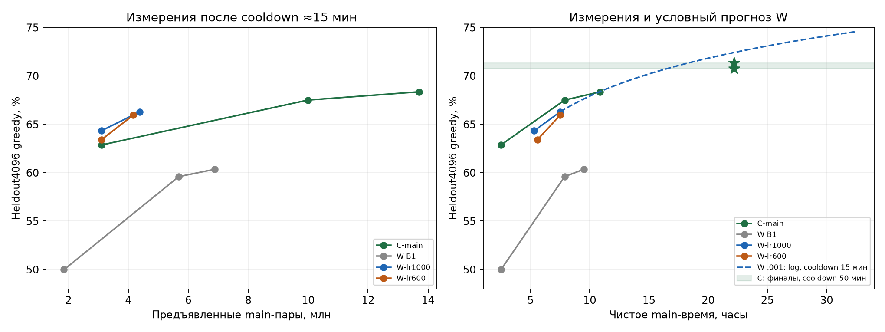

# B2: устойчивость W и решение о продолжении

**Продолжить GPU0 W-QK с LR0,001 одной сессией ≈11ч после reset; вторую выделять по результату.** При3,10M main-пар:64,33% против C62,87%, Δ+1,46п.п. [0,39;2,54]. LR0,0006:63,40%, Δ+0,54 [−0,51;1,58]. Рецепт устойчив на наблюдённых7,5ч main каждой ветки; выигрыша по времени пока нет. Преимущество строго по target-токенам отдельно не установлено.

## Данные и проверка

Pinned output `friend2/nlp-hw02-b2/1`: session/оба workers **complete**, exits[0,0], wall29497,905с=8ч11мин38с. Обе end-main оценки и pair-probes завершены. `final_complete:false` означает отсутствие отдельной final-session ветки: `end_main_complete` и `pair_probe_complete` — true; это не ошибка завершения.

Две fresh W e6/d6/d768,113426435 параметров, общий seed42/long2x order, batch128/micro32; headwise QK-LN, z-loss1e-4, warmup2000. Остальной протокол — [b1-ev-b2-plan](b1-ev-b2-plan.md), исправления и smoke — [b2-review](b2-review.md). B1-results.md отсутствует; B1 взят из исходного output и EV. Все числа ниже — сохранённые измерения либо явно помеченные расчёты.

[CPU-анализ](../research/analyze-b2-results.py) сверил **64 локальных файла с producer SHA/bytes**, включая два дополнительно скачанных `updates.jsonl` (read-only pinned API, GPU0). Повторно проверены correctness, ID/question SHA/reference/BPE length всех **20348** B2 per-example строк; суммы совпали с complete/metrics/summary. В каждом main-журнале проверены последовательность updates/cursor, сумма времени и skips. FP16/full PT, order.npy и notebook не скачивались: содержимое весов, моменты Adam и их finite здесь не проверялись. Полные receipts/локальные SHA — [JSON](../results/b2-results.json). GPU, model forwards, новое исполнение программ и sampling — **0**.

## Точки B2

Greedy heldout4096/old991 после отдельных disposable **900с linear cooldown**, q0. CE — teacher-forced unsmoothed compact30 token CE, **не CE сгенерированных программ** и не raw CE. Bins — исходная BPE-длина reference: <60 /60–90 /90–120 /≥120; знаменатели2013/1457/488/138.

| Ветка / точка | heldout4k | Бины, % | old991 | CE4k / CEold |
|---|---:|---|---:|---|
| LR0,001 /3,10M |2635/4096 **64,33%**|78,09 /56,90 /40,78 /25,36|644/991 **64,98%**|0,297800 /0,303796|
| LR0,001 /end |2715/4096 **66,28%**|80,28 /58,34 /42,62 /29,71|669/991 **67,51%**|0,285351 /0,289473|
| LR0,0006 /3,10M |2597/4096 **63,40%**|78,49 /54,08 /39,96 /24,64|654/991 **65,99%**|0,300067 /0,306018|
| LR0,0006 /end |2701/4096 **65,94%**|79,58 /57,93 /44,26 /28,26|673/991 **67,91%**|0,286736 /0,291506|

Main не включает setup/probe/checkpoint I/O/eval/cooldown. Updates и пары — **attempted**, включая AMP skips; cooldown возвращается к uncooled anchor и main cursor не продвигает.

| Ветка / точка | main_s | Updates | Main-пары | Target-токены main | NaN-эскалации / nonfinite skips | AMP skips main | Cooldown updates |
|---|---:|---:|---:|---:|---:|---:|---:|
| LR0,001 /3,10M |19117,887|24219|3100032|189741051|0 /0|1|1137|
| LR0,001 /end |27000,558|34153|4371584|267629303|0 /0|6|1136|
| LR0,0006 /3,10M |20091,078|24219|3100032|189741051|0 /0|0|1081|
| LR0,0006 /end |27000,345|32499|4159872|254651286|0 /0|4|1079|

За весь main AMP-skips — **0,0176% /0,0123%** attempts; это обычные GradScaler skips, не NaN-эскалации. LR-factor1,0, halving/rollback0, OOM retries0. Cooldown completed; отдельного полного журнала его skips нет. Sampled max absolute scaled attention logit25,64/14,71 — выборка, не глобальная граница. Численный рецепт выдержал эту сессию; вклад QK, z-loss и warmup по отдельности не разделён.

## Контроли C и B1 W

| Модель / точка | main_s | Updates / main-пары | heldout4k, % | Бины, % | old991, % | CE4k / CEold |
|---|---:|---|---:|---|---:|---|
| C /9000 |9000,120|24270 /3106560|62,87|79,23 /52,99 /36,89 /20,29|63,27|0,317346 /0,321687|
| C-main /28370 |28370,027|78056 /9991168|67,50|80,68 /59,99 /45,08 /34,06|71,04|0,275776 /0,281288|
| C-main /39170 |39170,172|107090 /13707520|68,36|81,77 /60,54 /46,11 /34,06|71,64|0,269676 /0,273631|
| W B1 /9000 |9000,058|14455 /1850240|49,98|68,31 /37,54 /22,13 /12,32|51,66|0,395610 /0,400170|
| W B1 EV /28370 |28370,249|44393 /5682304|59,59|75,76 /49,62 /34,43 /18,12|—|—|
| W B1 EV /34200 |34200,440|53789 /6884992|60,35|76,25 /50,38 /35,45 /21,74|63,47|0,300574 /0,306054|

C9000: cooldown907,64с/2427updates, main AMP0. Другие C здесь —900с; их показатели skips не пересчитывались. B1 W завершила с **двумя NaN-эскалациями**, LR0,001→0,0005→0,00025; AMP12, nonfinite64 в surviving state и91 в recovery history — разные счётчики из-за rollback. Эти итоговые счётчики нельзя приписывать каждой ранней точке.

EV W28370: accuracy восстановлена по4096 saved generations/executions и проверенным reference; **old991 и teacher-forcing CE отсутствуют**. По одним генерациям CE истинного таргета не восстановить. EV34200=60,35% заменяет прежнюю B1 оценку60,74%; две ветки cooldown различаются, причинный эффект этой разницы не установлен. E не является валидным контролем: EV28370 содержит1428 `missing_solve` из4096строк (numeric2657), final34200 — `FloatingPointError`; направление E закрыть.

## Вердикт по эффективности

- **Главный pair-gate пройден.** C9000 видела3106560пар, на6528/0,21% больше B2-gate. W0,001 выигрывает60ответов:285gains/225losses, +1,46п.п., парный описательный95% CI[0,39;2,54]. W0,0006 выигрывает22ответа, CI включает0. Выигрыш W0,001 сосредоточен в≥60BPE; короткий бин ниже C на1,14п.п.
- **LR0,001 предпочтительнее, но превосходство над0,0006 не доказано.** На равных3,10Mпар Δ+0,93п.п. [−0,05;1,91], при27000с +0,34 [−0,69;1,37]. В конце GPU0 увидела на5,09% больше пар; log-интерполяция GPU0 на4159872пар даёт66,00% против65,94% GPU1 — почти равенство. Поэтому больший поздний наклон GPU1 не основание менять LR или обучать обе дальше.
- **По времени C пока лучше.** Отметка3,10M потребовала W5,31/5,58ч против C2,50ч: примерно2,12/2,23×. При27000с C≈67,30% по log-интерполяции9000→28370 против W66,28/65,94%; точной C27000 нет. Ближайшая измеренная C28370=67,50%, но это на1370с позже. B2 против B1 W28370 выигрывает≈6,70/6,35п.п. при меньших времени и числе пар; это явное исправление прежнего рецепта, не чистая абляция QK.
- **На main-пару W0,001 эффективнее; строго на токен — пока гипотеза.** W и C имеют одинаковый tokenizer/compact30, но W использует long2x, C9000 ordinary. В B2-gate61,21target-токена/пару; среднее всего ordinary-корпуса55,58. Точный C-prefix token counter отсутствует, cooldown также предъявляет разное число пар. Равные пары не равны target/source tokens и тем более FLOPs. При грубом пересчёте C по среднему55,58 и log-кривой C преимущество W0,001 сохраняется около1,1п.п.; это расчёт, не дополнительное измерение.

Все CI описательные, без поправки на многократный просмотр heldout. Нового независимого финального набора здесь нет.

## Экстраполяция и90ч

Для GPU0 две точки дают $A_{15}(t)=66{,}284+5{,}657\ln(t/7{,}5002)$, где $A_{15}$ — greedy accuracy в%, $t$ — накопленные main-часы, cooldown15мин. Наклон по логарифму пар5,682п.п. Альтернатива с условным потолком90%: $A_{15}(t)=90-23{,}716(t/7{,}5002)^{-0{,}2292}$. Потолок90% не установлен; это только сценарий замедления. **Две точки не устанавливают learning law или prediction interval.**

Текущие финалы C после50мин: **70,75% main /71,36% long2x**, main≈22,18ч. Сравнение ниже — с этими фиксированными весами; продолжающаяся C создаст движущуюся цель. Бонус $\Delta_{CD}$ от50мин относительно15мин у W **не измерен**;0/1/2п.п. — сценарии, не перенос доказанного эффекта C.

| Условный бонус50мин W | Дойти до71%, всего main-ч | Дойти до C71,36%, всего main-ч | Ещё main-ч от B2 до71,36% |
|---|---:|---:|---:|
|0п.п.|17,26–19,73|18,40–21,46|10,90–13,96|
|+1п.п.|14,46–15,77|15,42–17,08|7,92–9,58|
|+2п.п.|12,12–12,75|12,92–13,75|5,42–6,25|

Диапазоны — log/floor90 сценарии, **не CI**. После одной сессии с9–9,5ч main накопится16,5–17ч: короткий прогноз≈70,2–70,9%, затем неизвестный бонус cooldown. После двух по9,5ч:26,5ч,≈72,24–73,43% до бонуса. Если будущий log-наклон уполовинится, эти две точки будут лишь68,60/69,85%;71,36% потребует≈45ч total main, то есть ещё≈38ч. Плато ниже цели также не исключено.

GPU1 по собственным двум точкам дала бы71% через ещё6,0–7,5ч без бонуса. Её более крутой fit8,59п.п./ln(t) чувствителен к22–38ответам и позднему catch-up; экстраполировать его как устойчивое превосходство LR0,0006 оснований нет.

90ч — **общий будущий лимит3×30**, не непрерывная90-часовая сессия и не ускорение одной модели втрое. Одна W продолжается последовательно, с сохранением optimizer/scaler/RNG/order. Из одного30ч аккаунта не получить3×11ч: реалистично2×11ч+короткая7ч,1ч на запас. Для всех трёх:6×11+3×7=87ч и3ч резерва; transfer/setup/checkpoint/cooldown/eval уменьшают main. Чистые8×11=88ч нельзя безусловно разложить по трём аккаунтам по30ч без укороченных сессий.

## План расхода

1. **Одна W0,001 сессия ≈11ч после reset.** Продолжать именно **uncooled latest** GPU0 `checkpoints/main-4b21b0d306c4.pt`,34153updates/4371584pairs, SHA`c1fb5913…795f0`; полный SHA в JSON/latest. Не брать point FP16 или удалённый ротацией branch anchor. Сначала strict transfer/load прежнего Torch/CUDA/recipe/order; LR0,001 constant, QK/z-loss/warmup counters сохранить, warmup заново не начинать.
2. **Цель9ч main**, затем disposable **50мин linear cooldown**, greedy4k/old991/CE и ограниченный sampling/timer; оставить≈40мин на setup/I/O/eval и остаток до11ч как резерв. Сохранить также uncooled stable для возможного продолжения. Промежуточные cooldown не расходовать без необходимости: нужен третий измеренный anchor и первый длинный cooldown W.
3. **Вторая W сессия — условная; всего W≤22 из90ч.** Продолжать, если первая дала≥71% greedy, сохранила finite/LR-factor1 и показала полезные W+C голоса при равном180с бюджете. Перед утверждением W в ансамбль нужен frozen mixed-vote прирост хотя бы+0,7п.п. к текущему C-ансамблю на tune, затем отдельная проверка выбранной политики и cold1919≤160с с20с запасом. Greedy71% само по себе не компенсирует более дорогие samples. Если первая W остаётся<71% или смесь уступает C при том же времени — W остановить, сохранённый checkpoint оставить.
4. **Остальные≥68ч — C-финалы и независимая C с другим seed**, прежний устойчивый C recipe/LR0,0015, финальный50мин cooldown. Для независимой C разумный первый бюджет22–29ч с переносом между сессиями; это действительно новый seed, в отличие от C-long2x с общим L1-предком. E/B1 W и параллельное дальнейшее сравнение двух B2 LR квоту не получают. При второй успешной W её финальный cooldown — снова50мин в конце второй сессии, с сохранением uncooled состояния.

## Samples за180с с C

Shape-bench без QK даёт стоимость W sample **1,3467×C**, greedy1,5634×; encoder уже входит в эти отношения. При одинаковом generation-бюджете W получает≈74,3% количества C samples. Для смеси переменная sample-стоимость в C-единицах: $K_C+1{,}3467K_W$, где $K_C,K_W$ — число stochastic samples C/W на задачу. Greedy, fixed cold/CPU cost и запас учитываются отдельно; нельзя делить все180с на один sample-rate.

Используем прежний **полный pipeline proxy** [architecture-decision — Гибрид: новая greedy и дешёвые C samples](architecture-decision.md#гибрид-новая-greedy-и-дешёвые-c-samples), а не только forced shape throughput. Старт1W+1C, досэмплировать только при disagreement; W greedy — anchor. Stop-rate взят с аналога C, не измерен на W.

| Адаптивный максимум W+C | Среднее W+C samples/задачу | Всего samples на1919, прогноз | Pipeline / generation+15%, с | Решение |
|---|---|---:|---:|---|
|2+6 =8|1,340+2,702 =4,042|≈7757|132,1 /147,8|Первый вариант для guard160|
|2+8 =10|1,340+3,382 =4,723|≈9063|147,6 /165,6|В180 условно помещается; запас до160 теряется|

Это **максимум на трудной задаче и среднее после early-stop**, не8/10samples каждой из1919. Цифры включают прежние fixed/executor costs; новое увеличение очереди исполнителя ими не проверено. QK overhead, actual W stop-rate, длины до512 и память W+C ещё не измерены: холодный single-T4 gate обязателен перед выбором production. У W shape greedy reserved14,23GiB, поэтому совместное размещение с C может потребовать уменьшения lanes или выгрузки модели. Совпадение W с C на71% не гарантирует прирост mixed vote; текущий v7 tune74,95% — реальный критерий полезности.

## Коммит

`git add` девяти файлов завершился128: песочница запретила создание shared Git `index.lock` (`Operation not permitted`). Индекс не изменён; `git commit` не запускался, обход ограничений не выполнялся. [Квитанция](../checks/b2-results-git.json). Все изменения сохранены в рабочем дереве.

## Источники

- **kaggle-b2-results** — собственный CPU-разбор pinned `friend2/nlp-hw02-b2/1` и `thisarivson/nlp-hw02-b1-ev/1`; [агрегаты/64 producer SHA/локальные SHA](../results/b2-results.json), [воспроизводимый скрипт](../research/analyze-b2-results.py). Запись в bibliography.
- [b1-ev-b2-plan](b1-ev-b2-plan.md), [b2-review](b2-review.md), [b1-review](b1-review.md) — рецепт, протокол и происхождение B1/B2; [l2-results](l2-results.md), [l3-results — Финал L3](l3-results.md#финал-l3) — измеренные контроли C.
- [architecture-decision](architecture-decision.md) и [shape receipt](../results/architecture-shape-bench.json) — относительная цена generation и исторический pipeline proxy. Новые forecasts/план выше — собственные условные расчёты; внешних scaling laws к accuracy не применялось.
