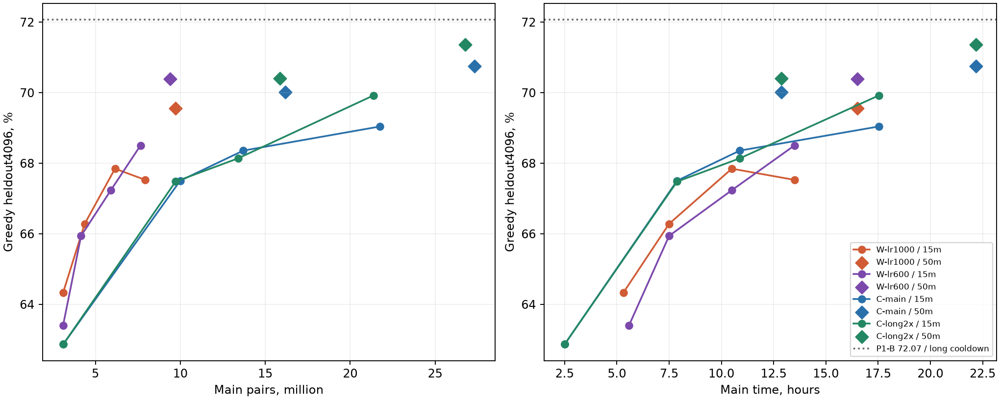

# B3: W-QK после 16,5 часа main

**W лучше использует main-пары, но преимущества по времени и финальному ансамблю нет.** После одинаковых 50 минут cooldown: W0,001 — **69,56%**, W0,0006 — **70,39%**, L3 C-long2x — **71,36%**. Лучший найденный W+C ансамбль в прогнозных 140с: **1537/2048 против v7 1535**, Δ+0,10п.п. [−0,74;+0,93]. **V7 сохранить.** Для дальнейшей W выбирать LR0,0006; две W дальше не продолжать.

## Происхождение и полнота

Pinned `thisarivson/nlp-hw02-b3/1`, локальный `results/kaggle-runs/nlp-hw02-b3/1/`: kernel **COMPLETE**, session/оба workers complete, exits[0,0], wall **38252,82с =10ч37мин33с**. Обе дошли до +9ч main, прошли две пробы и final; budget stop/missed points отсутствуют. Рецепт и строгий resume — [b3-plan](b3-plan.md), проверка restore — [b3-review](b3-review.md).

[CPU-анализ](../research/analyze-b3-results.py) проверил **219 B3 producer SHA/bytes**, complete/training/metrics/checkpoint/summary/latest, **66131 per-example строку** W+B2/C/P1 с исходными ID/question SHA/reference/BPE length и повторным correctness по сохранённым исполнениям. Проверены **320 K8 журналов /81920 samples** пяти моделей; C-журналы также сверены с recover manifests. Frozen v7 воспроизведён:1535,1232 ранние остановки. Для v7 и двух выбранных W-политик совпали **6144 code/execution winners** с production replay и независимым union-find selector; проверено удаление bridge-кандидата из нетранзитивного isclose-графа.

**22 manifest-файла локально отсутствуют:** full/FP16 PT, notebook, order.npy, main `updates.jsonl`, cooldown journals и test answers. Их inventory/SHA сохранены в [JSON](../results/b3-results.json). Поэтому finite тензоров, поминутные AMP/CE и AMP cooldown здесь независимо не проверены. Промежуточные main AMP неизвестны; конечные counters ниже — producer summary. Новых API/GPU/forwards/обучения/sampling/исполнения программ — **0**; fresh не читался.

## Все точки B2 → B3

Greedy heldout4096/old991. Main_s исключает cooldown/eval/I/O; пары и updates — attempted, включая AMP skips. Cooldown disposable, main cursor не продвигает. CE — teacher-forced unsmoothed compact30 token CE, а не CE сгенерированной программы. Бины — исходная BPE-длина reference; знаменатели **2013/1457/488/138**.

| LR / точка | main_s | Main-пары | Cooldown, мин | 4k matches (%) | old991, % | CE4k / old |
|---|---:|---:|---:|---:|---:|---|
|0,001 / B2 gate|19117,89|3100032|15|2635 (64,33)|64,98|0,297800 /0,303796|
|0,001 / B2 end|27000,56|4371584|15|2715 (66,28)|67,51|0,285351 /0,289473|
|0,001 / B3 probe1|37800,54|6156672|15|2779 (67,85)|69,22|0,273817 /0,276705|
|0,001 / B3 probe2|48600,61|7937664|15|2766 (67,53)|69,93|0,266960 /0,269030|
|**0,001 / B3 final**|**59401,30**|**9717888**|**50**|**2849 (69,56)**|**72,96**|**0,253841 /0,255863**|
|0,0006 / B2 gate|20091,08|3100032|15|2597 (63,40)|65,99|0,300067 /0,306018|
|0,0006 / B2 end|27000,35|4159872|15|2701 (65,94)|67,91|0,286736 /0,291506|
|0,0006 / B3 probe1|37800,22|5912320|15|2754 (67,24)|69,53|0,275110 /0,276538|
|0,0006 / B3 probe2|48601,09|7658880|15|2806 (68,51)|70,43|0,265850 /0,266455|
|**0,0006 / B3 final**|**59400,86**|**9397248**|**50**|**2883 (70,39)**|**71,85**|**0,252957 /0,254183**|

| LR / точка | <60, % |60–90, %|90–120, %|≥120, %|
|---|---:|---:|---:|---:|
|0,001 / B2 gate|78,09|56,90|40,78|25,36|
|0,001 / B2 end|80,28|58,34|42,62|29,71|
|0,001 / B3 probe1|81,07|59,64|47,13|34,78|
|0,001 / B3 probe2|80,53|59,37|47,75|34,06|
|0,001 / B3 final|81,47|62,94|49,18|37,68|
|0,0006 / B2 gate|78,49|54,08|39,96|24,64|
|0,0006 / B2 end|79,58|57,93|44,26|28,26|
|0,0006 / B3 probe1|80,63|59,85|44,67|29,71|
|0,0006 / B3 probe2|81,17|61,36|47,34|34,06|
|0,0006 / B3 final|82,41|63,49|50,41|38,41|

| Main stability | W0,001 | W0,0006 |
|---|---:|---:|
|Attempts: B2+B3 / только B3|75921 /41768|73416 /40917|
|AMP skips: B2 gate → B2 end → B3 final|1 →6 →23|0 →4 →21|
|AMP skips только B3 / доля attempts|17 /0,0407%|17 /0,0415%|
|Nonfinite skips / NaN-эскалации / LR-halving|0 /0 /0|0 /0 /0|
|Конечный LR / micro|0,001 /32|0,0006 /32|
|B3 throughput, пар/с|165,01|161,64|

Периодические process logs:418/410 последовательных отметок, LR прежний, pairs=128×updates. Они не заменяют полные update journals. Обычные AMP skips не являются NaN-эскалациями.

## Пары, время и контроли C

На графике линии соединяют только **15-минутные** точки; ромбы — отдельные **50-минутные**. Все C-точки/пары/CE/bins сохранены в JSON и [l3-results — Все точки L1 → L2 → L3](l3-results.md#все-точки-l1--l2--l3). Общий L1 — один предок. В C-long2x order cursor при начале L2 сброшен, а updates наследуются: **total main pairs=128×updates**, включая6035840 L1-пар; один `anchor_cursor` недосчитал бы их.

Для совпадения времени/пар ниже используется **log-интерполяция соседних C-точек того же cooldown**. Это расчёт без нового measurement/CI; большой ранний интервал C ограничивает точность. Строго почти равная пара есть только в B2 gate: C3106560пар против W3100032, +0,21% у C. Там W0,001/0,0006 выигрывают +1,46/+0,54п.п.; парные CI — [b2-results](b2-results.md).

| Короткая W-точка | W−C-main при равных парах, п.п. | W−C-long при равных парах | W−C-main при равном main_s | W−C-long при равном main_s |
|---|---:|---:|---:|---:|
|0,001 / B2 end|+2,06|+2,04|−1,02|−1,00|
|0,001 / B3 probe1|+2,26|+2,21|−0,42|−0,22|
|0,001 / B3 probe2|+0,94|+0,87|−1,14|−1,42|
|0,0006 / B2 end|+1,92|+1,90|−1,36|−1,34|
|0,0006 / B3 probe1|+1,81|+1,77|−1,03|−0,83|
|0,0006 / B3 probe2|+2,06|+1,99|−0,16|−0,44|

**Выигрыш на пару сохранился, выигрыша по времени нет.** Равенство пар не означает равенство source/target tokens, FLOPs или cooldown-пар: W использует long2x, C-main ordinary; точного token-matched контроля нет. Для W final50 при9,40–9,72Mпар **нет охватывающих C50 точек по парам**: первая C50 уже15,85–16,19M. Экстраполировать её назад как измерение нельзя.

При равных **59401с main и50мин cooldown** C-main≈70,35%, C-long≈70,84% по интерполяции двух50-мин финалов L2/L3. W0,0006: +0,03/−0,46п.п.; W0,001: −0,80/−1,29. По реальному финалу L3 контроль обучался22,18ч main против W16,50ч: следующая таблица уравнивает **cooldown, но не main-время**.

| Финал | Greedy4k | Бины, % | old991, % | CE4k / old |
|---|---:|---|---:|---|
|W0,001,50мин|69,56%|81,47 /62,94 /49,18 /37,68|72,96|0,253841 /0,255863|
|W0,0006,50мин|70,39%|82,41 /63,49 /50,41 /38,41|71,85|0,252957 /0,254183|
|L3 C-main,50мин|70,75%|82,81 /63,56 /50,20 /43,48|73,46|0,249945 /0,254509|
|**L3 C-long2x,50мин**|**71,36%**|83,26 /64,10 /51,64 /44,20|72,86|0,248291 /0,250602|
|P1-B,≈3ч40мин 1−sqrt/q10%|72,07%|83,31 /64,52 /54,71 /49,28|74,27|0,245521 /0,249940|

W0,0006−L3 long: **−0,98п.п. [−1,93;−0,03]**,177 gains/217 losses; W0,001−long: **−1,81 [−2,78;−0,83]**. От P1-B: соответственно **−1,68 [−2,66;−0,71] /−2,51 [−3,48;−1,55]**; это сравнение с лучшей одиночной C при **неравных cooldown**, не оценка эффекта ширины. P1-B не прошла свой заранее заданный truncation gate — [p1-results](p1-results.md).

Финальная W0,0006−W0,001: +0,83п.п. [−0,13;+1,79], при **меньшем на3,30% числе пар**; LR superiority не доказана. Но для единственного дальнейшего W-запуска LR0,0006 предпочтительнее по финалу и поздней динамике. Probe1→probe2 при одинаковых15мин: W0,001 −0,32 [−1,37;+0,74], W0,0006 **+1,27 [+0,23;+2,31]**; CE снизилась у обеих. Разность probe2→final смешивает ещё3ч main и увеличение cooldown15→50мин; чистый бонус cooldown не измерен.

## K8 и смеси на tune2048

Один фиксированный пул T0,7/seed270042, первые K samples; новые случайные повторы не создавались. Single K8 ниже — **без дополнительного greedy голоса**, но с прежним greedy tie anchor. Смеси используют C-main greedy и frozen count→greedy→meanLP→order, numeric connected components isclose1e-6. Повторы программ остаются отдельными голосами; gold участвует только в подсчёте метрики.

| Single | K8 matches (%) | K8 +greedy |
|---|---:|---:|
|W0,001|1470 (71,78)|1471|
|W0,0006|1476 (72,07)|1470|
|C-main|1502 (73,34)|1498|
|C-long2x|1507 (73,58)|1504|
|P1-B|1522 (74,32)|1515|

Shape-bench без QK: W sample **1,3467×C**, greedy1,5634×C; encoder уже включён. Цена stochastic пула в C-единицах: $U=K_C+1{,}3467K_W$, где $K_C,K_W$ — число samples соответствующего размера. Greedy/fixed load/CPU оплачиваются отдельно. Поэтому одинаковый K с W дороже, а W singleK8 стоит10,77 C-samples, не8.

| Статический пул +C-main greedy | Samples | Цена U | Matches: W0,001 / W0,0006 |
|---|---:|---:|---:|
|C-main4 +C-long4, контроль|8|8,00|1511|
|C-main4 +P1-B4, контроль|8|8,00|1510|
|C-main4 +W4|8|9,39|1502 /1505|
|C-main3 +C-long3 +W2|8|8,69|1508 /1502|
|C-main3 +P1-B3 +W2|8|8,69|1505 /1505|
|C-main4 +W3, почти равная цена8C (+0,50%)|7|8,04|1497 /1500|
|C-main4 +C-long4 +P1-B4, контроль|12|12,00|1528|
|C-main4 +C-long4 +W4|12|13,39|1516 /1520|
|C-main4 +P1-B4 +W4|12|13,39|1523 /1515|

Замена части C на W при равном K не помогает, хотя стоит дороже. Полная [сетка1264 политик](../results/b3-ensemble-grid.csv):2–3 модели, K1=1 на каждую, K2=1…8/модель, сумма K2≤12. Для пар проверены также W greedy и порядок W→C; у троек C-main greedy. **696 вариантов** проходят прогноз≤140с; «лучший» ниже означает максимум **в этой сетке**, а не среди всех возможных селекторов.

| Адаптивная политика | Matches | Ранних остановок | Среднее samples / U | Осторожный test/tune, с |
|---|---:|---:|---:|---:|
|v7: main/long/P1-B,1/1/1→3/5/4|1535|1232|6,586 /6,586|127,1 /139,3|
|main/long/W0,0006,1/1/1→6/4/1|1527|—|— /6,616|≤133,8|
|main/P1-B/W0,001,1/1/1→1/5/5|1536|—|— /7,206|≤136,9|
|**main/P1-B/W0,0006,1/1/1→1/6/4**|**1537**|**1234**|**6,180 /6,940**|**136,8 /129,7**|
|То же,1/1/1→1/7/1, цена≤v7|1533|1234|5,385 /5,731|107,9 /100,8|

Лучший W-вариант: **39 gains/37 losses**, Δ**+0,0977п.п.**, парный95% CI **[−0,7369;+0,9322]** к v7. При ограничении также **средней sample-цены≤6,586** лучший W-вариант даёт1533, Δ−0,0977 [−0,9645;+0,7692]. Полезный прирост не установлен даже до поправки за поиск1264 вариантов. Все интервалы описательные/pointwise на многократно использованном tune; независимой проверки нет.

**Прогноз времени:** прежние v5 cold phases и decoder-all profile v7, округлённые shared waves, C sample cost1/W1,3467; fixed CPU/executor overhead сохранён, +4с reserve на W load. У лучшего варианта номинал test/tune118,0/117,2с, осторожно136,8/129,7с; stress+15% generation **152,8/146,8с**. При требовании stress≤140 лучшая смесь —1533. Это не новый T4 timer: QK overhead, длины, mixed memory и новая очередь execution не измерены. В B3 single W greedy test занял41,57/37,02с, peak reserved14,24/14,31GiB; K8 journal151,97/175,77с включает execution и другой decoder, не является временем v8.

## Остаток недели и решение о v8

**Приоритет — C и завершение инференса.** Прежний W-gate «greedy≥71% и mixed≥v7+0,7п.п.» не пройден; **B4 для финала сейчас не рекомендована**. Если оставлять исследовательский шанс, только **одна W0,0006**, без повторения сравнения двух LR. Последний short log-наклон дал бы условные72,58% после ещё9ч main, но его перенос на final50 не проверен; плато70,39% также допустимо. W0,001 последний short-наклон отрицательный. Такой прогноз не основание автоматически тратить19ч.

Квоты **со слов пользователя**, до24.10 00:00UTC: thisarivson≈19ч, аккаунт друга≈30ч, аккаунт друга≈30ч. Ниже лимиты **wall сессий аккаунта**, с двумя GPU внутри; не удваивать доступную квоту и не путать её с суммой GPU-device-hours. Необязательно израсходовать все79ч; завершить training/выбор раньше22.10 важнее.

| Аккаунт / предел | Приоритетный план до20.10 | Резерв |
|---|---|---|
|аккаунт друга /30ч|Два продолжения C-main+C-long2x параллельно, каждое≤10ч30мин с≈8–8,5ч main и50мин linear final; **21ч** суммарно. Затем при необходимости C-main long-cooldown A/B≤4ч30мин.|1ч на inference gates,≥3ч30мин на сбои/переносы|
|аккаунт друга /30ч|Независимая C с новым seed вместо ещё двух W; при готовом fresh-runner можно две C разных seeds на двух GPU. Две сессии≤11ч и короткая≤4ч30мин, **≤26ч30мин**, прежний LR0,0015/рецепт, конечный50мин cooldown.|≥3ч30мин; не начинать новую архитектуру/рецензента|
|thisarivson /19ч|Сначала cold v7/final timers **≤1ч** суммарно. Если нужен последний W-эксперимент: long cooldown W0,0006 A/B **≤4ч30мин**. B4≤10ч30мин — **только если** этот опыт подтвердит полезную W+C смесь при том же time budget.|≥3ч; без положительного W-сигнала B4-резерв оставить свободным|

**Длинный cooldown и truncation — проверка, не новый default.** Из одного uncooled anchor: GPU0 — q0, GPU1 — q0,1 с length-stratified truncation; одинаковые planned updates и $\eta_j=\eta_0(1-\sqrt{j/N})$. Здесь $j$ — номер cooldown update, $N$ — заранее фиксированное число updates, $\eta_0$ — LR stable. Сравнить q0 с уже сохранённым50мин linear, q0,1 — с q0, отдельно greedy/CE и matched-cost voting. Первое сравнение меняет и форму, и длительность; второе изолирует truncation. Сохранить uncooled stable, не продолжать из cooled FP16.

На C ориентир≈3ч30–40мин обучения ветки. **Не переносить31372 C updates из P1 на W:** при скорости W это заняло бы≈6ч55мин. Для W около3ч36мин — примерно**16,3k updates**, предварительно зафиксировать N по throughput, оставить setup/eval до cap4ч30мин. W+truncation требует совместимого CPU/smoke gate; численные QK/z-loss не менять. Историческая P1 не установила gain truncation, поэтому при отсутствии уверенного mixed выигрыша оставить50мин linear/q0. Отдельный полный K8 eval/fresh нужен только выбранному финалу; тестовый gold не использовать.

Если условная B4 состоится после удачного длинного cooldown, её финальную ветку включить в те же10ч30мин: при cooldown≈3ч36мин останется около6ч main с оценкой/I/O, а не9ч main плюс бесплатный длинный финал.

**Календарь:**17–18.10 — cold v7 gate, параллельные C-запуски и, при наличии интереса, ограниченный W cooldown;18–20.10 — завершить C/новый seed, один CPU replay и выбрать веса/политику. До конца20.10 — freeze кандидата.21.10 — одна проверка frozen eval2048/fresh1024 без дальнейшего tuning, cold single-T4 test1919≤140с с запасом до160/180, проверка чистового notebook/1919 code-only строк. **Четверг22.10 — готовые ансамбль, финальный notebook и посылки**, резерв на сбои. Не запускать цикл обучения, который закончится после freeze.

**Условие «W очевидно сильнее» не выполнено: переход на v8 W+C не готовить.** Сохранить v7 и current W journals/anchors как резерв. Если новый ограниченный W-опыт даст заранее выбранной политике≥+0,7п.п. с положительным парным CI на отдельной проверке и реальный cold≤140с, тогда проектировать v8: сначала проверить память C-greedy/W-samples и QK decoder, затем выбирать K по новому timer. Нынешние1/6/4 и136,8с — исследовательский кандидат, не готовность production.

## Воспроизведение и коммит

Из `work/`, Python с NumPy/Matplotlib: `python research/analyze-b3-results.py`. Компактные [агрегаты/SHA/CI](../results/b3-results.json), [вся сетка](../results/b3-ensemble-grid.csv), [график](../results/b3-learning-curve.png); исходный output остаётся ignored. CPU-проверка и результат попытки коммита — в `checks/b3-results-cpu.json` и `checks/b3-results-git.json`.

`git add` явного списка13 собственных файлов завершился128: sandbox запретил shared Git `index.lock` (`Operation not permitted`). Последующий `git commit --only` завершился1: новые файлы не попали в индекс после неудачного add. Индекс не изменён, коммит не создан; обход ограничений не выполнялся. Все материалы сохранены в рабочем дереве; [квитанция](../checks/b3-results-git.json).

## Источники

- **kaggle-b3-results** — собственный CPU-разбор17.10.2026 pinned `thisarivson/nlp-hw02-b3/1`, producer manifest/session/points/process logs/K8 journals; [воспроизводимый анализ](../research/analyze-b3-results.py), [результаты](../results/b3-results.json), bibliography — kaggle-b3-results. Измерения — содержание output; интерполяции, CI, timing и план — собственные расчёты/рекомендации.
- [b2-results](b2-results.md), [b3-plan](b3-plan.md), [b3-review](b3-review.md) — исходные состояния, протокол и restore gates.
- [l3-results — Финал L3](l3-results.md#финал-l3), [p1-results](p1-results.md), [final-inference — V7: ансамбль из трёх моделей](final-inference.md#v7-ансамбль-из-трёх-моделей), [architecture-decision](architecture-decision.md) — сохранённые C-контроли, decoder/vote, T4 shapes и источник прогноза времени. Новых внешних работ нет.
