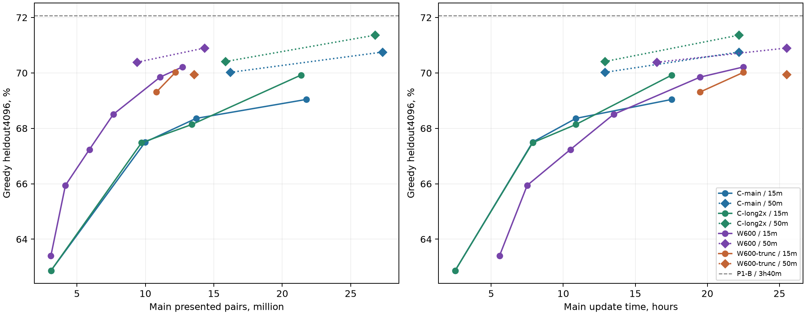

# B4: W600, truncation и решение о B5

**Plain W600: 2904/4096 =70,90%; trunc: 2865/4096 =69,95%.** За ещё9ч main plain прибавила к B3 **+0,51п.п. [−0,44;+1,46]**. Преимущество на предъявленную пару сохранилось; преимущества по времени нет. Truncation не рекомендована: итог **−0,95п.п. [−1,93;+0,02]** к plain при меньшем числе пар, а при интерполяции к равным парам отрицательная разница сохраняется.

**Сохранить v7; B5 main не запускать по умолчанию.** Лучший найденный W+C: **1541/2048** против1535, Δ+0,29п.п. [−0,59;+1,22], при средней цене6,149 C-samples против6,586 у v7. Увеличение бюджета не улучшило этот максимум. Это слабый исследовательский резерв, не подтверждённый выигрыш; следующий расход квоты — C, финальный cooldown и cold inference gates.

## Полнота и метод

Pinned `thisarivson/nlp-hw02-b4/1`: kernel/session/оба workers **COMPLETE**, exits[0,0], wall **38297,92с =10ч38мин18с**. Обе прошли +3/+6/+9ч main, две15-минутные пробы, final50мин, greedy4096/old991/CE/test1919 и K8 tune2048; пропусков точек и budget stop нет.

[Воспроизводимый CPU-анализ](../research/analyze-b4-results.py), [агрегаты и provenance](../results/b4-results.json), [проверки](../checks/b4-results-cpu.json). Сверены **230 producer SHA/bytes**, **71087 main updates**, **10485 cooldown updates**, исходные ID/question SHA/reference/BPE length и correctness сохранённых исполнений. Журналы main/cooldown дополнительно скачаны read-only: [квитанция](../checks/b4-results-download.json). Latest output привязан к v1 точным совпадением скачанного manifest с архивным; все восемь новых файлов проверены по его SHA/bytes. Веса и order не скачивались.

Одинаковы стартовые fingerprints model/Adam/scaler/RNG/state и все **32570 общих stream SHA prefixes**. Это проверка записанного общего префикса, не повтор CUDA restore. **14 manifest-файлов отсутствуют** локально: notebook, order, четыре full PT, шесть FP16 и два test-answer JSONL. Их полный inventory сохранён в JSON; finite тензоров и restore независимо не запускались. Новых GPU/forwards/обучения/sampling/исполнений программ — **0**, fresh не читался.

CI ниже — **20000 парных bootstrap повторов по задачам**, seed2026101801, с эквивалентным multinomial resampling gains/losses/unchanged; нормальные CI тоже сохранены в JSON. Это описательные pointwise интервалы на неоднократно использованных heldout/tune, без поправки за поиск ансамбля. Интерполяции не являются измерениями и CI не получают. CE — unsmoothed compact30 teacher-forced token CE, EOS включён, PAD/BOS исключены; per-example NLL для CE CI не сохранены.

## Кривая B2 → B3 → B4

LR0,0006, W-QK6+6/d768, z-loss1e-4; один непрерывный plain main из B2. У trunc общий B3-предок, затем q10% в main **и** cooldown. Main_s — сумма времени updates, без disposable cooldown/eval/I/O; пары — attempted presentations, включая AMP skips. Все новые точки из полного output; прежние — повторно выровненные B2/B3 per-example файлы.

| Ветка / точка | main_s | Main-пары | CD, мин | Greedy4k, matches (%) | old991, % | CE4k / old |
|---|---:|---:|---:|---|---:|---|
|Plain / B2 gate|20091,08|3100032|15|2597 (63,40)|65,99|0,300067 /0,306018|
|Plain / B2 end|27000,35|4159872|15|2701 (65,94)|67,91|0,286736 /0,291506|
|Plain / B3 +3ч|37800,22|5912320|15|2754 (67,24)|69,53|0,275110 /0,276538|
|Plain / B3 +6ч|48601,09|7658880|15|2806 (68,51)|70,43|0,265850 /0,266455|
|Plain / B3 final|59400,86|9397248|50|2883 (70,39)|71,85|0,252957 /0,254183|
|Plain / B4 +3ч|70201,61|11077632|15|2861 (69,85)|71,14|0,255605 /0,258007|
|Plain / B4 +6ч|81002,00|12702720|15|2876 (70,21)|71,24|0,252257 /0,253541|
|**Plain / B4 final**|**91801,76**|**14327424**|**50**|**2904 (70,90)**|**73,06**|**0,243664 /0,247925**|
|Trunc / B4 +3ч|70201,43|10809728|15|2839 (69,31)|70,84|0,271615 /0,274671|
|Trunc / B4 +6ч|81002,04|12191744|15|2868 (70,02)|70,74|0,270026 /0,271633|
|Trunc / B4 final|91801,04|13566208|50|2865 (69,95)|72,65|0,262423 /0,265129|



Линии15мин и пунктир50мин строятся отдельно. Сравнение B3 final→B4 probe1 меняет cooldown50→15 и не доказывает ухудшение main. Probe2→final тоже смешивает ещё3ч main и15→50мин cooldown.

**При равных парах:** log-интерполяция соседних C-точек с тем же cooldown, без экстраполяции. У C-long2x total main pairs=128×updates, включая6035840 унаследованных L1-пар; сброшенный при L2 order cursor не является полным счётчиком обучения. Строго измеренный ранний почти matched-pair B2 gate: W63,40% против C62,87%, Δ+0,54п.п. [−0,51;+1,58] по [b2-results](b2-results.md).

| Короткая W-точка | W−C-main при равных парах, п.п. | W−C-long2x |
|---|---:|---:|
|B2 end|+1,92|+1,90|
|B3 +3ч|+1,81|+1,77|
|B3 +6ч|+2,06|+1,99|
|B4 plain +3ч|+2,06|+2,10|
|B4 plain +6ч|+2,06|+2,18|
|B4 trunc +3ч|+1,59|+1,61|
|B4 trunc +6ч|+1,98|+2,07|

У final50 **нет равнопарного C-контроля**: W13,57–14,33M, первая C50 уже15,85–16,19M. Утверждать количественный финальный pair gain нельзя. Равные предъявленные пары также не уравнивают retained pairs, tokens/FLOPs или число cooldown updates; W/long используют long2x, C-main — ordinary.

**При равном времени:** для B2 end/B3 +3/+6ч plain отстаёт от C-main на1,36/1,03/0,16п.п., от C-long на1,34/0,83/0,44п.п. (log-интерполяция15-минутных точек, [b3-results](b3-results.md)). Новые B4 probes лежат позже последней C15 точки63110с, а B4 final позже последней C50 точки79850с: C вперёд не экстраполируется. В обратную сторону при **79850с main иCD50** W≈**70,73%** между B3/B4 final против измеренных C-main70,75%/C-long71,36%: **−0,02/−0,63п.п.** Это расчёт, а не новый matched-time эксперимент. Для trunc на этом времени второго50-минутного checkpoint нет.

Финалы ниже уравнивают50мин cooldown, но не main: W25,50ч против L3 C22,18ч. P1-B использовала тот же L3 stable и≈3ч40мин другого cooldown, без дополнительного main.

| Финал | Greedy4k | old991 | CE4k / old | W−контроль, п.п. [95% CI] |
|---|---:|---:|---|---|
|L3 C-main,50мин|70,75%|73,46%|0,249945 /0,254509|Plain +0,15 [−0,81;+1,10]|
|L3 C-long2x,50мин|71,36%|72,86%|0,248291 /0,250602|Plain −0,46 [−1,39;+0,51]|
|P1-B,≈3ч40мин/q10%|72,07%|74,27%|0,245521 /0,249940|Plain −1,17 [−2,10;−0,22]|

Trunc−L3 long **−1,42 [−2,42;−0,42]**, trunc−P1-B **−2,12 [−3,10;−1,15]**. Разница с P1-B не изолирует архитектуру или truncation: обучение и финальный schedule различаются. P1-B остаётся полезной частью v7, хотя не прошла собственный заранее заданный truncation gate — [p1-results](p1-results.md).

| Финал / исходная BPE-длина reference | <60 (n2013) |60–90 (1457)|90–120 (488)|≥120 (138)|
|---|---:|---:|---:|---:|
|B4 plain|82,22%|64,10%|52,66%|42,03%|
|B4 trunc|82,31%|61,98%|51,43%|39,13%|
|L3 C-long2x|83,26%|64,10%|51,64%|44,20%|
|P1-B|83,31%|64,52%|54,71%|49,28%|

## A/B: trunc против plain

**Равное время:** обе получили9ч новых main updates и одинаковые900/900/3000с cooldown. Это равные основные вычислительные интервалы внутри одной сессии, а не точное равенство всего per-worker wall/billing. Из-за двух проходов trunc делает меньше attempted и cooldown updates. GPU также различны: hardware/скорость не отделены перекрёстным запуском.

| B4 точка | Trunc−plain4k, п.п. [95% CI] | Исправлено /сломано | Trunc−plain при равных main-парах, интерполяция |
|---|---|---:|---:|
|+3ч /CD15|−0,54 [−1,51;+0,42]|192 /214|−0,45п.п.|
|+6ч /CD15|−0,20 [−1,17;+0,76]|202 /210|−0,09п.п.|
|Final /CD50|**−0,95 [−1,93;+0,02]**|189 /228|**−0,89п.п.**|

**Равные пары:** интерполируется plain на10,810/12,192/13,566M между соседними plain-точками с тем же cooldown. Финальный plain proxy **70,83%** против trunc69,95%; точной оценки plain на13,566M нет. Поэтому paired CI выше относятся к наблюдённым равновременным endpoints, **не** к matched-pair причинному эффекту. B4 не содержит полного факторного контроля main truncation×cooldown truncation; отделить их эффекты нельзя.

| За B4 main | Plain | Trunc |
|---|---:|---:|
|Attempted updates / предъявления|38517 /4930176|32570 /4168960|
|Средний update, с|0,84121|0,99479|
|AMP skips B4 / cumulative|19 /40|16 /37|
|Nonfinite /OOM /эскалации /LR-halving|0 /0 /0 /0|0 /0 /0 /0|
|Final cooldown updates /AMP|3538 /1|2993 /1|

На **общем префиксе** trunc update time **+18,47%**, на всех main endpoints +18,26%; это фактический B4, smoke+33,76% на200updates не переносится как точный долгий throughput. Trunc предъявила **на15,44% меньше новых пар**, а retained main предъявлений **на24,03% меньше**, чем plain. Обе остались при LR0,0006/factor1/micro32; каждый из шести cooldown имеет один AMP skip, OOM/nonfinite0. Итоговые LR final1,443·10⁻⁷ /4,954·10⁻⁸; расписание дошло до cap, искусственного нулевого update не было.

### Что исключалось

Main: **423410/4168960 =10,15625%**, по13из128; retained3745550, исключено **10,07925% target-токенов**. Среди исключений407456уникальных cache IDs; это не число уникальных ошибочных задач. В финальном cooldown дополнительно38909/383104исключений; обе пробы11934/117504 и11583/114048. Каждая маска/квота/длина/retained-token denominator проверена; отбор по CE внутри compact bins53/79/105, не original BPE60/90/120.

| Compact target proxy bin, main | Предъявлено | Исключено | Доля |
|---|---:|---:|---:|
|<53|1970366|200699|10,1859%|
|53–79|1082721|109960|10,1559%|
|79–105|827984|83827|10,1242%|
|≥105|287889|28924|10,0469%|

Excluded target min/Q25/median/Q75/P90/P99/max: **5/37/54/80/99/136/379**, source **7/39/51/65/81/112/226**. Средний per-example CE excluded/retained **0,64136/0,18824** — среднее по шагам, не token-weighted общий CE. Пропорциональные квоты почти уравняли доли удаления между длинами. Эти журналы не отличают шум от трудных правильных targets; full source-length знаменатели и CE каждого retained примера отсутствуют. Trunc повысила heldout CE относительно plain на0,01876 при отрицательном greedy gain; гипотеза о полезной очистке данных не подтверждена.

## K8 tune2048 и ансамбли

Все320журналов пяти моделей/81920samples проверены: frozen ID/question SHA/reference, T0,7/seed270042/batch32/cap512, первые K из сохранённых8. Single K8 — без дополнительного greedy голоса; greedy используется в прежнем tie rule. Mixed: один greedy anchor, count→greedy→meanLP→order, connected components isclose1e-6, повторы сохраняют multiplicity. Gold используется только для метрики. Селектор и early-stop совпадают с production replay и независимым union-find oracle.

| Single K8 | Matches | K8+greedy |
|---|---:|---:|
|B4 plain|1509 (73,68%)|1499|
|B4 trunc|1489 (72,71%)|1482|
|L3 C-main|1502|1498|
|L3 C-long2x|1507|1504|
|P1-B|1522|1515|

Поиск **4438 W+C политик**: одна W +1–3 C; K1=1/модель, K2=1…8, максимум14samples. У пар проверены C и W greedy anchors; у троек/четвёрок — первый C (C-main, если присутствует). Все указанные максимумы проходят осторожный proxy≤140с на test и tune. Дополнительно304 C-only политики с C-main greedy. **6144** baseline/W winner code+execution решений совпали с production и независимым selector; ещё8192 — C-контроли и абляции. Проверен нетранзитивный isclose bridge case. Полная [сетка](../results/b4-ensemble-grid.csv) сохраняет все CI/gains/losses/стоимости/timing; «лучший» означает максимум в этой объявленной сетке.

| Политика / greedy anchor | K1→K2 | Matches | Max /среднее samples | Среднее U | Δv7, п.п. [95% CI] |
|---|---|---:|---:|---:|---|
|v7: main/long/B, main greedy|1/1/1→3/5/4|1535|12 /6,586|6,586|—|
|**long/B/plain, long greedy**|**1/1/1→1/8/1**|**1541**|**10 /5,803**|**6,149**|**+0,29 [−0,59;+1,22]**|
|main/B/trunc, main greedy|1/1/1→1/7/1|1536|9 /5,332|5,679|+0,05 [−0,78;+0,88]|
|C-only: main/long/B, main greedy, тот же бюджет|1/1/1→3/3/5|1538|11 /6,188|6,188|+0,15 [−0,49;+0,78]|
|C-only: main/long/B, main greedy, чуть больше|1/1/1→6/1/6|1541|13 /6,984|6,984|+0,29 [−0,54;+1,07]|

Для W отдельно ограничены **максимум12 и среднее samples≤6,586**, затем дополнительно **среднее U≤6,586**; один и тот же plain winner проходит оба условия. Расширение до **max14 и U≤7,574 (+15%)**, а также весь max14/≤140с grid, оставляет тот же1541. У trunc1536 — лучший при прежнем U; ни одна W-ветка не даёт убедительного прироста.

Plain winner: **1228 early stops**,48исправлено/42сломано к v7; W даёт ровно **один** sample/задачу, увеличение приходится на P1-B. Если убрать W из этого конкретного long/B пула:1536,4,417средних samples; заменить W на один C-main sample с тем же long greedy:1536,5,762samples. Это небольшая наблюдаемая польза W в конкретной смеси, но одновременно меняются early stops; чистая причинная прибавка W не установлена. В C-only расширенной сетке1541 достижимо и без W. На равном U лучший C1538: разница с W всего3ответа, также после поиска.

Статические смеси с C-main greedy: C-main4+W4 дают **1511plain/1515trunc**; main3+long5+W4 —1527/1522; main3+B4+W5 —1529/1535. Они не совпадают с адаптивными политиками выше: экономия ранних остановок и greedy anchor — часть рецепта.

У plain winner proxy test/tune: номинал **102,5/99,4с**, осторожно **114,5/107,4с**, stress+15% generation **127,1/121,1с**. V7 прежний осторожный прогноз127,1/139,3с. Здесь K_W=1 не требует W stage2, поэтому смесь сравнительно дешева; fixed load иW-greedy доплата учитываются только если фактически используются. Это не cold single-T4 measurement: QK overhead, новые длины, mixed resident/KV memory и executor tails не проверены. B4 single greedy test**30,88/35,11с** и K8 journals214,27/199,51с относятся к другому full pipeline, не являются временем ансамбля. Producer test generation сообщает peak reserved≈**14,39/14,36GiB**; перенос W в1024-lane mixed decoder требует отдельной проверки памяти.

Цена stochastic samples в C-единицах **U=K_C+1,3467K_W**, greedy/fixed load/CPU отдельно. Это shape-bench без QK, а не новый timer B4 mixed. Поэтому равный raw sample count с W дороже. Сетка исследовательская, на том же tune; максимумы и их CI не являются независимой проверкой выбранной политики.

## Рекомендация, квоты и заморозка

**Основной выбор: остановить W main, прекратить trunc; C и завершение сдачи имеют больший приоритет.** W25,5ч main ещё уступает фиксированной C-long22,18ч; последние9ч дали21дополнительный greedy ответ без положительной нижней CI. В ensemble полезность ограничилась одним sample и6ответами на2048после4438проб; прежний порог≥+0,7п.п. с положительной CI не пройден. Повторять две W-ветки и эксперименты с q не стоит.

Если пользователь всё же выбирает исследовательскую B5, продолжать **только plain GPU0 uncooled**: `model-GPU0/checkpoints/main-9bdf4998eb30.pt`, SHA`f23fe1e36135e23b1ba1d393537ea501f25165a084b8462c16d8bc24843abc7a`,111933updates/14327424pairs/main91801,755с. Model/Adam/scaler/RNG/order/cursor восстановить полностью, LR0,0006constant, без нового warmup; не cooled FP16. Место — аккаунт друга, одна≤11ч сессия с другой GPU под C, main≈9ч+CD50+оценка/I/O. Это заменяет одну рекомендованную C-ветку, а не добавляет бесплатную квоту. `thisarivson`≈7ч для такого B5 недостаточен. Нужны прежние CPU/transfer/smoke gates; эта CPU-сессия запуск не готовила и не выполняла.

**Финальный длинный cooldown:** на окончательных C uncooled states, q0, прежний order и optimizer, фиксированное $N$ по измеренному throughput на≈3,5ч, $\eta_j=\eta_0(1-\sqrt{j/N})$. Здесь $j$ — номер cooldown update, $N$ — заранее зафиксированный предел, $\eta_0$ — LR stable. Две выбранные C можно охлаждать параллельно на двух GPU; полный cap с setup/greedy/K8/I/O **≤5ч**. Сравнивать с уже сохранённым50-минутным финалом **того же** anchor; сохранять uncooled full states и оба cooled FP16. Это меняет длительность и форму одновременно. P1-A дала лишь+0,27п.п. [−0,63;+1,17], поэтому long cooldown — финальная проверка кандидата, не доказанное улучшение; при отсутствии выигрыша в заранее выбранном mixed policy оставить50мин. Truncation не включать. Для W long cooldown не приоритетен; если всё же проверять q0, $N\approx15$тыс. при0,84с/update, не переносить31372 C updates: W это≈7,3ч.

Квоты **со слов пользователя**, до24.10 00:00UTC; это wall сессий аккаунта с двумя GPU внутри, не удвоенные GPU-device-hours. Проверка актуальной квоты/API запусков здесь не делалась. Не требуется расходовать всё.

| Аккаунт | План до freeze | Резерв |
|---|---|---|
|аккаунт друга,30ч|Две последовательные сессии≤11ч: C-main/C-long2x на разных GPU, из собственных последних uncooled states, прежний LR/order. Каждая≈9ч main+50мин final+I/O/eval. После последней — long cooldown двух лучших C≤5ч. Итого≤27ч.|≥3ч; если свежие C уже есть из другой сессии, не повторять тот же запуск|
|аккаунт друга,30ч|При готовом runner — независимая C/новый seed, максимум две≤11ч сессии и финальный cooldown≤5ч. Вторую GPU можно отдать второй C seed либо уже существующей C. Итого≤27ч.|≥3ч. Если fresh runner/перенос не готов быстро, приоритет продолжению C и готовому финалу, а не новой инфраструктуре|
|thisarivson,≈7ч|Cold v7 и затем выбранный финал:≤1ч суммарно коротких gates; переносы/контрольный повтор≤1ч. W main не запускать.|≈5ч для сбоя, переноса финального C cooldown с другого аккаунта или финального таймера|

**Календарь:**18.10 — запустить разрешённые отдельно C continuation/seed и закрыть cold v7 test1919+tune2048 gate.19–20.10 — закончить обучение/cooldown, один CPU replay новых журналов; до вечера20.10 выбрать веса, greedy anchor и K. **Freeze20–21.10**: зафиксировать hashes/config до одной итоговой eval2048/fresh1024; не подбирать K по fresh.21.10 — cold single-T4 test1919, полный timer≤140с с запасом до160/180, проверка1919 code-only JSONL/порядка/чистового notebook. **Посылки≈22.10**, остаток до дедлайна — на исправление формата/перезапуск, не новую архитектуру. Если обучение не успевает к freeze, использовать сохранённые лучшие C/v7.

**Прогноз — сценарии, не CI.** Для ещё9ч plain main, с тем жеCD50: plateau **70,90%**; перенос последнего50-минутного B3→B4 log-наклона **71,25% (+0,36п.п.)**; перенос последних коротких probes **71,67% (+0,77п.п.)**. Последний смешивает ненаблюдённый перенос наклона CD15→CD50; падение тоже возможно. Прежний B3 short-прогноз72,58% был выше фактического B4 на1,68п.п., поэтому выбирать оптимистичный сценарий как ожидание нельзя. Сейчас подтверждённый ensemble gain W — **0**, наблюдаемый tune gain+0,29п.п. с широкой CI. Для окончательного C/seed/cooldown ансамбля рабочий ориентир **0…+0,5п.п. к v7**, без гарантии: это инженерный сценарий для планирования, не измеренный эффект и не прогноз public score. Если gates не подтверждают выигрыш, сохранить v7.

## Коммит

`git add` явного списка16 B4-файлов завершился128: песочница запретила создание `.git/worktrees/study1/index.lock` (`Operation not permitted`). Staged index остался пустым; коммит не создан. Все материалы сохранены в worktree, raw journals ignored. [Квитанция и список для повтора](../checks/b4-results-git.json), включая саму квитанцию. Повторить из обычного терминала в этой ветке после просмотра diff:

```bash
python3 - <<'PY'
import json, subprocess
from pathlib import Path
r = json.loads(Path('work/checks/b4-results-git.json').read_text())
subprocess.run(['git', 'add', '--', *r['paths']], check=True)
subprocess.run(['git', 'commit', '-m', r['message']], check=True)
PY
```

## Источники

- **kaggle-b4-results** — собственный CPU-разбор18.10.2026 pinned `thisarivson/nlp-hw02-b4/1`: manifest/session/start/stream/updates/cooldown/metrics/per-example/K8. bibliography — kaggle-b4-results, [анализ](../research/analyze-b4-results.py), [JSON](../results/b4-results.json), [сетка](../results/b4-ensemble-grid.csv). Измерения принадлежат output; интерполяции, CI, прогнозы и план — собственные расчёты.
- [b4-plan](b4-plan.md), [b4-review](b4-review.md), [b2-results](b2-results.md), [b3-results](b3-results.md) — протокол, предок, численная устойчивость и прежние кривые.
- [l3-results — Финал L3](l3-results.md#финал-l3), [p1-results](p1-results.md), [final-inference — V7: ансамбль из трёх моделей](final-inference.md#v7-ансамбль-из-трёх-моделей), [architecture-decision](architecture-decision.md) — C-контроли, frozen v7 и цена инференса. Новых внешних научных источников нет.
