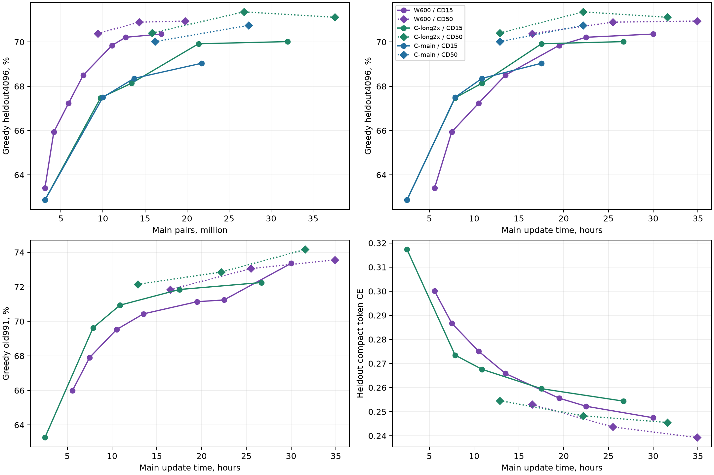
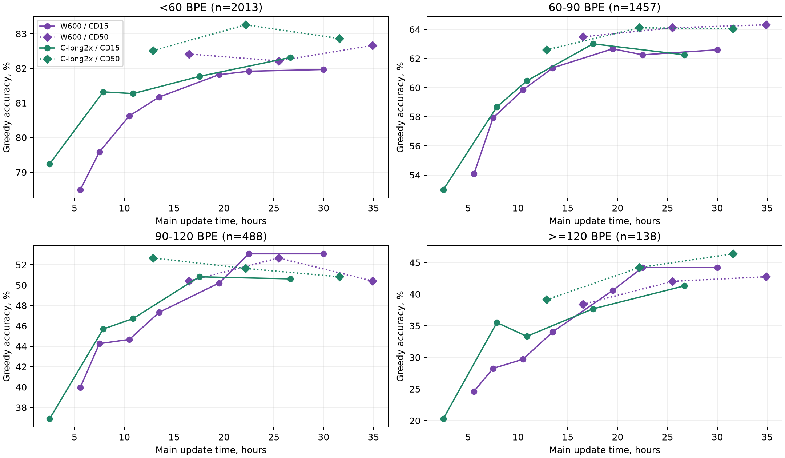

# B5: плато main, ансамбли и длинный cooldown B6

**W: 2906/4096 =70,95%, Δ к B4 +0,05 п.п. [−0,88;+0,98]. C-long2x: 2913/4096 =71,12%, Δ к L3 −0,24 п.п. [−1,12;+0,66].** Оба сравнения при одинаковом 50-минутном cooldown. Ещё9ч24мин main не дали подтверждённого прироста greedy; CE снизилась у обеих веток.

**Сохранить v8 основным ответом; выполнить B6 как ограниченную финальную проверку cooldown, следующую main-сессию не планировать.** Лучший tune-ансамбль новых C-long2x/P1-B/W даёт1547 против v8 offline1541: +0,29 п.п. [−0,63;+1,22], с большей вычислительной ценой. Это кандидат v9, выигрыш после поиска не подтверждён. По сообщению пользователя **v8 public78,54%, v7 public77,92%** (Δ+0,62 п.п.); размер/парные исходы public неизвестны, CI не вычисляется.

## Полнота и происхождение

Пользователь указал private `friend1/nlp-hw02-b5`, **версия6**, старт18.10.2026 **18:14UTC**; версии1–5 отменены в очереди/при старте. Скачанная папка `results/kaggle-runs/nlp-hw02-b5/1/` — локальная метка, **не версия production1**. Исторические ссылки на RUNNING v3 в [b5-plan](b5-plan.md)/[b5-review](b5-review.md) заменены этим сообщением о фактическом запуске; независимый version-specific API-аудит v6 здесь не выполнялся.

Kernel/session/оба workers **COMPLETE**, exits[0,0], wall **38659,33с =10ч44мин19с**. Обе ветки достигли +33840с main, одной пробы +4,5ч/CD15 и final/CD50; пропусков/budget stops нет. Состояния независимые: общего старта/RNG/потока W и C не требуется.

[CPU-анализ](../research/analyze-b5-results.py), [агрегаты/provenance/все CI](../results/b5-results.json), [проверки](../checks/b5-results-cpu.json), [сетка](../results/b5-ensemble-grid.csv). Проверены **207 producer SHA/bytes**, **127170 main** и **14631 cooldown updates**, frozen IDs/question SHA/references/BPE length/correctness. Шесть недостающих JSONL скачаны read-only через CLI; свежий manifest побайтно совпал с исходным, каждый файл проверен по SHA/bytes: [квитанция](../checks/b5-results-download.json). Latest endpoint сам по себе номер версии не закрепляет; совпадение manifest связывает дополнительные файлы с исходным snapshot.

Из357 manifest-файлов150 отсутствуют локально:106 исходников,31pyc и13 основных артефактов (8PT,2orders,notebook,2test-answer JSONL). Полный inventory — в JSON. Тензоры/Adam/RNG не загружались, actual CUDA restore и tensor finiteness повторно не проверялись. Новых GPU/forwards/обучения/sampling/исполнений программ — **0**, fresh не читался. API использовался только для скачивания перечисленных журналов.

CI — **20000 парных bootstrap повторов по задачам**, seed2026101901, эквивалентное multinomial resampling gains/losses/unchanged; normal CI также сохранены. В полной сетке — normal CI, у выбранных сравнений ещё bootstrap. Интервалы pointwise, описательные: heldout/tune многократно использованы, поправки за поиск нет. Для CE нет per-example NLL и CI. Интерполяции не являются новыми измерениями и CI не получают.

## Кривые B2–B5 и L1–L3–B5

Main time — сумма времени attempted updates, без disposable cooldown/eval/I/O; пары = **128×updates**, включая AMP skips и weighted repeats. У C `main_pairs` в B5-журналах — order cursor: к нему нужно добавить **6035840** унаследованных L1-предъявлений. Например, финал C:cursor31556224, всего37592064пары. CE — unsmoothed compact30 teacher-forced token CE с EOS, без PAD/BOS.

| Ветка / точка | Main, ч | Main-пары, млн | CD, мин | Greedy4k: matches (%) | old991, % | CE4k /old |
|---|---:|---:|---:|---|---:|---|
|W600 /probe-020091|5,58|3,100|15|2597 (63,40)|65,99|0,300067 /0,306018|
|W600 /end-main-027000|7,50|4,160|15|2701 (65,94)|67,91|0,286736 /0,291506|
|W600 /b3-probe-037800|10,50|5,912|15|2754 (67,24)|69,53|0,275110 /0,276538|
|W600 /b3-probe-048601|13,50|7,659|15|2806 (68,51)|70,43|0,265850 /0,266455|
|W600 /b3-final-059400|16,50|9,397|50|2883 (70,39)|71,85|0,252957 /0,254183|
|W600 /b4-probe-070201|19,50|11,078|15|2861 (69,85)|71,14|0,255605 /0,258007|
|W600 /b4-probe-081002|22,50|12,703|15|2876 (70,21)|71,24|0,252257 /0,253541|
|W600 /b4-final-091801|25,50|14,327|50|2904 (70,90)|73,06|0,243664 /0,247925|
|W600 /b5-probe-108002|30,00|16,941|15|2882 (70,36)|73,36|0,247480 /0,248664|
|W600 /b5-final-125641|34,90|19,784|50|2906 (70,95)|73,56|0,239261 /0,242474|
|C (shared L1) /t009000|2,50|3,107|15|2575 (62,87)|63,27|0,317346 /0,321687|
|C-long2x /l2-10800|7,88|9,721|15|2764 (67,48)|69,63|0,273475 /0,278274|
|C-long2x /l2-21600|10,88|13,400|15|2791 (68,14)|70,94|0,267588 /0,270274|
|C-long2x /l2-28800|12,88|15,852|50|2884 (70,41)|72,15|0,254557 /0,257069|
|C-long2x /l2-45540|17,53|21,365|15|2864 (69,92)|71,85|0,259540 /0,262151|
|C-long2x /l2-62280|22,18|26,770|50|2923 (71,36)|72,86|0,248291 /0,250602|
|C-long2x /b5-probe-096050|26,68|31,945|15|2868 (70,02)|72,25|0,254385 /0,257400|
|C-long2x /b5-final-113690|31,58|37,592|50|2913 (71,12)|74,17|0,245524 /0,246272|

| Одинаковый cooldown | Greedy4k Δ [95% CI], п.п. | Исправлено /сломано | old991 Δ [95% CI], п.п. |
|---|---|---:|---|
|W: B5 probe − B4 +6ч /CD15|+0,15 [-0,83; +1,12]|212 /206|+2,12 [+0,10; +4,14]|
|C: B5 probe − L3 mid /CD15|+0,10 [-0,90; +1,07]|211 /207|+0,40 [-1,61; +2,42]|
|W: B5 final − B4 final /CD50|+0,05 [-0,88; +0,98]|186 /184|+0,50 [-1,31; +2,42]|
|C: B5 final − L3 final /CD50|-0,24 [-1,12; +0,66]|169 /179|+1,31 [-0,40; +3,03]|

B5 final−baseline CE4k/old: **W −0,004403/−0,005451; C −0,002767/−0,004330**. Улучшение likelihood не превратилось в execution gain. W tune greedy1437→1437, eval1467→1469; C tune1457→1444, eval1466→1469. Это повторные диагностические половины, не независимая оценка. Probe→final смешивает дополнительный main и CD15→CD50; чистый эффект cooldown из этой пары не выделяется.

**Равные пары:** у W B5 final19,784M интерполированная C-long/CD50 **70,81%**, W−C≈**+0,13п.п.**; у новой W probe16,941M/CD15≈**+1,33п.п.**. Историческое преимущество W на пару ослабло; tokens/FLOPs и cooldown updates этим не уравниваются. **Равное время:** на C B5 final31,58ч/CD50 интерполированная W70,93%, измеренная C71,12% (W−C≈−0,19п.п.). При CD15 на26,68ч W≈70,30% против C70,02%. Интерполяция log-linear внутри соседних точек с тем же cooldown, без экстраполяции и CI. У финалов разных веток34,90−31,58≈3,32ч разницы main; парный W−C−0,17п.п. [−1,15;+0,81] сравнивает endpoints, не равное время.

### Длины и устойчивость

| Original BPE bin /n | W B4→B5, % | W Δ [95% CI], п.п. | C L3→B5, % | C Δ [95% CI], п.п. |
|---|---|---|---|---|
|0–60 /2013|82,22→82,66|+0,45 [-0,60; +1,49]|83,26→82,86|-0,40 [-1,44; +0,60]|
|60–90 /1457|64,10→64,31|+0,21 [-1,58; +1,99]|64,10→64,04|-0,07 [-1,78; +1,58]|
|90–120 /488|52,66→50,41|-2,25 [-5,33; +0,82]|51,64→50,82|-0,82 [-3,90; +2,46]|
|120–inf /138|42,03→42,75|+0,72 [-4,35; +5,80]|44,20→46,38|+2,17 [-3,62; +7,97]|

Ни один длиновой CI не исключает0. W90–120 снизилась, у C≥120 направление положительное, но n138 даёт широкий интервал; подбирать length routing по этим срезам оснований нет.

| B5 training audit | W600 | C-long2x |
|---|---:|---:|
| Main attempted updates /новые пары |42626 /5456128|84544 /10821632|
| Main update, с /pairs·с⁻¹ |0,79389 /161,23|0,40027 /319,79|
| AMP main: за B5 /cumulative |16 /56|40 /124|
| AMP probe /final |0 /1|1 /3|
| Main+cooldown nonfinite /OOM /эскалации |0 /0 /0|0 /0 /0|
| LR main /microbatch |0,0006 /32|0,0015 /64|
| CD50 updates /endpoint LR |3764 /9,03·10⁻⁸|7481 /1,72·10⁻⁷|

Все main/cooldown timestamps, счётчики, constant LR и linear cooldown проверены по шагам. AMP skips учтены отдельно от nonfinite rejects; нет признаков аварийного rollback или LR-halving. У W sampled attention abs logit max14,63, это редкие записанные измерения, не максимум всех attention logits. Конечные stream SHA согласованы с summaries; orders здесь не скачивались, последовательность cache IDs заново не пересчитывалась.

## K8 tune2048 и ансамбли

Пул: **C-main L3, C-long2x L3, P1-B, W B4, W B5, C-long2x B5**. Все384K8-журнала/98304samples: первыеK из8, T0,7/seed270042/batch32/cap512, frozen IDs/question SHA/reference. Single K8 без дополнительного greedy голоса; mixed — один greedy anchor, connected components isclose1e−6, count→greedy→meanLP→order, multiplicity сохраняется. Gold используется только после выбора для метрики.

Поиск **22025 политик**, из них5167 проходят **max(test,tune) осторожный timing-proxy≤140с**. Все подмножества2–4 из6моделей, K1=1/модель, K2=1…8, сумма≤14; у пар оба greedy anchors, у троек/четвёрок первый C в порядке main→old long→new long→P1-B→old W→new W. Это объявленная сетка, а не все возможные anchors/K1. Ускоритель [b5-replay.cpp](../research/b5-replay.cpp) повторяет B3 bitset selector без fast-math;399360 native/Python bits совпали,18432winner code/execution совпали с production и независимым union-find oracle. Проверены удаление нетранзитивного bridge, multiplicity и fallback пустого пула.

| Single K8 | Matches /2048 | K8+greedy |
|---|---:|---:|
|C-main L3|1502|1498|
|C-long2x L3|1507|1504|
|P1-B|1522|1515|
|W B4|1509|1499|
|W B5|1513|1506|
|C-long2x B5|1501|1495|

**Baseline v8 —1541 offline, v7 —1535. GPU v8 —1532 — другой набор samples**, формы батчей/compaction и RNG consumption; это не ошибка селектора. Нельзя приписывать новым моделям разницу1547−1532=15ответов: согласованное сравнение по исходным K8-журналам — **1547−1541=6**. Public78,54% — отдельная пользовательская оценка на другом наборе, она не калибрует tune CI.

| Политика /greedy anchor | K1→K2 | Matches | Mean samples /C-units U | Осторожно /stress15%, с | Δv8 [95% CI], п.п. |
|---|---|---:|---:|---:|---|
|v7 main/old long/B, main greedy|1/1/1→3/5/4|1535|6,586 /6,586|139,27 /158,39|−0,29 [−1,22;+0,59]¹|
|v8 old long/B/old W, old long greedy|1/1/1→1/8/1|1541|5,803 /6,149|114,51 /127,09|0|
|**new long/B/new W, new long greedy**|**1/1/1→1/6/5**|**1547**|**6,582 /7,480**|**136,84 /152,79**|**+0,29 [−0,63;+1,22]**|
|Тот же состав, U≤v7|1/1/1→1/6/3|1545|5,786 /6,408|136,84 /152,79|+0,20 [−0,68;+1,07]|
|New long/B, new long greedy, U≤v8 иstress≤140|1/1→5/6|1541|5,094 /5,094|108,05 /120,77|0,00 [−0,93;+0,93]|

¹ Обратное парное сравнение к v8; выбор основного ответа опирается также на уже выполненный cold run и пользовательский public score. Фактический cold v8 существенно быстрее своего proxy. Одинаковый proxy у1/6/3 и1/6/5 связан с округлёнными shared waves и оплатой неполных W lanes как полного батча.

Глобальный winner одновременно лучший **после удаления старых C-long2x/W из пула** и лучший с обязательными обеими новыми моделями. К v8 **50исправлено/44сломано**, к v7 **60/48, Δ+0,59п.п. [−0,39;+1,56]**. Ранних остановок1233, maximum12stochastic samples, среднее6,5815. Weighted mean cost **на21,64% выше v8**. При U≤v8 иmax12 лучшего score, чем1541, нет; при U≤v7 достигается1545, также без положительной нижней CI.

### Замена весов без перенастройки v8

Все строки сохраняют long greedy и1/1/1→1/8/1; одинаковый proxy114,51с не означает равное фактическое время.

| Long /W | Matches | Δv8 [95% CI], п.п. | Исправлено /сломано |
|---|---:|---|---:|
|L3 /B4 (v8)|1541|0|0 /0|
|L3 /B5|1540|−0,05 [−0,54;+0,44]|14 /15|
|B5 /B4|1533|−0,39 [−1,07;+0,29]|22 /30|
|B5 /B5|1537|−0,20 [−0,98;+0,59]|33 /37|

Таким образом, новые веса не являются автоматическим улучшением v8.1547 получено совместной сменой весов и распределения samples после22025проб на tune; перенос на новый sampling/public неизвестен.

Timing — **тот же осторожный B4 proxy**, C-sample1/W1,3467, отдельная ширинная цена greedy и4с/W на загрузку, rounded1024-lane waves; fixed CPU/load сохраняются. Это shape-bench без отдельного QK timer, не статистическая верхняя граница. У winner nominal test/tune118,03/117,17с, conservative136,84/129,69с, stress152,79/146,78с. До цели140 остаётся всего3,16с; measured v8 cold91,92с не переносится на W stage2. Сетка с двумя resident W тоже требует отдельного memory gate; в рекомендуемом кандидате W одна.

## B6 и последняя квота

**Рекомендация: B6 на аккаунте друга, две GPU параллельно; только q0 long cooldown из end-main B5. Ещё одна main-сессия сейчас не нужна.** W за9ч24мин получила2дополнительных greedy ответа; C потеряла10; CD15 почти не выросли. Сигнала для повторения main до freeze нет. Длинный cooldown — отдельная ограниченная гипотеза: P1-A из L3 дала лишь+0,27п.п. с CI через0, поэтому улучшение B6 не обещается; её преимущество перед новым main — короткий путь к финальному весу при сохранённом fallback.

| GPU /ветка | Uncooled full stable | SHA256 |
|---|---|---|
|GPU0 W|`model-GPU0/checkpoints/main-789d436a3fb0.pt`|`3b11360d5242e0e8b3fc1ac38254f0d4d544fba8bb62ee4c7bb034943e6cdc32`|
|GPU1 C-long2x|`model-GPU1/checkpoints/main-6b2c636e5f7f.pt`|`69dff4405d2236097f48733adbfc9e3bfd5d20b501a3fcfd1dae62ec2ce63074`|

Это `B6_uncooled_latest`/`latest.json`, **до** disposable final50. Полный restore model/Adam/scaler/RNG/state/cursor, собственные orders и frozen W/C implementations; без warmup, дополнительного main, truncation или сброса cursor. Не продолжать охлаждённые B5 FP16/P1-B. Переход от constant LR к cooldown — единственная смена schedule.

Расписание **$\eta_j=\eta_0(1-\sqrt{j/N})$, $j=1,\ldots,N$**: $\eta_0$ — прежний peak LR ветки, $j$ — attempted cooldown update, $N$ — фиксированное число updates. Последний attempted update имеетLR0; AMP skips отдельно учитываются. $q=0$: все128пар остаются в loss. Перед запуском измерить throughput на disposable restore-пробе, затем полностью восстановить anchor/RNG и закрепитьN; не менятьN в середине расписания.

| Расчёт по B5 | W | C-long2x |
|---|---:|---:|
|Опорный update: max(main mean, final50 mean), с|0,797098|0,401070|
|N на≈3ч40мин update time, округление вниз до100|**16500**|**32900**|
|Предъявления cooldown|2112000|4211200|
|Update time по B5, с|13152,12|13195,22|
|С10% overhead +2400с setup/eval/I/O|16867,33 (4ч41мин)|16914,74 (4ч42мин)|
|Запас до полного cap18000с|1132,67с|1085,26с|

Формула планирования $N=100\lfloor13200/(100s)\rfloor$, где $s$ — консервативное измеренное время update. Для другой T4 пересчитатьN **вниз** так, чтобы $1{,}1Ns+2400\le18000$; 10% — инженерный запас, не гарантия. Все setup/restore/probe/eval/K8/publication reserves входят в общий **hard≤5ч**; watchdog должен завершаться раньше backend ceiling. При угрозе дедлайна сохранять partial и готовый B5 final50, не выдавать недошедший cooldown за завершённый.

Оценка каждой GPU: greedy heldout4k+old991/length bins/CE, K8 tune2048 тем же sampler и manifest; сравнение парно с B5 final50 и действующим v8 на журналах. Это сравнение **длительности+формы cooldown**, не изолированное действие $1-\sqrt{\cdot}$. Сохранить отдельный cooled FP16+SHA, исходный uncooled latest и все journals; fresh оставить для одного frozen gate после выбора политики.

Квоты **по данным пользователя**, без нового live quota-запроса; reset24.10 00:00UTC:

| Аккаунт /остаток | План | Резерв после планового расхода |
|---|---|---|
|аккаунт друга ≈18ч|B6 полный hard5ч, включая калибровку/оценку|≈13ч на сбой/повтор переноса; не обязательный main|
|аккаунт друга 30ч|Новых main/seed/архитектур не запускать доfreeze|30ч как резерв; не расходовать квоту ради её использования|
|thisarivson ≈6,5ч|Frozen evaluation и cold v9/v8 контроль, целевой совокупный cap≤1ч|≈5,5ч на исправление формата/повтор final|

**Календарь:**19.10 — подготовка и B6, затем CPU paired replay.20.10 — выбор весов/anchor/K; **freeze20–21.10** с hashes/config и одной final eval/fresh без дальнейшего tuning.21.10 — cold single-T4 timer и clean notebook/1919 code-only JSONL. **Посылки≈22.10**; до reset24.10 остаётся запас на восстановление/формат, не новый исследовательский цикл. Если B6 задержится или не даст убедительного основания менять веса, сдавать проверенную v8.

## Условный v9

**План, без сборки/запуска в этой CPU-сессии:** основной baseline остаётся v8. Если B6/frozen gate поддержит новые веса, взять проверенный v8 pipeline и заменить только pinned weights/config. Резервный B5-кандидат: **C-long2x B5 /P1-B /W B5, greedy new long,1/1/1→1/6/5**, T0,7/seed270042; reviewer выключен. Если B6 лучше, сначала повторить CPU journal replay с её cooled weights; не называть предсказанные ниже timing/score измерениями B6.

| Вес B5-кандидата | FP16 payload | SHA256 |
|---|---|---|
|C-long2x B5|`model-GPU1/weights/b5-final-113690-fp16.pt`|`32475040a951f74869663b740d0047ddfdc233309d55d5eb0dfb28c2068860c7`|
|P1-B|прежний private P1 dataset /`model-pilot-b__weights__long-truncation-fp16.pt`|`8439037720dda16dda6b73fe676860d5498bbcba4cacebc0d709bbb22db464a5`|
|W B5|`model-GPU0/weights/b5-final-125641-fp16.pt`|`30ff358be26dc3b0e9093fd73f3f56539ac00c33b8eaf00f9963c015ba14755a`|

Веса B5 здесь не скачивались: перед сборкой проверить payload SHA/finite/strict model_spec и перенести private с явным version/content pin; одного неприкреплённого latest mount недостаточно. Сохранить исходные decoder/selector/executor, guards160/166/170/172 и OOM/RNG rollback; в v8 test уже потребовал W1024→512 retry. Архитектуры/число resident models прежние, но новый W stage2 требует фактического memory gate.

Прогноз **≈118с nominal test, до137с осторожно; stress≈153с**. Реальный v8 занял91,92с, новый W stage2 добавляет работу, поэтому использовать91,92как обещание нельзя. Один private/offline cold test1919→отдельный tune child2048, одна активнаяT4, session cap≤12мин; пройти test≤140с, оба<180с, complete votes/guards/reexecution/format/order/actual model SHA/peak memory. Проверить новые samples с заранее замороженной политикой; **1547 не является обязательным побитным результатом нового GPU sampling**. При отрицательном frozen gate или таймере>140 — сохранить v8, не подбиратьK по fresh.

## Коммит

`git add` явного списка17 собственных файлов завершился128: `Unable to create .../.git/worktrees/study1/index.lock: Operation not permitted`. Индекс остался пустым и не изменился, commit не создан; ограничение не обходилось. [Квитанция и список для повтора](../checks/b5-results-git.json) включает также саму квитанцию. Чужой `checks/cleanup-2026-10-18.md` не изменялся и в список не включён.

## Источники

- **kaggle-b5-results** — пользовательский протокол/номер версии/public score и собственный CPU-аудит19.10.2026 локального B5 output: bibliography — kaggle-b5-results, [скрипт](../research/analyze-b5-results.py), [JSON](../results/b5-results.json). Журналы — измерения; CI/интерполяции/тайминг/квоты/B6/v9 — собственные расчёты и рекомендации с указанными ограничениями.
- [b5-plan](b5-plan.md), [b5-review](b5-review.md), [b4-results](b4-results.md), [l3-results](l3-results.md), [p1-results](p1-results.md), [final-inference — V8: C-long2x / P1-B / W plain B4](final-inference.md#v8-c-long2x--p1-b--w-plain-b4). Библиографические записи этих источников существуют; новых внешних научных работ не использовано.
