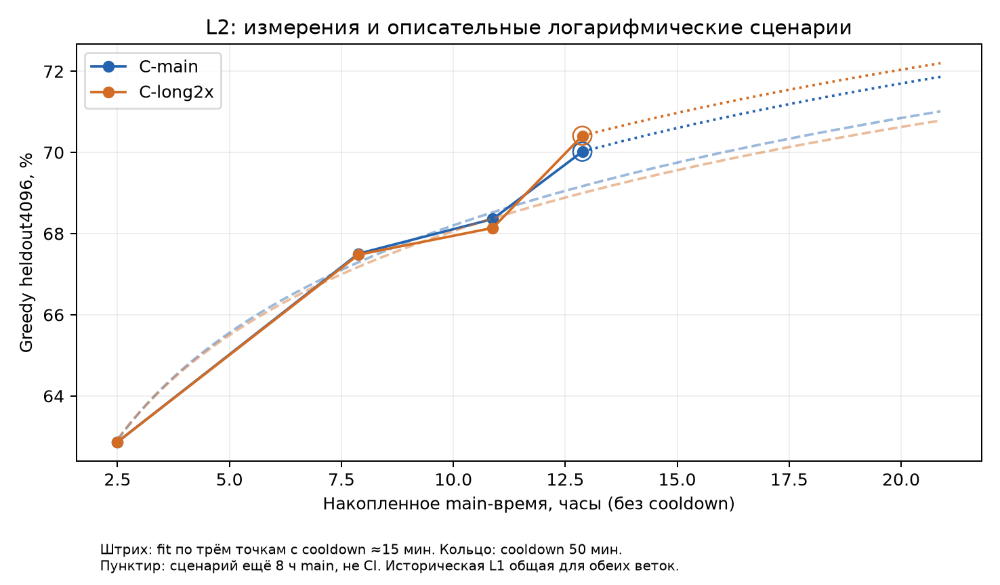

# L2: результаты C-main, C-long2x и голосования

**Итог:** дополнительное обучение улучшило обе C. Гипотеза направленного long-weighting по заранее заданным критериям не подтверждена. C-long2x полезна как кандидат в ансамбль: mixed K4+K4+greedy выигрывает на tune, но eval и полный таймер одной T4 ещё не пройдены. Production-декодер не выбран.

## Гипотеза, параметры и данные

[l2-plan](l2-plan.md) и [course-methods-review — Протоколы трёх направлений GPU1](course-methods-review.md#протоколы-трёх-направлений-gpu1) заданы до запуска. Обе ветки из одного stable L1 anchor: 47 155 attempted updates, main 17 569,936 с, полный AdamW/scaler/RNG. C-main продолжает прежний order/cursor; C-long2x удваивает строки с **compact target ≥79 BPE**, меняет weighted order и начинает его с cursor0. Это proxy для исходной длины ≥90, а не точная исходная классификация train.

C: 53 646 403 параметра, 6+6/d512/h8/SwiGLU1368, compact30, 9 725 737 original train rows, token CE, LR0,0015/AdamW/AMP, effective128/micro64. Weighted epoch 11 227 811 слотов; long train 15,444%, long среди предъявлений 26,756%. Добавлено main +3/+6/+8 ч; одинаковые cooldown 15/15/50 мин. Полные stable states восстановлены после disposable cooldown и остаются пригодными для L3.

Greedy: heldout4096 и old991; фиксированный hash-split tune2048/eval2048, исходные BPE bins <60/60–90/90–120/≥120. K8/T0,7 только tune; seed270042, 64 batch-журнала на модель, все 32 768 samples завершены. Fresh1024 не читался. Greedy eval из последовательных marks — уже многократно использованная описательная диагностика, не независимый финальный gate. Новый vote eval не выполнялся.

## Происхождение и выгрузка

Пользователь запустил [боевой L2, серверная v2](https://www.kaggle.com/code/thisarivson/nlp-hw02-kaggle-l2/versions?versionNumber=2) из UI. API latest и pinned v2 COMPLETE; v1 ERROR. Внутренний status complete, оба worker complete, exits [0,0], wall **34 411,547 с = 9,559 ч**. Локальный каталог `results/kaggle-runs/nlp-hw02-kaggle-l2/1/` сохраняет запрошенное пользователем имя **1**, а не номер серверной версии.

Получены все JSON/JSONL/logs из pinned kernel output и [private live v11](https://www.kaggle.com/datasets/thisarivson/nlp-hw02-l2-live/versions/11), все шесть FP16 points. Финальные live веса — hardlinks к идентичным kernel weights. Историческая C/t009000 получена отдельными C-only JSON из L1 live v7; D и L1 веса не скачивались.

`git check-ignore` подтвердил ignored-каталог. На диске **788 MiB**, из них 644,184 MB шесть FP16 файлов; стабильные full states ≈644 MB каждый и order.npy не скачивались. Подробные файлы/bytes/SHA в `download-receipt.json`, отдельная квитанция L1 в `l1-reference-live-v7/download-receipt.json`; [маленький аудит](../checks/l2-download-audit.json).

Kernel producer manifest: 244 сохранённых файла SHA/bytes exact. Live: 28 raw SHA +152 gzip SHA воспроизведены; API отдаёт распакованные JSON вместо имён `.gz` из recovery manifest. 178 live payloads побайтно равны kernel; только session-summary/live-sync-status различаются из-за времени snapshot. В live status ещё содержит предыдущую sync_error, однако финальный kernel status **uploaded/normal-exit**, а recovery manifest live **normal-exit**; финальные journals и weights полные.

**Ограничение для L3:** full-state SHA здесь проверен только как согласованная квитанция latest/manifest, без загрузки и чтения полного PT. Перед resume проверить SHA/restore на Kaggle; recovery-loader должен учесть наблюдаемые распакованные `.gz` имена, не считать отсутствие суффикса потерей файла.

Финальные FP16 SHA:

- `model-C-long2x/weights/l2-28800-fp16.pt` — 107364659 bytes; `6227ee2fc8dd12e186137be229fef2b1ceba659848c35bedd90cec6502f41548`.
- `model-C-main/weights/l2-28800-fp16.pt` — 107363571 bytes; `3806a5827004fd88f533a7307abc0c1e387faafc5672f4224392b363c4d2ad3d`.

Оба final PT прочитаны `torch.load(weights_only=True)` на CPU: format/model_spec/optimizer_included=False, 212 tensors, 53 646 403 elements, floating tensors FP16 и finite. [Проверка](../checks/l2-final-weights-cpu.json). Model forwards/GPU/новые Kaggle runs =0; исполнение программ заново не запускалось. Correctness пересчитана по сохранённым numeric values с isclose1e-6.

## Все точки

Время — накопленное **main_s без cooldown/eval/I/O**, updates — attempted main updates anchor. L1 t009000 общий предок, C-long2x тогда ещё не существовала: отдельного парного сравнения двух моделей в этой точке нет. K8 измерен только в финале.

| Модель / точка | main_s | updates | cooldown, мин | 4k: matches (%) | BPE bins %, <60 / 60–90 / 90–120 / ≥120 | tune / eval, из2048 | old, из991 | CE4k / CEold | test1919, с | test execution statuses | Point |
|---|---:|---:|---:|---:|---|---:|---:|---|---:|---|---|
| C (shared L1) / t009000 | 9000.120 | 24270 | 15.13 | 2575 (62.87) | 79.23 / 52.99 / 36.89 / 20.29 | 1286 / 1289 | 627 | 0.317346 / 0.321687 | 33.732 | numeric: 1898; execution_error: 15; timeout_or_worker_exit: 2; syntax_error: 3; missing_solve: 1 | complete |
| C-main / l2-10800 | 28370.027 | 78056 | 15.00 | 2765 (67.50) | 80.68 / 59.99 / 45.08 / 34.06 | 1392 / 1373 | 704 | 0.275776 / 0.281288 | 38.052 | numeric: 1906; execution_error: 8; syntax_error: 3; timeout_or_worker_exit: 2 | complete |
| C-long2x / l2-10800 | 28370.081 | 75944 | 15.01 | 2764 (67.48) | 81.32 / 58.68 / 45.70 / 35.51 | 1376 / 1388 | 690 | 0.273475 / 0.278274 | 42.572 | numeric: 1900; syntax_error: 7; timeout_or_worker_exit: 4; execution_error: 8 | complete |
| C-main / l2-21600 | 39170.172 | 107090 | 15.00 | 2800 (68.36) | 81.77 / 60.54 / 46.11 / 34.06 | 1397 / 1403 | 710 | 0.269676 / 0.273631 | 30.220 | numeric: 1903; execution_error: 11; timeout_or_worker_exit: 2; syntax_error: 3 | complete |
| C-long2x / l2-21600 | 39170.105 | 104686 | 15.01 | 2791 (68.14) | 81.27 / 60.47 / 46.72 / 33.33 | 1379 / 1412 | 703 | 0.267588 / 0.270274 | 39.394 | numeric: 1903; execution_error: 10; timeout_or_worker_exit: 3; syntax_error: 3 | complete |
| C-main / l2-28800 | 46370.143 | 126452 | 50.01 | 2868 (70.02) | 82.46 / 62.39 / 50.20 / 39.13 | 1425 / 1443 | 723 | 0.255885 / 0.259744 | 19.884 | numeric: 1913; execution_error: 6 | complete |
| C-long2x / l2-28800 | 46370.246 | 123842 | 50.00 | 2884 (70.41) | 82.51 / 62.59 / 52.66 / 39.13 | 1445 / 1439 | 715 | 0.254557 / 0.257069 | 22.860 | numeric: 1911; execution_error: 6; syntax_error: 1; timeout_or_worker_exit: 1 | complete |

CE — unsmoothed compact teacher-forcing token CE, не raw CE. Bins знаменатели 2013/1457/488/138; tune ≥90 —316, tune <60 —1000. Все test timer1919 полные: input read + fresh weights/tokenizer load + generate/restore + bounded exec + answers close. Test correctness неизвестна; numeric status не означает правильный ответ. Все heldout/old execution statuses и restore counts — в [JSON](../results/l2-results.json).

Парность: actual L2 main расхождение 0,054/0,066/0,102 с, cooldown targets совпали. Нештатных nonfinite skips/rollback/escalations нет, micro64 и LR0,0015 сохранены. L2 main AMP skips 42/39, cumulative с L1 46/43; cooldown AMP skips 1/1/4 у обеих веток. C-long2x получила 76 687 дополнительных attempted updates против79 297: throughput ниже на 3,29% при одинаковом main времени.

## Парное long2x − main и вердикт

Положительные gains — main ошиблась, long правильна; losses — обратные. Все CI — разность accuracy в п.п., **парные нормальные 95%**, без поправки на многочисленные сравнения; McNemar exact сохранён в JSON. Это exploratory измерения на повторно использованном heldout.

| Точка | Tune overall Δ | Tune ≥90 Δ | Tune <60 Δ | Gates overall≥+0,5 / long≥+3 / short≥−0,5 |
|---|---:|---:|---:|---|
| l2-10800 | -0.78 | -0.63 | -0.20 | нет / нет / да |
| l2-21600 | -0.88 | -1.90 | +0.00 | нет / нет / да |
| l2-28800 | +0.98 | +1.27 | -0.20 | да / нет / да |

**Основная гипотеза не прошла критерии:** на +3/+6 ч tune overall и длинный срез отрицательные; в финале длинный tune +1,27 п.п. ниже +3. Финальный full4k +0,39 [−0,55;+1,33], eval −0,20 [−1,55;+1,16] не дают требуемого single-model eval≥+1. Old во всех точках отрицателен (финал −0,81 [−2,78;+1,17]), но убедительного сильного вреда не установлено. Более низкая CE long сама по себе решение не меняет.

Полезность long как **ансамблевого кандидата** — отдельная гипотеза: при равном K mixed tune +0,78 к main K8 проходит порог+0,5, но CI включает0; +greedy вариант сильнее. Это основание для одного inference-only gate, не подтверждённая production-победа и не повод автоматически продолжать long recipe.

> [!info]- Все парные срезы: gains/losses; Δ [95% CI], п.п.
>
> | Точка | Срез | n | Gains/losses; Δ [CI] |
> |---|---|---:|---|
> | l2-10800 | heldout4k | 4096 | 219/220; -0.02 [-1.03; +0.98] |
> | l2-10800 | tune2048 | 2048 | 105/121; -0.78 [-2.22; +0.66] |
> | l2-10800 | eval2048 | 2048 | 114/99; +0.73 [-0.66; +2.13] |
> | l2-10800 | ge90 | 626 | 43/38; +0.80 [-2.02; +3.62] |
> | l2-10800 | tune2048-ge90 | 316 | 20/22; -0.63 [-4.65; +3.39] |
> | l2-10800 | tune2048-lt60 | 1000 | 40/42; -0.20 [-1.97; +1.57] |
> | l2-10800 | old991 | 991 | 44/58; -1.41 [-3.41; +0.58] |
> | l2-21600 | heldout4k | 4096 | 221/230; -0.22 [-1.24; +0.80] |
> | l2-21600 | tune2048 | 2048 | 101/119; -0.88 [-2.30; +0.54] |
> | l2-21600 | eval2048 | 2048 | 120/111; +0.44 [-1.01; +1.89] |
> | l2-21600 | ge90 | 626 | 49/47; +0.32 [-2.75; +3.39] |
> | l2-21600 | tune2048-ge90 | 316 | 21/27; -1.90 [-6.19; +2.39] |
> | l2-21600 | tune2048-lt60 | 1000 | 39/39; +0.00 [-1.73; +1.73] |
> | l2-21600 | old991 | 991 | 54/61; -0.71 [-2.83; +1.41] |
> | l2-28800 | heldout4k | 4096 | 200/184; +0.39 [-0.55; +1.33] |
> | l2-28800 | tune2048 | 2048 | 102/82; +0.98 [-0.32; +2.27] |
> | l2-28800 | eval2048 | 2048 | 98/102; -0.20 [-1.55; +1.16] |
> | l2-28800 | ge90 | 626 | 53/41; +1.92 [-1.11; +4.95] |
> | l2-28800 | tune2048-ge90 | 316 | 23/19; +1.27 [-2.75; +5.28] |
> | l2-28800 | tune2048-lt60 | 1000 | 27/29; -0.20 [-1.67; +1.27] |
> | l2-28800 | old991 | 991 | 46/54; -0.81 [-2.78; +1.17] |

> $\bar d=(g-l)/n$, $CI=\bar d\pm1.96\sqrt{((g+l)/n-\bar d^2)/n}$. Здесь $d_i=b_i-a_i\in\{-1,0,1\}$ — разность correctness одной задачи, $g/l$ — gains/losses, $n$ — число пар. В таблицах умножено на100. Нормальный CI может чуть расходиться с exact McNemar около0,05; оценки не скорректированы за выбор лучшего из 12 вариантов.

## Кривая обучения и прогноз

Fits только по **трём коротким cooldown точкам**, включая общую L1: main2,500 /7,881 /10,881 ч. Финальная12,881 ч с50 мин cooldown исключена из fit. Модель $A(t)=a+b\ln(t/t_0)$, $t_0=1$ч; $A$ — accuracy в процентах, $a$ — intercept, $b$ — прирост п.п. на единицу log-time. $b=3,816/3,700$ для main/long. Проверены также log наклон последних двух коротких точек и степенной fit ошибки $100-A(t)=c(t/t_0)^{-\alpha}$ без floor. $c$ — масштаб ошибки, $\alpha$ — темп её снижения; ни закон, ни асимптота не установлены.

Сценарии прироста anchored к фактическому final score, при том же50 мин финальном cooldown; диапазон — разброс этих fits, **не статистический CI**.

| Ещё main, ч | C-main Δ, п.п. | C-main итог, % | C-long2x Δ, п.п. | C-long2x итог, % |
|---:|---:|---:|---:|---:|
| 2 | 0.38…0.55 | 70.40…70.57 | 0.29…0.53 | 70.71…70.94 |
| 4 | 0.72…1.03 | 70.74…71.05 | 0.55…1.00 | 70.96…71.41 |
| 8 | 1.28…1.84 | 71.30…71.86 | 0.99…1.79 | 71.40…72.20 |
| 16 | 2.14…3.08 | 72.16…73.10 | 1.65…2.99 | 72.06…73.40 |

Точек мало, learning/data-order эффекты и плато могут сломать любой прогноз;16 ч особенно ненадёжны. Уверенного процента «за N часов» здесь нет.

**Cooldown:** от +6 до +8 ч main full4k вырос на1,66/2,27 п.п. Это одновременно +2 ч main и +35 мин cooldown. Final residual относительно экстраполяций коротких cooldown: **+0,85…1,21 main /+1,41…1,93 long** п.п. Остаток согласуется с пользой длинного cooldown, но включает ошибку fit и все неизмеренные изменения: приписывать его целиком cooldown нельзя. Нужны15/50 мин ветки **из одного stable anchor** для причинного сравнения; текущие данные не дают такой оценки.

## Голосование tune2048 без GPU

Использована **точная функция `exp27_decode.choose`**, извлечённая из source AST. В неё передаются только greedy/sample execution и LP, без reference/correctness. Числовые компоненты графа isclose (rel/abs 1e-6); ties count → совпадение с greedy → средний LP → исходный order. LP untempered, с EOS. Greedy LP=0 как в сохранённом L2 протоколе. Single long использует собственный greedy anchor; mixed — **C-main greedy**; `+greedy` добавляет ровно его один голос для mixed. Выбор выполняется до сверки с reference.

K — число stochastic samples; +greedy даёт ещё1 голос. Mixed4+4 имеет те же8 samples, mixed8+8 — **16, K удвоен**. ПервыеK4 из сохранённых K8, без повторного sampling/подбора по gold. Все saved K8 winners/correctness воспроизведены. Базы main greedy1425/2048=69,58%, long greedy1445/2048=70,56%.

В двух сравнительных столбцах: gains/losses; Δ [paired95%CI], п.п. Oracle — any-correct среди samples, плюс greedy если он голосует; это недоступная модели оценка для справки.

| Вариант | Matches /2048 | Accuracy,% | Против C-main greedy | Против C-main K8 | Oracle,% |
|---|---:|---:|---|---|---:|
| C-main K4 | 1449 | 70.75 | 79/55; +1.17 [+0.07; +2.28] | 26/48; -1.07 [-1.90; -0.25] | 78.27 |
| C-main K4 +greedy | 1451 | 70.85 | 51/25; +1.27 [+0.44; +2.10] | 28/48; -0.98 [-1.81; -0.14] | 79.83 |
| C-main K8 | 1471 | 71.83 | 90/44; +2.25 [+1.14; +3.35] | 0/0; +0.00 [+0.00; +0.00] | 81.84 |
| C-main K8 +greedy | 1473 | 71.92 | 73/25; +2.34 [+1.40; +3.29] | 19/17; +0.10 [-0.48; +0.67] | 82.42 |
| C-long K4 | 1461 | 71.34 | 118/82; +1.76 [+0.41; +3.11] | 83/93; -0.49 [-1.76; +0.78] | 78.32 |
| C-long K4 +greedy | 1463 | 71.44 | 108/70; +1.86 [+0.58; +3.13] | 80/88; -0.39 [-1.63; +0.85] | 79.74 |
| C-long K8 | 1478 | 72.17 | 126/73; +2.59 [+1.24; +3.93] | 85/78; +0.34 [-0.88; +1.56] | 82.18 |
| C-long K8 +greedy | 1480 | 72.27 | 121/66; +2.69 [+1.38; +3.99] | 85/76; +0.44 [-0.77; +1.65] | 82.86 |
| mixed K4+K4 | 1487 | 72.61 | 112/50; +3.03 [+1.82; +4.24] | 56/40; +0.78 [-0.16; +1.72] | 83.30 |
| mixed K4+K4 +greedy | 1492 | 72.85 | 99/32; +3.27 [+2.19; +4.36] | 60/39; +1.03 [+0.07; +1.98] | 83.84 |
| mixed K8+K8 **K×2** | 1504 | 73.44 | 120/41; +3.86 [+2.65; +5.06] | 57/24; +1.61 [+0.75; +2.47] | 85.74 |
| mixed K8+K8 +greedy **K×2** | 1501 | 73.29 | 110/34; +3.71 [+2.57; +4.85] | 57/27; +1.46 [+0.59; +2.34] | 85.99 |

Mixed4+4 против **long K8**:61gains/52losses, +0,44 [−0,58;+1,46]; mixed4+4+greedy:69/55, +0,68 [−0,38;+1,75]. Против main K8+greedy с одинаковыми8samples+1greedy:55/36, +0,93 [+0,02;+1,84], exact McNemar p0,0586. Против main K8 p0,0439; у выбранного из 12 вариантов CI/p не учитывают selection bias. Ни superiority к лучшему single long, ни перенос на eval не установлены. Mixed16 без greedy сильнее main K8 на+1,61 [+0,75;+2,47], но это смесь diversity и **удвоенного K**.

## Время test1919 на одной T4

**Измерено:** K8 tune2048 занял156,379/155,722с на2048 строк. Это aggregate sampler + восстановление + sample execution + JSON I/O/cleanup. `vote_k8` не сохраняет отдельные sampler/exec seconds, а weights/tokenizer load предшествуют его таймеру. Называть156с чистой генерацией нельзя. Greedy1919: main19,884=17,923generation+0,589exec+1,372 прочее; long22,860=11,392generation+9,939exec+1,530 прочее. Long execution включил timeout/retry; вариативность реальна.

Сценарий: масштаб156с на1919/2048, добавить свежий greedy (нужен для ties даже без+greedy),3с cold I/O для single/5с для mixed и15% запас. Для mixed две модели последовательно на **одной T4**; два encoder/load пути, суммарная работа обеих, без ускорения от двух GPU. K4 время не измерено: показан оптимистичный0,5×K8 и осторожный1×K8 на каждую модель, не доверительный интервал и не гарантия границ.

| Декодер | Номинальная оценка, с | С15% запасом, с | ≤180 с |
|---|---:|---:|---|
| Greedy main / long | **19,88 /22,86 измерено** | примерно23 /26 | измеренный gate прошёл |
| Single K8 (+greedy) | 172 | 198 | номинально близко; с запасом не подтверждено |
| Mixed K4+K4 (+main greedy) | 171…317 | 197…365 | только оптимистичный сценарий; нужен full timer |
| Mixed K8+K8 | 317 | 365 | существенно выше180 в этом сценарии |

В смешанном опыте нельзя складывать параллельные GPU timers как wall одной T4 или считать K4 гарантированно вдвое быстрее K8. Нужен реальный полный timer от input/weights до answers close; желательно≤155–160с для резерва на cold start/timeout. Для pure compute можно повысить batch_rows у K4 с 32до 64 для тех же256lanes, но качество/память/таймер надо проверить; это предложение, здесь не выполнено.

## Следующий шаг и L3

1. **Сначала inference-only time gate одной T4** на final L2 FP16: frozen mixed K4+K4+main greedy/T0,7, single main K8(+greedy) как резерв по измеренному времени, test1919 без gold. До этого не тратить полную L3 на продолжение long ради ансамбля. K16 исключить изproduction при нынешнем времени.
2. Базовая рекомендация **L3: продолжать одну C-main ещё8 ч main**, обычный LR/полный stable AdamW/scaler/RNG/order, финальный **50 мин cooldown**. Ожидание +1,3…1,8п.п. greedy — сценарий. C-long сохранить как backup/specialist; long2x training не доказала направленный gate. Если заранее frozen mixed проходит time gate с запасом и окончательно выбран для L3, разумно продолжить **обе C по8 ч main** и тем же50 мин cooldown для сохранения сравнимого возраста. Обещать эффект такого решения данные не позволяют.
3. Финальный кандидат-декодер — **mixed4+4+main greedy**, если timer разрешает две модели; иначе заранее выбранный single main K8+greedy при прошедшем timer, затем main K4+greedy; если timed vote не проходит — main greedy. После L3 tune используется для решения только среди заранее допустимых timed вариантов. Затем **одна проверка выбранного декодера на eval2048**, включая paired gate кmain K8:≥+0,7п.п., нижнийCI>0, old991 без сильного вреда, full1919≤180 с. На отрицательномeval не перебирать второе место поeval.
4. **Fresh1024 один раз** после фиксации weights/recipe/decoder; показать полный результат без нового tuning. Stable states брать изlivev11 и проверять дообучение наKaggle; cooled FP16 использовать только дляinference. Официальный score/формат сдачи остаются отдельной проверкой.

Содержание источников — зарегистрированные protocol/журналы. Verdict, прогнозы, timing reserve и рекомендацияL3 — выводы этого CPU-анализа, не внешние гарантии.

## Источники

- **kaggle-l2-results**: собственные pinned L2v2 output/summary/checkpoints/K8journals; [private livev11](https://www.kaggle.com/datasets/thisarivson/nlp-hw02-l2-live/versions/11), L1livev7 C/t009000. Запись в bibliography.
- [l2-plan](l2-plan.md), [l2-review](l2-review.md), [course-methods-review](course-methods-review.md), [candidate-selection-cpu](candidate-selection-cpu.md), [execution-voting-decoding](execution-voting-decoding.md).
- [Реестр](../kaggle/runs.json), [download utility](../kaggle/download-l2-results.py), [CPU анализ](../research/analyze-l2-results.py), [метрики/срезы/CI/сценарии](../results/l2-results.json).
- [Exact vote source](../kaggle/src/exp27_decode.py), [fixed split](../kaggle/src/l2_sampler.py), [producer evaluation/timer](../kaggle/src/l2_eval.py), [paired CI protocol](../kaggle/l2_compare.py).

Коммит этого разбора заблокирован песочницей при `git add`: shared Git `index.lock`, `Operation not permitted`. Индекс не изменён; изменения сохранены. Посторонний `work/submissions/` не затрагивался.
