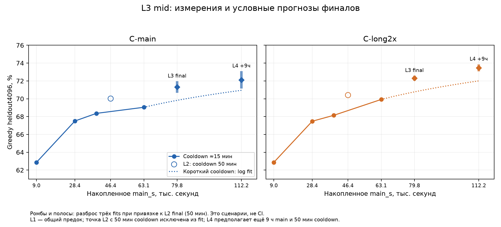
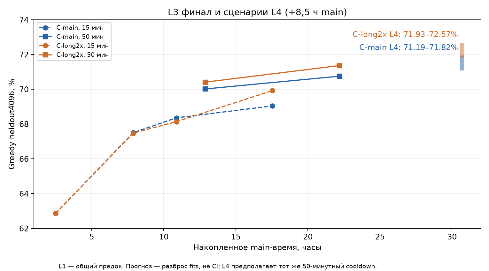

# L3: результаты обеих C

## Промежуточная точка

**Greedy heldout4k: C-main 2828/4096 = 69,04%, C-long2x 2864/4096 = 69,92%.** От сопоставимой короткой точки L2 main выросла на +0,68 п.п., long — на +1,78 п.п. CI прироста main включает ноль; у long — выше нуля. Преимущество long над main +0,88 п.п. пока не подтверждено парным CI. На момент mid финальных результатов ещё не было; финальный разбор ниже.

### Протокол и происхождение

[l3-plan](l3-plan.md): независимое продолжение обеих stable C из L2, прежние AdamW/scaler/RNG, ordinary и long2x orders, effective128, LR0,0015. Промежуточный tag `l2-45540`: +16 740 с main в L3, накопленно **63 110 с main**, затем disposable cooldown **15 минут**. Tag считает main после исходного L1 anchor, а `main_s` включает предыдущие 17 569,936 с L1. Cooldown, evaluation и I/O в `main_s` не входят.

Наблюдатель сохранил 15 файлов в ignored `results/kaggle-runs/nlp-hw02-kaggle-l3/mid/`: по семь JSON каждой C и `kernel-status.txt` со статусом RUNNING. Оба `complete.json` согласованы с отдельными metrics/training/checkpoint; latest counters/identity/model_spec согласованы с точкой и L2. Финал сессии не проверялся, Kaggle-команды не выполнялись.

[CPU-скрипт](../research/analyze-l3-results.py) повторно сверил correctness всех **10 174** mid-строк по сохранённым numeric execution/reference с `isclose` rel/abs1e-6; проверил ID, question SHA, reference и исходную BPE-длину против L2, фиксированный tune/eval split, match indices и length bins. Локальные SHA всех 15 файлов записаны в [JSON](../results/l3-results.json); это отпечатки локального snapshot, не отдельная проверка producer manifest. FP16 и full PT здесь не скачаны: проверена согласованность SHA-квитанций, сами веса не читались. Model forwards, обучение, повторное исполнение программ, новые sampling и fresh evaluation — **0**.

### Все точки

**Mid корректно сравнивать с L2 `l2-21600` (68,36 / 68,14%) и `l2-10800`: у них одинаковый короткий cooldown.** Финальная L2 `l2-28800` (70,02 / 70,41%) получила 50 минут cooldown и не входит в fit коротких точек. Mid ниже неё на −0,98 / −0,49 п.п.; это смешанное сравнение main-времени и длительности cooldown, не доказательство ухудшения от продолжения.

L1 `t009000` — **один общий предок**, а не две отдельные обученные модели. Updates — attempted main updates stable anchor, без disposable cooldown; при пропусках и откатах это не число успешных Adam updates.

| Модель / точка | main_s | updates | cooldown, мин | heldout4k: matches (%) | BPE bins %, <60 / 60–90 / 90–120 / ≥120 | tune / eval, из2048 | old991: matches (%) | CE4k / CEold | test pipeline, с | test статусы | Точка |
|---|---:|---:|---:|---:|---|---:|---:|---|---:|---|---|
| C, общий L1 / t009000 | 9000,120 | 24270 | 15,13 | 2575 (62,87) | 79,23 / 52,99 / 36,89 / 20,29 | 1286 / 1289 | 627 (63,27) | 0,317346 / 0,321687 | 33,73 | N1898 E15 T2 S3 M1 | complete |
| C-main / l2-10800 | 28370,027 | 78056 | 15,00 | 2765 (67,50) | 80,68 / 59,99 / 45,08 / 34,06 | 1392 / 1373 | 704 (71,04) | 0,275776 / 0,281288 | 38,05 | N1906 E8 S3 T2 | complete |
| C-long2x / l2-10800 | 28370,081 | 75944 | 15,01 | 2764 (67,48) | 81,32 / 58,68 / 45,70 / 35,51 | 1376 / 1388 | 690 (69,63) | 0,273475 / 0,278274 | 42,57 | N1900 S7 T4 E8 | complete |
| C-main / l2-21600 | 39170,172 | 107090 | 15,00 | 2800 (68,36) | 81,77 / 60,54 / 46,11 / 34,06 | 1397 / 1403 | 710 (71,64) | 0,269676 / 0,273631 | 30,22 | N1903 E11 T2 S3 | complete |
| C-long2x / l2-21600 | 39170,105 | 104686 | 15,01 | 2791 (68,14) | 81,27 / 60,47 / 46,72 / 33,33 | 1379 / 1412 | 703 (70,94) | 0,267588 / 0,270274 | 39,39 | N1903 E10 T3 S3 | complete |
| C-main / l2-28800 | 46370,143 | 126452 | 50,01 | 2868 (70,02) | 82,46 / 62,39 / 50,20 / 39,13 | 1425 / 1443 | 723 (72,96) | 0,255885 / 0,259744 | 19,88 | N1913 E6 | complete |
| C-long2x / l2-28800 | 46370,246 | 123842 | 50,00 | 2884 (70,41) | 82,51 / 62,59 / 52,66 / 39,13 | 1445 / 1439 | 715 (72,15) | 0,254557 / 0,257069 | 22,86 | N1911 E6 S1 T1 | complete |
| **C-main / l2-45540** | **63110,470** | **169956** | **15,00** | **2828 (69,04)** | **81,87 / 61,63 / 46,11 / 41,30** | **1403 / 1425** | **712 (71,85)** | **0,261232 / 0,266371** | **30,76** | **N1908 S3 T3 E5** | **complete** |
| **C-long2x / l2-45540** | **63110,308** | **166915** | **15,00** | **2864 (69,92)** | **81,77 / 63,01 / 50,82 / 37,68** | **1416 / 1448** | **712 (71,85)** | **0,259540 / 0,262151** | **32,79** | **N1902 E13 T3 S1** | **complete** |

N — numeric; E — execution_error; S — syntax_error; T — timeout_or_worker_exit; M — missing_solve. Test —1919 строк, полный сохранённый таймер input read + fresh weights/tokenizer load + generate/restore + bounded exec + answers close. Numeric не означает правильный ответ: test gold отсутствует. CE — unsmoothed **compact30 token CE** на teacher forcing, не raw CE. Знаменатели bins: 2013 /1457 /488 /138; tune/eval — по2048, не независимый новый test. Tune mid: 68,51 /69,14%; eval mid: 69,58 /70,70%.

### Парные сравнения

Gains — задача стала правильной у второй модели/поздней точки; losses — перестала. CI — прежний парный нормальный 95% CI из [l2-results](l2-results.md), не поправлен на множественные срезы. Exact McNemar считается по discordant парам. Повторно наблюдаемые heldout/tune/eval — описательная диагностика, не независимый финальный gate.

| heldout4k, n=4096 | Gains / losses | Δ, п.п. | 95% CI, п.п. | Exact McNemar p |
|---|---:|---:|---|---:|
| Mid C-long2x − C-main | 236 /200 | +0,88 | [−0,12; +1,88] | 0,0936 |
| C-main: l2-45540 − l2-21600 | 231 /203 | +0,68 | [−0,31; +1,68] | 0,1949 |
| C-long2x: l2-45540 − l2-21600 | 253 /180 | +1,78 | [+0,79; +2,78] | 0,000525 |

Long выросла и на tune (+1,81 п.п.) и на eval (+1,76 п.п.); main +0,29 /+1,07 п.п., оба CI включают ноль. Old991: main +0,20 [−1,87; +2,28], long +0,91 [−1,10; +2,91]; убедительного изменения нет.

У long преимущество mid сосредоточено в **90–120 BPE**: +4,71 [1,35; 8,07] п.п., 47 gains/24 losses. На ≥120 long ниже main на −3,62 [−10,98; +3,73] п.п., n=138. Объединённый ≥90: +2,88 [−0,22; +5,97]. Направленная гипотеза long-weighting целиком этим не подтверждена: отдельный срез положителен, overall и объединённый long CI включают ноль.

> [!info]- Mid C-long2x − C-main: дополнительные срезы
>
> | Срез | n | Gains / losses | Δ [95% CI], п.п. |
> |---|---:|---:|---|
> | tune2048 | 2048 | 113 /100 | +0,63 [−0,76; +2,03] |
> | eval2048 | 2048 | 123 /100 | +1,12 [−0,31; +2,55] |
> | <60 | 2013 | 69 /71 | −0,10 [−1,25; +1,05] |
> | 60–90 | 1457 | 109 /89 | +1,37 [−0,52; +3,26] |
> | 90–120 | 488 | 47 /24 | +4,71 [+1,35; +8,07] |
> | ≥120 | 138 | 11 /16 | −3,62 [−10,98; +3,73] |
> | old991 | 991 | 55 /55 | 0,00 [−2,07; +2,07] |

### Кривая обучения и прогноз L3/L4

Fit обновлён по **четырём коротким точкам**: main_s≈9000 /28370 /39170 /63110. L2 final с50 мин cooldown показан отдельно и исключён из fit. Проверены log fit всех коротких точек, log наклон последних двух и степенной fit ошибки без floor. Для $A(t)=a+b\ln(t/t_0)$ здесь $A$ — accuracy в процентах, $t$ — main_s, $t_0=1$с, $a$ — intercept, $b$ — прирост п.п. на единицу логарифма времени. Степенной вариант $100-A(t)=c(t/t_0)^{-\alpha}$: $c$ — масштаб ошибки, $\alpha$ — темп её снижения; предел качества не установлен.

Общий log наклон main/long теперь **3,307 /3,615**; последние два коротких измерения — **1,433 /3,737**. У main рост заметно замедлился; данных недостаточно, чтобы отличить плато от флуктуации оценки/order. Если оставить15 мин cooldown, прогноз L3 составляет лишь **69,38…69,82 /70,67…70,80%**.

Для финалов с50 мин cooldown основной сценарий переносит **только прирост fitted curve** на фактический L2 final: $\widehat A_{50}(t)=A_{50}(t_{L2})+F(t)-F(t_{L2})$. $F$ — один из трёх fits коротких точек; $A_{50}(t_{L2})$ — измеренные70,02/70,41%; $t_{L2}$ —46370с. Это предполагает переносимость поведения длинного cooldown и прежний recipe; это **не измерение причинного эффекта cooldown**.

| Сценарий, cooldown50 мин | main_s, примерно | C-main, % | C-long2x, % |
|---|---:|---:|---:|
| L3 final l2-62280, ещё4,65ч main от mid | 79850 (22,18ч) | **70,80…71,82** | **72,17…72,44** |
| L4: ещё9ч main после L3 | 112250 (31,18ч) | **71,29…72,94** | **73,22…73,71** |

**Диапазоны — разброс сценариев, не prediction CI.** Четыре точки не устанавливают learning law. Проверка чувствительности: прибавить к mid-anchored коротким прогнозам прежний L2 final residual соответствующего fit (main +0,85…1,21; long +1,41…1,93 п.п.). Объединённый разброс двух способов: **L3 main70,59…71,82 /long72,17…72,73%; L4 main71,08…72,94 /long73,22…74,00%**. Эти остатки смешивают cooldown, обучение и ошибку fit; более широкий реальный исход, включая плато, возможен. После финала L3 оценку нужно обновить.

### Отдельно: ожидаемый эффект mixed vote

Mid содержит только greedy, **L3 sample journals отсутствуют по плану**, поэтому measured mixed score L3 пока нет. Исторический L2 mixed K4+K4+main greedy/T0,7 — **1492/2048 =72,85% на tune**. Его выигрыш:

- к main greedy69,58%: **+3,27** [2,19; 4,36] п.п., 99 gains/32 losses;
- к long greedy70,56%: **+2,29** п.п.;
- к среднему двух greedy70,07%: **+2,78** п.п. — так интерпретируется ориентир «≈+2,8»;
- к main K8: **+1,03** [0,07; 1,98] п.п., 60 gains/39 losses; это меньший дополнительный выигрыш смеси поверх single voting.

Осторожный перенос для планирования — **+2…3 п.п. к одному будущему greedy**, а не поверх уже улучшенного K8. Для центральных long сценариев это условно **≈74…75% после L3 и75…77% после L4**. Разница tune и full4k, selection bias выбранного L2 варианта, изменение diversity и таймер одной T4 не позволяют считать эти проценты измеренным результатом или гарантией; дополнительно складывать оба выигрыша нельзя.

Mid greedy union oracle: **3064/4096 =74,80%**, близко к L2 final3068/4096=74,90%. Есть436 discordant пар против384 в L2 final: модели сохраняют взаимодополняющие ответы, но число задач, решённых хотя бы одной, почти прежнее. Oracle требует gold и недоступен при выборе ответа; он не предсказывает качество голосования stochastic samples и не ограничивает его потолок.

### Признаки проблем и недостающие файлы

| Проверка | C-main | C-long2x | Интерпретация |
|---|---:|---:|---|
| Mid cooldown AMP /nonfinite skips | 1 /0 | 1 /0 | Единичный AMP skip, нет зарегистрированных nonfinite rejects в этой ветке |
| L3 net attempted updates /main_s | 43504 /16740,33 | 43073 /16740,06 | Latest counters и cursor продолжают L2; cursor delta =128×updates delta |
| Updates/с: конец L2 → L3 mid | 2,689 →2,599 | 2,661 →2,573 | −3,36% /−3,29%, умеренное среднее замедление |
| CE4k: короткий L2 →mid | 0,269676 →0,261232 | 0,267588 →0,259540 | CE снизилась на0,008445 /0,008048 |
| CEold: короткий L2 →mid | 0,273631 →0,266371 | 0,270274 →0,262151 | CE снизилась на0,007260 /0,008124 |
| Restore errors heldout /old | 1 /0 | 0 /0 | У main один пустой код, id1795,124BPE, missing_solve |
| Eval/test generation OOM attempts | 0 | 0 | В сохранённых eval-журналах нет OOM |
| Test generation /execution, с | 11,17 /18,29 | 12,25 /19,20 | Основное удлинение pipeline — CPU execution/retry; по3 timeout, по1 chunk retry/pool restart |

CE mid выше L2 final на **+0,00535 /+0,00498** по4k и **+0,00663 /+0,00508** поold; длительность cooldown различается. Рост CE при одинаковом коротком cooldown не наблюдается. Полный test30,76/32,79с остаётся значительно ниже180с для greedy; это не gate mixed inference.

**NaN/AMP skips и аварийные откаты main пока нельзя проверить:** latest не содержит cumulative skips/stability/LR/micro_batch. Непрерывные конечные counters не исключают rollback: runtime сохраняет потраченное main-время после восстановления. Средние2,599/2,573 updates/с — net attempted updates; они не измеряют локальные провалы throughput, token throughput или успешные updates/с. Обычный restore после disposable cooldown предусмотрен протоколом и не является аварией.

Для полного main-аудита не хватает **каждой C**: `progress.json` и/или `summary.json` с полным state (`AMP_skips`, `nonfinite_skips`, `stability`, `last_lr`, `micro_batch`); `stability-history.json`, если он создавался; worker/stdout logs с updates/main_s/CE/LR/NF для временной динамики. Для проверки tensor finiteness/фактического веса отдельно нужны FP16 PT и/или latest full PT с producer manifest. Для текущих парных метрик и кривой всех файлов достаточно; скачивание здесь не выполнялось.

Следующий шаг — после конца L3 добавить **финальную** `l2-62280` с50 минутами cooldown, K8/mixed tune-журналы и main stability/logs; повторить парные сравнения и скорректировать L4. Параллельный анализ чистого cooldown и его файлы этим разбором не меняются.

Попытка коммита этого разбора: `git add` четырёх новых L3-only файлов отклонён песочницей — `Unable to create .../.git/worktrees/study1/index.lock: Operation not permitted`. Индекс не изменён; маленькие записи навигации/библиографии и новые артефакты сохранены. Чужие незавершённые правки не staging.

### Источники

- **kaggle-l3-mid-results**: сохранённые наблюдателем JSON L3 `friend1/nlp-hw02-kaggle-l3`, mid `l2-45540`,2026-10-13; локальные SHA и квитанции в [JSON](../results/l3-results.json). Запись в bibliography.
- [l3-plan](l3-plan.md), [l2-results](l2-results.md), [L2 сводка](../results/l2-results.json), [исходный CPU-анализ L2](../research/analyze-l2-results.py).
- [CPU-анализ L3](../research/analyze-l3-results.py), [producer cooldown/restore/stability](../kaggle/src/l2_runtime.py), [evaluation/timer](../kaggle/src/l2_eval.py), [fixed split](../kaggle/src/l2_sampler.py).
- Журналы и протокол — содержание источников; интерпретация CI, forecasts и vote transfer — выводы этого анализа.

## Финал L3
**C-main2898/4096 =70,75%; C-long2x2923/4096 =71,36%.** Боевой `friend1/nlp-hw02-kaggle-l3` завершён: kernel COMPLETE, session/оба workers complete, exits[0,0], final live uploaded. Wall38000,05с =10ч33мин20с. Финал `l2-62280`: +33480с main после L2, накопленно≈79850с, одинаковый cooldown50мин.
### Происхождение и проверки
Локальные `final/` и kernel output summaries получены наблюдателем; для разбора повторных Kaggle-команд не выполнялось. [CPU-анализ](../research/analyze-l3-final.py) сверил обе complete/metrics/training/checkpoint/latest, все10174final per-example correctness/IDs/reference/question SHA/BPE lengths против L2, фиксированный split и bins, 128K8 batch-журналов/32768samples. Все saved single K8 winners воспроизведены; выбор получает только execution/LP/greedy, reference используется после выбора. [JSON, локальные SHA и CI](../results/l3-final-results.json). Fresh не читался, нового sampling/GPU/обучения в анализе нет.
Для подготовки инференса/продолжения отдельно проверены private **l3-live v12**, recover-manifest и оба финальных FP16: remote names/bytes, producer SHA↔local SHA↔metrics/checkpoint. [CPU v4](../checks/final-inference-l3-cpu.json): strict loads,212finite FP16 tensors каждой C, малые реальные forwards, выбор/повторное исполнение16mixed winners. Для L4 full latest скачаны по одному, проверены на CPU и удалены; это stable uncooled состояния, не inference FP16.
### Все точки L1 → L2 → L3
Короткие15-минутные и финальные50-минутные точки не смешивать в оценке эффекта продолжения. L1 t009000 — общий предок. main_s не включает cooldown/eval/I/O; updates — attempted main updates, не успешные Adam updates. Bins имеют знаменатели2013/1457/488/138; tune/eval — по2048, old —991. CE — unsmoothed compact30 token CE, не raw CE.
| Модель / tag | main_s | updates | cooldown, мин | 4k matches (%) | bins %, <60 /60–90 /90–120 /≥120 | tune /eval | old matches (%) | CE4k /old | test1919, с |
|---|---:|---:|---:|---:|---|---:|---:|---|---:|
| C (shared L1) / t009000 | 9000,1 | 24270 | 15,13 | 2575 (62,87) | 79,23 / 52,99 / 36,89 / 20,29 | 1286 /1289 | 627 (63,27) | 0,317346 /0,321687 | 33,73 |
| C-main / l2-10800 | 28370,0 | 78056 | 15,00 | 2765 (67,50) | 80,68 / 59,99 / 45,08 / 34,06 | 1392 /1373 | 704 (71,04) | 0,275776 /0,281288 | 38,05 |
| C-long2x / l2-10800 | 28370,1 | 75944 | 15,01 | 2764 (67,48) | 81,32 / 58,68 / 45,70 / 35,51 | 1376 /1388 | 690 (69,63) | 0,273475 /0,278274 | 42,57 |
| C-main / l2-21600 | 39170,2 | 107090 | 15,00 | 2800 (68,36) | 81,77 / 60,54 / 46,11 / 34,06 | 1397 /1403 | 710 (71,64) | 0,269676 /0,273631 | 30,22 |
| C-long2x / l2-21600 | 39170,1 | 104686 | 15,01 | 2791 (68,14) | 81,27 / 60,47 / 46,72 / 33,33 | 1379 /1412 | 703 (70,94) | 0,267588 /0,270274 | 39,39 |
| C-main / l2-28800 | 46370,1 | 126452 | 50,01 | 2868 (70,02) | 82,46 / 62,39 / 50,20 / 39,13 | 1425 /1443 | 723 (72,96) | 0,255885 /0,259744 | 19,88 |
| C-long2x / l2-28800 | 46370,2 | 123842 | 50,00 | 2884 (70,41) | 82,51 / 62,59 / 52,66 / 39,13 | 1445 /1439 | 715 (72,15) | 0,254557 /0,257069 | 22,86 |
| C-main / l2-45540 | 63110,5 | 169956 | 15,00 | 2828 (69,04) | 81,87 / 61,63 / 46,11 / 41,30 | 1403 /1425 | 712 (71,85) | 0,261232 /0,266371 | 30,76 |
| C-long2x / l2-45540 | 63110,3 | 166915 | 15,00 | 2864 (69,92) | 81,77 / 63,01 / 50,82 / 37,68 | 1416 /1448 | 712 (71,85) | 0,259540 /0,262151 | 32,79 |
| **C-main / l2-62280** | 79850,5 | 213386 | 50,00 | 2898 (70,75) | 82,81 / 63,56 / 50,20 / 43,48 | 1441 /1457 | 728 (73,46) | 0,249945 /0,254509 | 30,84 |
| **C-long2x / l2-62280** | 79850,4 | 209144 | 50,00 | 2923 (71,36) | 83,26 / 64,10 / 51,64 / 44,20 | 1457 /1466 | 722 (72,86) | 0,248291 /0,250602 | 23,73 |

Все точки complete. Финал сравнивается с **финалом L2 l2-28800**, у обоих50мин cooldown. Финальные test статусы main: numeric1910/execution_error6/timeout3; long: numeric1915/execution_error2/timeout2. Это диагностика выполнения, correctness test неизвестна.
### Парные приросты
| Сравнение | n | gains /losses | Δ [95% CI], п.п. | exact McNemar p |
|---|---:|---:|---|---:|
| C-main: final L3 − final L2 | 4096 | 217 /187 | +0,73 [-0,23; +1,69] | 0,1490 |
| C-long2x: final L3 − final L2 | 4096 | 210 /171 | +0,95 [+0,02; +1,89] | 0,0514 |
| Final long − main, heldout4k | 4096 | 222 /197 | +0,61 [-0,37; +1,59] | 0,2410 |
| Final long − main, tune2048 | 2048 | 104 /88 | +0,78 [-0,54; +2,11] | 0,2790 |
| Final long − main, eval2048 | 2048 | 118 /109 | +0,44 [-1,00; +1,88] | 0,5955 |
| Final long − main, ge90 | 626 | 56 /48 | +1,28 [-1,91; +4,47] | 0,4926 |
| Final long − main, old991 | 991 | 37 /43 | -0,61 [-2,37; +1,16] | 0,5764 |
| C-main: final L3 − L2, old991 | 991 | 51 /46 | +0,50 [-1,44; +2,45] | 0,6849 |
| C-long2x: final L3 − L2, old991 | 991 | 49 /42 | +0,71 [-1,18; +2,59] | 0,5296 |

CI — прежний парный нормальный95%, без поправки на повторные срезы/выбор. У long CI прироста едва исключает0, **exact p0,0514**: пограничное свидетельство, а не устойчивое подтверждение. У main CI включает0. Направление обеих положительное, CE ниже; superiority long над main не установлена ни overall, ни ≥90. На90–120 long51,64% против50,20%, на≥12044,20% против43,48%; длинный срез пока слишком мал для уверенного вывода.
### Голосование tune2048
Точная `exp27_decode.choose` из L2: numeric isclose1e-6 connected components; count → greedy → mean LP → order. ПервыеK4 из сохранённыхK8, без gold-зависимого выбора. Single использует свой greedy tie anchor; mixed — C-main. +greedy добавляет один голос main в mixed. **Лучший single здесь C-long2x K8 =1507/2048** (выбран постфактум среди single вариантов). Все CI описательные, superiority выбранного варианта на tune не является независимым eval gate.
| Вариант | matches /2048 | % | Δ [CI] к C-main K8 | Δ [CI] к лучшему single long K8 |
|---|---:|---:|---|---|
| C-main K4 | 1472 | 71,88 | -1,46 [-2,31; -0,62] | -1,71 [-2,97; -0,45] |
| C-main K4 +greedy | 1488 | 72,66 | -0,68 [-1,50; +0,13] | -0,93 [-2,17; +0,32] |
| C-main K8 | 1502 | 73,34 | +0,00 [+0,00; +0,00] | -0,24 [-1,48; +0,99] |
| C-main K8 +greedy | 1498 | 73,14 | -0,20 [-0,74; +0,35] | -0,44 [-1,66; +0,78] |
| C-long K4 | 1493 | 72,90 | -0,44 [-1,76; +0,88] | -0,68 [-1,54; +0,17] |
| C-long K4 +greedy | 1487 | 72,61 | -0,73 [-2,03; +0,57] | -0,98 [-1,80; -0,15] |
| C-long K8 | 1507 | 73,58 | +0,24 [-0,99; +1,48] | +0,00 [+0,00; +0,00] |
| C-long K8 +greedy | 1504 | 73,44 | +0,10 [-1,14; +1,34] | -0,15 [-0,68; +0,39] |
| mixed K4+K4 | 1510 | 73,73 | +0,39 [-0,61; +1,39] | +0,15 [-0,85; +1,15] |
| mixed K4+K4 +greedy | 1511 | 73,78 | +0,44 [-0,46; +1,34] | +0,20 [-0,84; +1,23] |
| mixed K8+K8 **K×2** | 1536 | 75,00 | +1,66 [+0,81; +2,51] | +1,42 [+0,49; +2,35] |
| mixed K8+K8 +greedy **K×2** | 1531 | 74,76 | +1,42 [+0,57; +2,26] | +1,17 [+0,23; +2,12] |

Greedy tune main1441/2048=70,36%, long1457/2048=71,14%. L2→L3 single K8:1471→1502main/1478→1507long; mixed4+4+greedy1492→1511. Это повторно используемый tune, не новый независимый test.
**Вклад C-main мал при равном stochastic K:** mixed4+4 без greedy против long8 даёт3дополнительных правильных ответа (+0,15п.п.,56gains/53losses), с main greedy —4 (+0,20п.п.,60/56). Оба CI включают0. Greedy голос main сам даёт1510→1511. Mixed8+8 достигает1536=75,00%, +1,42п.п. к long8 [0,49;2,35],62/33; **K удвоен8→16**, поэтому это не изолированный эффект main/diversity. Long K16 не измерен.
### Кривая и прогноз L4

Прежний mid прогноз L3main70,80…71,82/long72,17…72,44% оказался выше фактических70,75/71,36. Прогноз был разбросом fits, не prediction CI; long особенно переоценена. Рост при одинаковом50-мин cooldown замедлился: за+9,3ч main +0,73/+0,95п.п.; на один log-time коэффициенты теперь1,348/1,752п.п.
Новый прогноз anchored к **измеренному финалу L3**: log fit всех четырёх коротких точек, последних двух коротких, степенной fit ошибки без floor и log наклон двух50-мин финалов. В каждом переносится только прирост fit на фактический L3 score; короткие и длинные cooldown не объединяются в один fit.
| L4 +8,5ч main, final cooldown50мин | Накопленное main_s | Greedy4k, %: разброс сценариев | Прогноз по двум50-мин финалам |
|---|---:|---:|---:|
| C-main | 110450,5 | 71,19…71,82 | 71,19 |
| C-long2x | 110450,4 | 71,93…72,57 | 71,93 |

Это **не CI и не установленный learning law**; плато/смена order-сегмента возможны. Если mixed tune сохранит нынешний выигрыш и получит тот же прирост, что long greedy, условный ориентир mixed4+4+greedy≈74,35…74,99%. Это отдельная гипотеза переноса, не измеренное качество L4; для v4 новые K4 обязаны пройти собственный quality/timing gate.
### Признаки проблем
| Проверка | C-main | C-long2x |
|---|---:|---:|
| Main AMP skips: cumulative /только L3 | 87 /41 | 84 /41 |
| Main nonfinite skips /stability escalations /history events | 0 /0 /0 | 0 /0 /0 |
| Final cooldown AMP /nonfinite skips | 4 /0 | 3 /0 |
| Final LR /microbatch | 0,0015 /64 | 0,0015 /64 |
| L3 attempted updates /main_s /updates·с⁻¹ | 86934 /33480,38 /2,597 | 85302 /33480,18 /2,548 |
| CE4k Δ к L2 final | −0,005941 | −0,006266 |
| CEold Δ к L2 final | −0,005235 | −0,006467 |
| Final restore errors heldout /old /test /K8samples | 0 /0 /0 /0 | 0 /0 /0 /0 |
| Greedy eval/test и K8 OOM attempts | 0 | 0 |
| Test generation /execution, с | 11,34 /18,29 | 9,14 /13,32 |
| K8 tune2048 total, с | 136,45 | 133,70 |

Kernel log содержит7566training tail occurrences, включая повторы supervisor. WORKER FAILED /POINT INCOMPLETE /traceback /CE NaN/Inf /NF>0 — **0**; во всех сохранённых JSON nonfinite float — **0**. Summary stable counters продолжают L2; обе FP16 finite. Обычные AMP skips не означают NaN. `stability.amp_total` (88/84) имеет иной scope, чем cumulative main AMP_skips, поэтому не используется как число main skips. Нет признаков аварийного rollback, LR-halving или проблем restore; timed cooldown завершается штатным возвратом stable state.
Kernel output summary содержит final_live_uploaded=true, а live snapshot session-summary ещё не содержит этого поля: snapshot сделан до завершения sync, не противоречие worker status. Полный test таймер30,84/23,73с включает CPU timeout/retry, у обеих chunk_retry/pool_restart1. Это не mixed gate на одной T4; K8 aggregate timer тоже не чистое GPU-время.
**Для перечисленных финальных метрик/CI/голосования/CPU gates файлов хватает.** Полные отдельные `gpu0-process.log`/`gpu1-process.log`, `model-*/progress.json` и необязательные stability-history.json в final snapshot отсутствуют; kernel tail и полные worker summaries достаточны для текущего аудита, но не для точного восстановления каждой временной просадки. Full PT после CPU resume удалены по требованию экономии диска, SHA/digest receipts сохранены.
### Решение для L4 и артефакты
**Рекомендация (a): продолжить обе модели из собственных L3 latest.** При равном K вклад main слаб, но CI допускает и пользу, и вред; замена на второй weighted seed не измерена, превосходство такого ансамбля неизвестно. Сохраняется существующее разнообразие двух обученных веток. По правилу пользователя неочевидный вывод означает(a); подготовленный [l4-plan](l4-plan.md) следует ему.
Посылки: [C-main greedy](../submissions/l3-c-main-greedy-l2-62280.jsonl), [C-long2x greedy](../submissions/l3-c-long2x-greedy-l2-62280.jsonl). По1919строк, только `code`; IDs/questions/код сверены с test.json и генерациями, порядок исходный. Private inference **v4** — [final-inference — V4 на финальных весах L3](final-inference.md#v4-на-финальных-весах-l3), отдельный бандл,1cold test+tune≤12мин; `final/next-inference.json` ready=true после CPU/статических проверок. GPU gate/push отдельно.
### Источники финала
- **kaggle-l3-final-results**: боевой L3, snapshot наблюдателя `results/kaggle-runs/nlp-hw02-kaggle-l3/final/`, kernel COMPLETE/worker summaries, private livev12; bibliography. [Анализ](../research/analyze-l3-final.py), [JSON](../results/l3-final-results.json).
- [l3-plan](l3-plan.md), [l3-review](l3-review.md), [l2-results](l2-results.md), прежние [L2](../research/analyze-l2-results.py)/[mid L3](../research/analyze-l3-results.py) CPU protocols; [runtime](../kaggle/src/l2_runtime.py), [l4-plan](l4-plan.md).
- Журналы/счётчики — содержание источников; интерпретация CI, рекомендации и прогнозы — выводы анализа.

Финальный коммит14.10.2026: `git add` явного списка текущих изменений заблокирован sandbox — shared worktree `index.lock`, `Operation not permitted`. Индекс не изменён; все материалы и проверенные бандлы сохранены, push=0.
