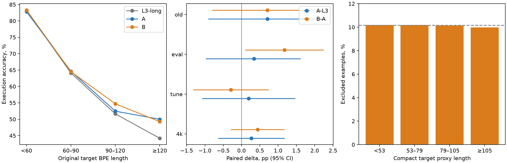
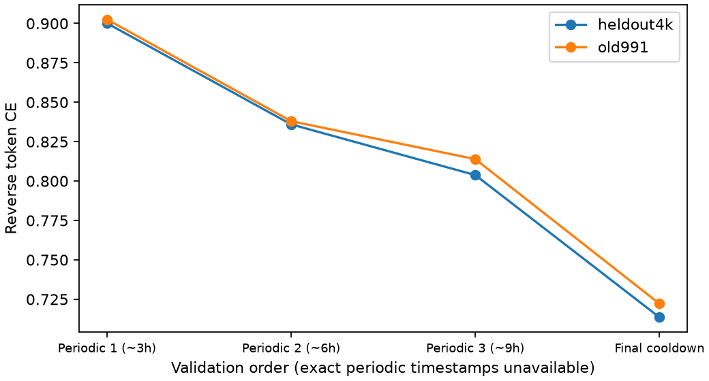
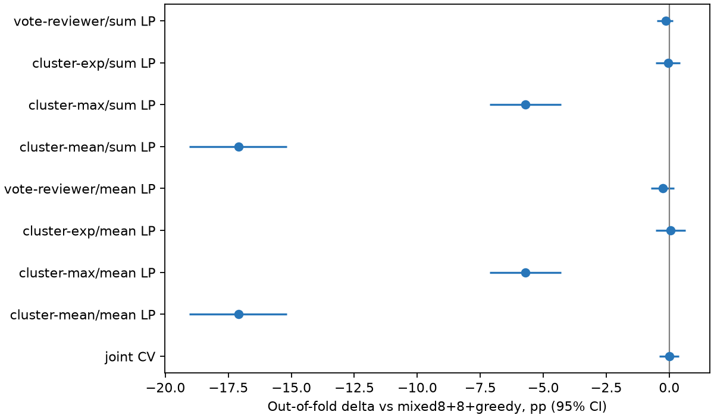

# P1: результаты длинного cooldown, truncation и рецензента

## Полнота и парный дизайн

Kernel `friend1/nlp-hw02-kaggle-p1` **COMPLETE**; оба worker complete, exits `[0,0]`, wall **36 338,53 с = 10ч05мин39с**, ниже hard10ч30мин. CPU-анализ не обучает модели, не генерирует новые ответы и не использует test для выбора.

**A/B завершили все31 372 attempted updates** из одной L3 C-long2x stable: updates209144/cursor20734592, anchor SHA48f2ba3f…. Совпали пять стартовых fingerprint-компонентов model/Adam/scaler/RNG/cursor-history, fingerprint полного restore и SHA предъявленного потока1951c03d…. На каждую ветку4 015 616 пар; peak0,0015 → endpoint0 по $1-\sqrt{j/31372}$. У обеих15AMP skips, nonfinite0. B имеет31372graph updates, OOM-fallback0. Stable main не продолжался.

A cooldown **13 001,95 с = 3ч36мин42с** против L3 **3007,72 с wall /7572updates**. B cooldown13 179,62с: wall **+1,37%**, чистое update time +1,24%. A−L3 меняет **длительность и форму**; разделить их эффекты нельзя. B−A меняет truncation при одинаковом attempted-step расписании; после15AMP skips успешных Adam updates31357у обеих.

Данные выровнены по ID/question SHA/reference/original BPE length. Saved correctness, bins, split counts и K8 decisions воспроизведены; все три P1 FP16 проверены по bytes/SHA. CPU оценивает producer restore receipts; без full stable PT повторное восстановление model/Adam/RNG локально не выполнялось.

**CI:** 10 000 парных bootstrap повторов по задачам, seed2026101401; для бинарных исходов A/B используется математически эквивалентное multinomial resampling gains/losses/unchanged. В таблицах95% CI. Для двух заранее заданных eval2048 сравнений дополнительно97,5% CI; положительная нижняя граница — критерий [p1-plan](p1-plan.md). Tune, old991 и bins диагностические; повторно использованный eval не является новым независимым test. CE — token-weighted, EOS включён, PAD/BOS исключены; CI для CE нет, поскольку per-example NLL не сохранены.

## A против финала L3 и B против A

| Greedy split | L3 C-long2x | A | B | A−L3, п.п. [95% CI]; gains/losses | B−A, п.п. [95% CI]; gains/losses |
|---|---:|---:|---:|---|---|
| heldout4096 |2923 /71,36%|2934 /71,63%|2952 /72,07%|+0,27 [−0,63;+1,17];189/178|+0,44 [−0,29;+1,17];127/109|
| tune2048 |1457 /71,14%|1461 /71,34%|1455 /71,04%|+0,20 [−1,07;+1,46];92/88|−0,29 [−1,32;+0,73];53/59|
| eval2048 |1466 /71,58%|1473 /71,92%|1497 /73,10%|+0,34 [−0,98;+1,61];97/90|+1,17 [+0,10;+2,25];74/50|
| old991 |722 /72,86%|729 /73,56%|736 /74,27%|+0,71 [−0,91;+2,32];38/31|+0,71 [−0,81;+2,22];33/26|

97,5% CI на eval: **A−L3 [−1,12;+1,81]**, **B−A [−0,05;+2,39] п.п.** Оба заранее заданных gate не пройдены. B−A имеет положительный обычный95% CI только на eval; tune этому не соответствует. Это сигнал для отдельной проверки, не доказанный победитель.

| Original target BPE bin, heldout4k | n | L3 | A | B | A−L3, п.п. [95% CI] | B−A, п.п. [95% CI] |
|---|---:|---:|---:|---:|---|---|
| <60 |2013|83,26%|82,81%|83,31%|−0,45 [−1,44;+0,50]|+0,50 [−0,25;+1,24]|
| 60–90 |1457|64,10%|64,65%|64,52%|+0,55 [−1,24;+2,33]|−0,14 [−1,51;+1,24]|
| 90–120 |488|51,64%|52,46%|54,71%|+0,82 [−2,25;+3,89]|+2,25 [−0,61;+5,12]|
| ≥120 |138|44,20%|50,00%|49,28%|+5,80 [−0,72;+13,04]|−0,72 [−7,25;+5,80]|

Ни один длиновой CI не исключает0; особенно широкий у≥120. Tune/eval bins и все gains/losses — в [JSON](../results/p1-results.json).

| Compact target token CE | L3 | A | B | A−L3 | B−A |
|---|---:|---:|---:|---:|---:|
| heldout4k |0,248291|0,234995|0,245521|−0,013296|+0,010526|
| old991 |0,250602|0,238388|0,249940|−0,012214|+0,011552|

A заметно улучшила CE при неопределённом execution gain. B ухудшила CE относительно A, хотя greedy eval и single K8 выросли: оптимизация token likelihood и правильность численного ответа не совпадают. Это собственная интерпретация измерений; CE разных направлений и raw/compact не сравниваются.



## K8 tune2048: single и mixed с L3 C-main

Frozen sampler: T0,7/seed270042/batch32/cap512,64журнала на модель,2048строк; OOM batch changes0. Greedy tie anchor mixed — **L3 C-main**. Равный K сравнивается отдельно от удвоения8→16; варианты greedy используют тот же сохранённый голос с coder LP0.

| Voting pool | L3 | A | B | A−L3, п.п. [95% CI]; gains/losses | B−A, п.п. [95% CI]; gains/losses |
|---|---:|---:|---:|---|---|
| Single K8 |1507|1506|1522|−0,05 [−1,22;+1,12];75/76|+0,78 [−0,29;+1,90];76/60|
| Single K8+greedy |1504|1500|1515|−0,20 [−1,42;+1,03];78/82|+0,73 [−0,34;+1,81];73/58|
| Mixed4+4 |1510|1515|1518|+0,24 [−0,63;+1,12];46/41|+0,15 [−0,73;+1,03];44/41|
| Mixed4+4+greedy |1511|1504|1510|−0,34 [−1,17;+0,49];33/40|+0,29 [−0,54;+1,12];40/34|
| Mixed8+8 |1536|1532|1529|−0,20 [−1,03;+0,63];37/41|−0,15 [−0,83;+0,59];26/29|
| Mixed8+8+greedy |1531|1525|1530|−0,29 [−1,12;+0,54];35/41|+0,24 [−0,44;+0,98];30/25|

A не улучшает нынешний mixed4+4+greedy. B single K8 интереснее A, но нет статистически установленного прироста; mixed8+8 тоже не растёт. Замена long на A/B в финальном ансамбле пока не обоснована. Это повторный tune без независимого K8 eval.

## Что исключала B

**407 836 /4 015 616 предъявлений =10,15625%**:13из128 на каждом шаге. Это число предъявлений с повторениями weighted order, не число уникальных исходных задач. Исключено10,0714% target-токенов. Target-length quantiles min/Q25/median/Q75/P90/P99/max:5/37/54/80/98/135/379; source:7/39/51/65/81/113/226. Средний per-example CE excluded **0,5875**, retained **0,1730**; усреднение по шагам, не общий token CE.

| Compact target proxy bin | Предъявлено | Исключено | Доля |
|---|---:|---:|---:|
| <53 |1 898 314|193 158|10,1752%|
| 53–79 |1 042 028|106 080|10,1801%|
| 79–105 |797 055|80 816|10,1393%|
| ≥105 |278 219|27 782|9,9857%|

Это ожидаемый результат пропорциональных квот с округлением: B не удаляла преимущественно длинные примеры. Верхний loss внутри bin может принадлежать шумному или трудному корректному примеру; журнал не позволяет объявить407836ошибочными targets. Original train BPE bins и полные source-length знаменатели не сохранены; компактные proxy bins нельзя выдавать за60/90/120.

## Рецензент

Обучение C6+6/d512 с нуля: **96 422 attempted updates**,31AMP skips/nonfinite0/escalations0, unchanged emergency factor1. Stable перед cooldown87078updates;9344cooldown updates =9,69% фактических updates при10% training wall. Финальный LR6,8945·10⁻⁸, математический endpoint0. Main update time9ч59мин49с, training wall10ч03мин39с. Архитектура/данные/направление — [p1-plan](p1-plan.md); reviewer никогда не обучался на correctness/reference кандидатов.

| Reverse validation | Heldout CE | Old991 CE |
|---|---:|---:|
| Periodic1 (~3ч) |0,900119|0,902552|
| Periodic2 (~6ч) |0,835959|0,838000|
| Periodic3 (~9ч) |0,803800|0,813899|
| Final после cooldown |0,713541|0,722161|



Точные timestamps/updates периодических CE отсутствуют; ось графика — порядок оценок,3/6/9ч номинальны. Последняя разница объединяет дополнительное обучение и cooldown; эффект формы отдельно не идентифицируется.

### CPU-скоринг и кросс-валидация

**Все2048задач, без подвыборки:**2048greedy C-main +16384C-main samples +16384C-long2x samples =**34 816кандидатов**;26 291уникальная code/question пара. FP16 weights SHAaeb7d645… strict-loaded в CPU FP32, Torch2.14.1; forwards **504,21с**, весь scoring+analysis около**544,35с =9мин04с**. Length-quantile benchmark предсказал505,87с; порог1,5ч не достигнут. Размер новых результатов — единицы MiB; большие journals/weights/stable не дублируются.

Scorer читает исходный **represented_code**, включая mode, без restore/recompact; greedy representation взята из L3 generation journal, не восстановлена из Python-кода. Считает

$$s_i=\log P(q\mid c_i)=\sum_{t=1}^{|q|+1}\log P(q_t\mid q_{<t},c_i),\qquad \bar s_i=s_i/(|q|+1).$$

$q$ — исходный вопрос, $c_i$ — представленная программа; последний $q_t$ — EOS. BOS/PAD не получают score. Дедуплицируются только forwards; multiplicity кандидатов остаётся в votes. Non-numeric/invalid кандидаты тоже просчитаны, но selector допускает только finite numeric результаты. Numeric clusters — connected components isclose1e-6; reference используется только в метриках и обучающей половине CV.

Селекторы для кластера $G$: `vote-reviewer` — $\log|G|+\beta\max_{i\in G}s_i$; `cluster-exp` — $\log\sum_{i\in G}\exp(\beta s_i)$; `cluster-max`/`cluster-mean` — максимум/среднее reviewer score без поддержки числом голосов. Вместо $s_i$ отдельно используется $\bar s_i$. $\beta\ge0$ выбирается из заранее заданной [сетки](p1-plan.md). Точный tie порядок count/greedy/coder LP/order сохранён. Приβ0 saved vote correctness полностью воспроизводится во всех pools.

Две половины **1024/1024**, normalized одинаковые вопросы находятся вместе. Для каждой строки β обучена на **другой** половине. Дополнительный `joint CV` выбирает на другой половине одновременно **семейство, sum/mean и β**. Это защищает от выбора лучшего семейства по всему tune; CI условен на обученных weights и fitted selectors, без повторного подбора внутри bootstrap. Tune повторно использован: независимой внешней проверки нет. Выбор full-grid winner по2048строкам не является OOF-результатом.

| Pool | Vote | Joint-CV reviewer | Δ, п.п. [95% CI] | Gains/losses |
|---|---:|---:|---|---|
| C-main8 |1502|1494|−0,39 [−0,88;+0,05]|8/16|
| C-long2x8 |1507|1507|0,00 [0;0], β0в обеих folds|0/0|
| Mixed4+4 |1510|1503|−0,34 [−0,73;+0,05]|5/12|
| Mixed4+4+greedy |1511|1504|−0,34 [−1,12;+0,44]|30/37|
| Mixed8+8 |1536|1530|−0,29 [−0,83;+0,24]|13/19|
| **Mixed8+8+greedy** |**1531**|**1531**|**0,00 [−0,39;+0,39]**|**8/8**|

Нулевой CI у long8 означает выбранное тождественное voting правило β0; он не утверждает отсутствие потенциального эффекта другого рецензента.

> [!details]- Все заранее заданные селекторы на полном17-кандидатном пуле
> β-sum/β-mean ниже — параметры для held folds0/1, обученные на противоположных половинах.
>
> | Selector | Score | OOF matches | Δ, п.п. [95% CI] | Исправлено /сломано | β для held0/1 |
> |---|---|---:|---|---:|---|
> | vote-reviewer |sum|1528|−0,15 [−0,49;+0,15]|4/7|0 /0,05|
> | cluster-exp |sum|1530|−0,05 [−0,54;+0,44]|12/13|0,01 /0,05|
> | cluster-max |sum|1414|−5,71 [−7,13;−4,30]|55/172|—|
> | cluster-mean |sum|1181|−17,09 [−19,04;−15,19]|55/405|—|
> | vote-reviewer |mean|1526|−0,24 [−0,73;+0,20]|9/14|0 /4|
> | cluster-exp |mean|1532|+0,05 [−0,54;+0,63]|19/18|0,5 /4|
> | cluster-max |mean|1414|−5,71 [−7,13;−4,30]|55/172|—|
> | cluster-mean |mean|1181|−17,09 [−19,04;−15,19]|55/405|—|
>
> Joint CV: held0 `cluster-exp/sum/β0,01`, held1 `vote-reviewer/sum/β0,05`;1531/2048,8gains/8losses. На всём tune cluster-exp/mean/β0,5 даёт1536, но OOF1532: full-grid выбор завышает впечатление о пользе. Все pools/grids/folds/OOF IDs — scorer summary (`../results/p1-reviewer/summary.json`, нет в репозитории).



### «248 проигранных» задач

При точном повторе L3 **8+8+greedy** vote1531, oracle1778, то есть **247** задач имеют правильный кандидат в пуле и неверного победителя. Для8+8без greedy:1536/1776,240проигранных. Число248 из запроса этим snapshot/selector не воспроизводится; отдельный список этих248ID не предоставлен. Список фактических247ID сохранён в summary/итоговом JSON, поэтому отличие на одну задачу проверяемо.

На фактических247 `joint CV` исправляет **8/247 =3,24%**, но ломает **8** ранее верных из1531: чистый gain0. Диагностический cluster-exp/mean исправляет19/247 (7,69%), ломает18: net+1ответ,95% CI включает0. Pure reviewer max исправляет55, но ломает172; число исправленных без числа новых ошибок вводило бы в заблуждение.

**Вывод:** reverse CE улучшается, но это не подтверждает полезное ранжирование execution correctness. Модель обучена восстанавливать формулировку исходной пары, а не отличать верный численный ответ от близкой неверной программы. Это объясняющая гипотеза, не установленная причина; нынешние selectors не дают основания добавлять reviewer forward в финал.

## Рецепт и последние6дней

**Сохранить нынешний L3 рецепт: constant-LR обучение → прежний50-минутный cooldown → адаптивное execution voting.** Длинный cooldown стоит дополнительно≈2ч50мин на модель, но A не дала установленного greedy/mixed выигрыша. Loss truncation не включать в production: B−A имеет сигнал на eval95%, но не проходит заданный97,5% gate и не улучшает mixed. Рецензента не включать и не тратить финальные training sessions на его продолжение: OOF gain полного пула0, а runtime добавляется.

1. **До17.10:** закрепить selector и проверить готовый [v6](final-inference.md#v6-адаптивный-инференс-с-decoder-all) одним cold test1919+tune2048 на одной T4,≤12мин сессия. Проверить полный таймер/guard/формат/реальное качество; этот GPU запуск здесь **не выполнен**.
2. **17.10 после reset:** приоритет — один запуск продолжения **обеих собственных L3 uncooled stable states**, C-main и C-long2x на разных GPU; прежние model/Adam/scaler/RNG/cursor и weighted policy. Ориентир8–8,5ч main +50мин cooldown +оценка/I/O, hard10ч30мин с учётом фактической квоты аккаунта. При нехватке бюджета первым продолжать long2x. Это рекомендация нового запуска; исторический отменённый L4 автоматически не возобновляется. FP16 A/B не заменяют full stable resume.
3. **18–19.10:** CPU replay новых journals → frozen final selector → одна итоговая eval2048/old991 и зарезервированный fresh1024 без дальнейшего tuning; затем single-T4 cold timer и чистовая посылка. Последний день оставить на проверку outputs/формата и сдачу, а не новую архитектурную ветку. Улучшение следующего продолжения не обещается; при провале сохранить проверенный L3.

**Инференс:** веса A/B и reviewer не добавляются; сохраняются greedy C-main и early stop после K2+K2 при полном численном согласии с greedy, иначе досэмплирование. Offline K8+K8 replay с≈9,4stochastic samples/задачу остаётся целевым режимом, не измеренным временем. Текущий v6 использует K6 ради запаса≤150с; K8 требует нового полного таймера — прежний осторожный прогноз152,8с выше150с, хотя ниже формального180с. Обе модели и старый greedy tie anchor сохраняются до нового frozen quality/timing gate. Новый scorer не переносится в runtime; hook рецензента остаётся выключенным.

Точный CPU replay текущего `final_adaptive`: L3 K2→K8 **1531/2048**,1133early stops,**9,3613**stochastic samples/задачу; K2→K6 **1533**,7,5742samples. С A вместо long:1526/1523; с B:1530/1530 дляK8/K6. Это ещё одна диагностика без преимущества A/B; padding/RNG новых GPU batched journals могут изменить эти числа.

## Недостающие артефакты и проверка

Для запрошенных CPU метрик/CI/K8/reviewer scoring файлов хватает. Ограничения:

- Full stable PT локально намеренно отсутствуют; нельзя независимо повторить CUDA restore либо продолжить train локально. Remote latest/manifests указывают сохранённые stable states.
- Нет точных timestamps/steps periodic reviewer CE и полных process logs: кривая по порядку validation, а не точной временной оси.
- Нет per-example token NLL, original train BPE/source-length знаменателей: CE CI и такие train length fractions не вычислены.
- Нет списка248ID; воспроизведено247. Нет нового K8 eval/fresh1024 и полного single-T4 mixed/reviewer таймера; это следующие GPU проверки, а не пропущенная часть CPU анализа.

[CPU checks](../checks/p1-results-cpu.json): score batch/single parity при PAD и разных длинах, EOS/count/sum/mean, multiplicity, независимость selection от reference, normalized-group CV. Compile/JSON finite/diff checks и визуальная проверка трёх графиков; сырые журналы и chunks остаются локально ignored, компактные summary/identity/графики сохраняются в Git.

**Коммит:** попытка `git add` явного P1-only списка получила exit128: shared worktree `index.lock`, `Operation not permitted`. Индекс не изменён, commit не создан; основной checkout не редактировался. [Квитанция и точный список файлов](../checks/p1-results-git.json). Повторить из обычного терминала в этом worktree после просмотра diff:

```bash
python3 - <<'PY'
import json, subprocess
from pathlib import Path
r = json.loads(Path('work/checks/p1-results-git.json').read_text())
subprocess.run(['git', 'add', '--', *r['paths']], check=True)
subprocess.run(['git', 'commit', '-m', r['message']], check=True)
PY
```

## Источники

- **kaggle-p1-final-results**: локальный snapshot наблюдателя `results/kaggle-runs/nlp-hw02-kaggle-p1/final/`, kernel status/session/worker summaries, metrics/training/restore/truncation/K8 journals, три FP16 checkpoints; bibliography. Журналы — первичные измерения, интерпретация CI и рекомендации — собственные выводы.
- [p1-plan](p1-plan.md), [p1-review](p1-review.md), [l3-results — Финал L3](l3-results.md#финал-l3), [final-inference](final-inference.md); новый [CPU-анализ](../research/analyze-p1-results.py), расширенный [scorer](../research/score-reviewer.py), [результаты A/B](../results/p1-results.json).
- Hägele2024, Kang–Hashimoto2020, Zhang2022 уже разобраны и внесены в bibliography через [p1-plan](p1-plan.md); P1 не воспроизводит их эксперименты и не подтверждает их результаты на ДЗ2.
