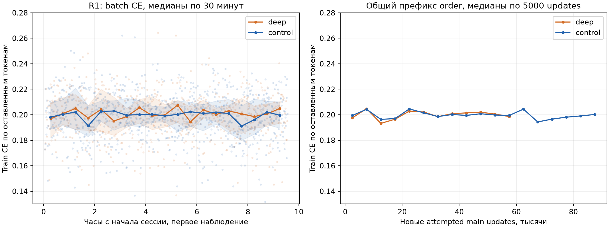

# R1: рост encoder против продолжения C-long2x

**Deep − контроль на heldout4k: +6 ответов, +0,15 п.п., 95% CI [−0,86; +1,15].** Преимущество encoder 12 при равном времени не установлено. На заранее указанном eval2048: +10 ответов, +0,49 [−0,98; +1,90] п.п. Deep получила на 31,3% меньше main updates. Ни greedy, ни голосование пока не обосновывают замену текущего v7.

**Рекомендация:** сначала одинаковый 50-минутный cooldown из обеих R1 stable, затем решать о продолжении deep. Сейчас не углублять C-main и не начинать decoder-рост. Базовый финальный рецепт — 50 мин cooldown; 3,6 часа из P1 не показали установленного преимущества. Это вывод анализа, а не новый запуск.

## Происхождение и полнота

`friend2/nlp-hw02-kaggle-r1`, версия 1: kernel **COMPLETE**, session/оба workers complete, exits `[0,0]`, wall **35 785,61 с =9 ч 56 мин 26 с**. Источник — скачанный `results/kaggle-runs/nlp-hw02-kaggle-r1/1/`; повторных Kaggle/API/GPU запусков нет.

По `r1-output-manifest.json` **не хватает `__notebook__.ipynb`**. У остальных **185/186** перечисленных файлов совпали bytes/SHA-256. Метрики, per-example, все 128 R1 K8 batch-журналов, обе cooled FP16, latest и full stable states, process/kernel logs, config и исходники присутствуют. Отсутствие исполненного ноутбука не мешает расчётам ниже. Пять файлов протокола, включая runtime/growth/truncation/selector/split, побайтно совпали с локальными.

[CPU-анализ](../research/analyze-r1-results.py) проверил 30 522 greedy-строки шести моделей, ID/question SHA/reference/original BPE lengths, correctness из numeric execution, bins и frozen split. Воспроизведены 384 K8 batch-журнала/98 304 samples, saved single K8 winners и frozen v7 **1535/2048**, 1232 early stops, 6,58594 samples. Выбор видит execution/LP/greedy; reference используется только после выбора. Новые forwards, исполнение программ, sampling и fresh1024 — 0.

[Отдельная CPU-проверка весов](../checks/r1-results-cpu.json): оба full stable и FP16 сверены по SHA, все model tensors/Adam moments finite, вторые моменты неотрицательны. Deep/control имеют 296/212 model tensors, 2/1 optimizer groups. Latest содержит ровно main, без terminal cooldown; LR 0,0015, micro 64, nonfinite/escalations/history events 0. Main AMP skips 28/40; это пропущенные Adam steps, а не признак nonfinite weights. Строгий CUDA reload здесь не повторялся.

## Дизайн и сопоставимость

Обе ветки стартовали из одного **L3 latest C-long2x**, updates209144/cursor20734592, main_s79 850,43. GPU0: encoder 6→12 с сохранением начальной функции; GPU1: encoder 6. Decoder 6, weighted order SHA72bc3dfd…, начало cursor и q10% одинаковы. В `ordinary` новый `order_seed` не переставляет order: загружен исходный L3 weighted порядок. Проверки presented-length/token totals совпали на всех 59 546 общих main batches; после них контрольная модель прошла дальше по тому же order. Исключаемые truncation примеры зависят от модели.

- **Deep против контроля** — корректное парное сравнение при равном **wall-time main 9,5 ч и linear cooldown 20 мин**. Оно включает цену меньшего числа updates и данных у deep; это не equal-update сравнение.
- **R1 против финала L3/P1** — измеримая разница конечных моделей, но не чистый эффект продолжения/глубины. У L3 cooldown 50 мин/q0; у P1 A/B — 31 372 шага $1-\sqrt{j/T}$ ($j$ — номер шага, $T=31372$), около 3,6 ч, A q0/B q10%; R1 имеет 20 мин linear/q10% и дополнительный main. Ни длительность cooldown, ни truncation отдельно здесь не идентифицированы.
- Все heldout/tune/eval уже использовались. CI — описательные парные 10 000 bootstrap повторов по задачам, seed2026101501, без поправки на выбор вариантов и множественные срезы. Они не охватывают разброс training seeds. В JSON сохранены также нормальные CI и exact McNemar p. CE CI нет: per-example NLL не сохранены.

## Метрики всех пяти вариантов

Знаменатели: heldout4096; tune/eval по 2048; old991. Bins по **исходной** target BPE-длине имеют 2013/1457/488/138 строк. CE — unsmoothed compact30 teacher-forcing token CE с EOS, без PAD/BOS, не raw CE.

| Модель | Heldout4k, matches (%) | Bins %, <60 /60–90 /90–120 /≥120 | Tune /eval | Old991, matches (%) | CE4k /CEold |
|---|---:|---|---:|---:|---|
| R1 deep12+6 |2874 (70,17)|82,22 /62,32 /52,05 /41,30|1423 /1451|699 (70,53)|0,274565 /0,280736|
| R1 контроль 6+6 |2868 (70,02)|82,12 /62,59 /51,02 /39,13|1427 /1441|712 (71,85)|0,271855 /0,274778|
| L3 C-long2x final |2923 (71,36)|83,26 /64,10 /51,64 /44,20|1457 /1466|722 (72,86)|0,248291 /0,250602|
| P1-A |2934 (71,63)|82,81 /64,65 /52,46 /50,00|1461 /1473|729 (73,56)|0,234995 /0,238388|
| P1-B |2952 (72,07)|83,31 /64,52 /54,71 /49,28|1455 /1497|736 (74,27)|0,245521 /0,249940|

`updates` ниже — накопленные **attempted main** updates stable, без disposable cooldown; main_s — сумма update timers, без I/O/cooldown/eval. Для P1 это прежний L3 main, а 31 372 новых cooldown updates относятся только к оцениваемой ветке.

| Модель | Main_s /main updates, накопленно | Новые main_s /updates в сессии | Main wall, с | Пропускная способность, updates/с | Cooldown wall, мин /updates |
|---|---:|---:|---:|---|---:|
| R1 deep |113748,33 /268690|33897,90 /59546|34204,98|1,741 по wall;1,757 по update timer|20,01 /2105|
| R1 контроль |113758,83 /295858|33908,40 /86714|34204,16|2,535 по wall;2,557 по update timer|20,00 /3052|
| L3 C-long2x |79850,43 /209144|33480,18 /85302|нет сопоставимой квитанции|2,548 по update timer|50,13 /7572|
| P1-A |79850,43 /209144|0 /0|—|cooldown 2,413 по wall;2,421 после warmup по update timer|216,70 /31372|
| P1-B |79850,43 /209144|0 /0|—|cooldown 2,380 по wall;2,391 после warmup по update timer|219,66 /31372|

В R1 последний save добавляет≈4–5 с сверх main 34200 с; собственно training wall34200,37/34200,20. Deep стоит **1,456× времени/update**, против smoke1,323×; имеет 68,67% updates контроля. Presented throughput222,83/324,50 пар/с, retained200,20/291,55 пар/с:128 предъявлений и 115 оставленных на attempt. В main deep15 graph→two-pass OOM fallbacks, cooldown ещё 1; у контроля 0. Micro64 сохранён. Это fallback до Adam, не сорванный worker.

## Парные результаты

Gains/losses — вторая модель стала правильной/перестала относительно базы в названии. Δ в п.п.,95%bootstrap CI.

| Сравнение | Срез | Gains /losses | Δ [95% CI], п.п. |
|---|---|---:|---|
| **Deep − контроль** |**heldout4096**|**226 /220**|**+0,15 [−0,86; +1,15]**|
| Deep − контроль |tune2048|107 /111|−0,20 [−1,56; +1,22]|
| Deep − контроль |eval2048|119 /109|+0,49 [−0,98; +1,90]|
| Deep − контроль |old991|42 /55|−1,31 [−3,33; +0,61]|
| Контроль − L3 final |heldout4096|172 /227|−1,34 [−2,29; −0,39]|
| Контроль − L3 final |eval2048|91 /116|−1,22 [−2,59; +0,15]|
| Deep − L3 final |heldout4096|194 /243|−1,20 [−2,20; −0,20]|
| Deep − L3 final |eval2048|109 /124|−0,73 [−2,20; +0,73]|

Для главного 4k сравнения exact McNemar p0,813. Обе R1 ниже L3 на 4k с отрицательным CI; **это реальное различие этих cooled моделей, но не доказательство вреда дополнительных 9,5 ч main** из-за другого cooldown/objective. На eval2048 даже эти R1−L3 CI включают 0.

> [!details]- Deep − контроль: длиновые срезы
>
> | Bin | n | Gains /losses | Δ [95% CI], п.п. |
> |---|---:|---:|---|
> | <60 |2013|68 /66|+0,10 [−1,04; +1,19]|
> | 60–90 |1457|104 /108|−0,27 [−2,27; +1,72]|
> | 90–120 |488|38 /33|+1,02 [−2,46; +4,30]|
> | ≥120 |138|16 /13|+2,17 [−5,80; +9,42]|
>
> Положительное направление на длинных задачах не подтверждено CI. Все сравнения R1−L3 по bins/tune/old, gain/loss IDs — в [JSON](../results/r1-results.json).

## K8 tune2048 и голосование

T0,7/seed270042/batch32/cap512 у всех; первые K из сохранённых 8, без новых samples. Frozen selector: numeric connected components isclose1e-6 → count → greedy → mean LP → исходный порядок. `g` — **один L3 C-main greedy** в mixed; single использует собственный greedy. Frozen v7: **C-main/L3-long/P1-B, K1=1/1/1→K2=3/5/4**,1535/2048,6,586 сэмпла в среднем. Это текущая база при ограничении инференса; не максимум любых статических pools.

| Pool | Matches /2048 | Stochastic samples, среднее /максимум | Δ к v7 [95% CI], п.п. |
|---|---:|---:|---|
| v7 frozen |1535|6,586 /12|0 [0;0]|
| Deep single 8 |1485|8 /8|−2,44 [−3,66; −1,27]|
| Deep single 8+свой g |1475|8 /8|−2,93 [−4,15; −1,76]|
| Контроль single 8 |1489|8 /8|−2,25 [−3,37; −1,12]|
| Контроль single 8+свой g |1488|8 /8|−2,29 [−3,42; −1,17]|
| Main+deep, g+4+4 |1504|8 /8|−1,51 [−2,49; −0,54]|
| Main+контроль, g+4+4 |1495|8 /8|−1,95 [−2,93; −1,03]|
| **Main+deep, g+8+8** |**1523**|16 /16|**−0,59 [−1,56; +0,39]**|
| **Main+контроль, g+8+8** |**1506**|16 /16|**−1,42 [−2,34; −0,49]**|
| Main+L3-long, g+8+8 |1531|16 /16|−0,20 [−1,03; +0,59]|
| Main+L3-long+deep, g+4+4+4 |1521|12 /12|−0,68 [−1,56; +0,15]|
| Main+контроль+deep, g+4+4+4 |1502|12 /12|−1,61 [−2,64; −0,63]|
| Main+L3-long+deep, g+8+8+8 |1539|24 /24|+0,20 [−0,68; +1,07]|
| Main+контроль+deep, g+8+8+8 |1530|24 /24|−0,24 [−1,17; +0,63]|
| Main+P1-B+deep, g+8+8+8 |1541|24 /24|+0,29 [−0,59; +1,12]|
| Main+L3-long+deep, adaptive1→3/5/4 |1519|6,727 /12|−0,78 [−1,56; +0,05]|
| Main+контроль+deep, adaptive1→3/5/4 |1504|6,691 /12|−1,51 [−2,49; −0,59]|

Single8 deep ниже контроля на 4 ответа. В mixed g+8+8 она полезнее контроля по point estimate, однако **преимущества перед нынешним v7 нет**. Лучший постфактум 1541 имеет 43 gains/37 losses к v7, CI включает 0;1539 имеет 43/39. Их 24 stochastic samples против 6,586 у v7 не являются равным бюджетом. Даже номинально одинаковый K не означает одинаковый wall-time для разных архитектур.

Замена P1-B на deep при **той же frozen adaptive конфигурации** даёт 1519: 29 gains/45 losses, на 2,1% больше средних samples. Замена long и P1-B на контроль/deep —1504: 36/67. Нынешний v7 сохраняется. Все варианты exploratory на повторно использованном tune; CI не скорректированы за перебор. K8 eval/fresh отсутствуют.

> [!details]- Дополнительные заранее перечисленные при CPU-разборе pools
>
> | Три модели, порядок после main | g+4+4+4 | g+8+8+8 | g+3+5+4 | Adaptive1→3/5/4 |
> |---|---:|---:|---:|---:|
> | L3-long, deep |1521|1539|1519|1519|
> | Контроль, deep |1502|1530|1504|1504|
> | L3-long, контроль |1513|1530|1509|1509|
> | P1-B, deep |1525|1541|1524|1523|
> | P1-B, контроль |1516|1529|1519|1519|
>
> Все CI/gains/losses/oracle misses и correctness vectors — в [JSON](../results/r1-results.json). Static main+deep8+8 без g1522; main+контроль 1507; main+L3-long1536. Старые single 8 L3-long/P1-A/P1-B1507/1506/1522 воспроизведены. Это конечный небольшой список pools, не поиск всех перестановок/весов/K.

## CE по времени: догоняет ли deep

**Промежуточных heldout CE в R1 нет:** только одна финальная оценка после cooldown. В process log есть 595/867 main точек — CE одного batch каждые 100 updates. Это retained-token train objective после truncation; с heldout CE его численно не сравнивать. Время — первое появление строки в общем kernel log, точность около 30 с supervisor polling. Полупрозрачная область — межквартильный разброс batches, не CI. Малый конечный неполный bin (3/4 точки) исключён из медиан и slopes.

| Наклон медиан train CE | Deep | Контроль |
|---|---:|---:|
| Последние 4 ч, CE/ч |+0,00120|−0,00098|
| Последние 2 ч, CE/ч |+0,00289|+0,00628|

Кривые колеблются около 0,20, знак зависит от окна и состава batches. При общих 595 observed updates до 59500 разность deep−контроль: mean +0,000178/median +0,000241 — почти наложение. **Свидетельства устойчивого догоняющего наклона нет**, но и heldout-плато этими train-loss точками установить нельзя. В конечной heldout CE deep **хуже на 0,002710**, old — на 0,005957. Экстраполировать время обгона по этой кривой нельзя.

## Greedy test1919 и влияние на инференс

Все таймеры — сохранённые full test runs, FP16 physical4D greedy, без gold и cache reuse. Это отдельные модели на своих GPU/в своих сессиях; **не холодный трёхмодельный v7 на одной T4**. K8 timer включает restore/execution, поэтому тоже не чистое GPU-время.

| Модель | Полный test, с | Generation, с | Execution, с | K8 tune2048 total, с |
|---|---:|---:|---:|---:|
| R1 deep |35,67|20,65|13,35|134,07|
| R1 контроль |16,89|14,68|0,65|135,24|
| L3 C-long2x |23,73|9,14|13,32|133,70|
| P1-A |27,21|12,23|13,32|155,78|
| P1-B |20,68|10,63|8,59|155,19|

У deep **generation+40,7%**, весь pipeline 2,11× к контролю; значительная часть разницы full timer — два timeout/worker-exit и один pool restart/chunk retry против 0 у control. Restore errors 0, greedy OOM 0. Deep/control выдали 101795/102642 токена с mode/EOS, mean 53,05/53,49, max 512 и по 3 без EOS: общий объём вывода почти одинаков, но распределение batch tails и время encoder не разложены.

У обеих decoder 6: число decoder layers и размер его self-KV на lane не выросли; encoder вызывается до авторегрессионного цикла. Поэтому encoder growth не удваивает работу каждого decode шага. **Однако утверждение «почти не влияет на полную скорость» этим тестом не подтверждено**: наблюдаемые +40,7% generation существенны. Отделить encoder overhead от tail/batch/GPU вариации можно только парным profile на одной T4 с общими forced sequences. Почти равные K8 totals 134,1/135,2 с этого не заменяют.

Если новые веса позже выиграют quality gate, загрузчик v7 уже поддерживает model_spec 12/6, но нужны новые pins, memory/quality gate и полный cold test+tune timer с тем же guard. Текущие receipts скорости v7 нельзя переносить на deep. Пока конфиг/веса финального инференса не меняются.

## Как потратить оставшуюся квоту

Рекомендации используют **часы квоты из запроса пользователя**: до 17.10 около 19 ч, после сброса около 90 ч на трёх аккаунтах. Баланс и правила списания заново не запрашивались. GPU0/GPU1 работают параллельно: длительности веток не складываются в wall-time сессии.

### До сброса: сначала снять неопределённость cooldown

1. **До 2 ч:** обе R1 uncooled latest → одинаковые 50 мин linear cooldown/q10% → greedy 4k/old/CE/test/K8, без нового main. Это тест длительности cooldown внутри R1; сравнение с L3 всё ещё смешивает q и дополнительный main. Сохранить обе stable; продолжать обучение из них. Cooldown3,6 ч не повторять.
2. **До 9 ч:** если после 50 мин у deep появится убедительный сигнал на парном eval или полезный вклад в ансамбль при сопоставимом K/time, дать ей ещё одно ограниченное продолжение с контролем: main≈7,5 ч +50 мин cooldown +оценка/I/O. При неопределённом greedy без пользы для ансамбля эти 9 ч отдать двум сильнейшим обычным C.
3. **Оставшиеся≈8 ч:** продолжить C-main и лучшую подтверждённую long-ветку, main≈6,5 ч +50 мин cooldown +оценка/резерв. C-main брать из своей L3 stable; выбор R1-control или L3-long зависит от сравнения с одинаковым 50-минутным cooldown. Параллельное продолжение копий одной stable создаёт разные кандидаты, а не суммарное последовательное обучение.

Это потолки 2+9+8=19 ч с setup/eval. Если первый тест не улучшит R1, нет оснований тратить квоту на deep ради самой архитектуры. q10% также не установлен как лучший objective: R1 не содержит q0 main-контроля. В дальнейших продолжениях сначала зафиксировать рецепт; q проверять отдельно и парно.

### После сброса: бюджет 90 ч

| Назначение | Бюджет квоты | Решение |
|---|---:|---|
| Продолжение двух лучших проверенных C |60 ч|Преимущественно 6+6, собственные uncooled stable, сохранённые Adam/scaler/cursor/order; сессии в пределах hard limit и одинаковый 50-минутный финал. Deep занимает место только после проверки выше.|
| Диагностика cooldown/objective |8 ч|Закрыть одинаковый 50-минутный протокол и при необходимости проверить q0/q10% из одной stable с одинаковыми main/cooldown. Глубину/order/q одновременно не менять.|
| Условный эксперимент роста |≤10 ч|C-main encoder 6→12 только если long-deep покажет пользу; нужна собственная C-main none-пара. Иначе эти 10 ч вернуть продолжениям. Decoder-рост сейчас не приоритетен.|
| Финальные cooldown/eval/inference и резерв |12 ч|Зафиксировать selector, одна eval/old/fresh без дальнейшего tuning, cold timer на одной T4, проверка формата и сдача.|

Распределить не более 30 ч на аккаунт: например, каждому по 20 ч продолжений; первым двум по 4 ч диагностики и 6 ч резерва, третьему 10 ч условного роста. Это учёт бюджета, а не автоматический запуск. Короткие диагностики можно закончить раньше.

**C-main сейчас не углублять:** R1 проверил другой anchor и не установил пользу даже у long. **Decoder-рост отложить:** его качество и оптимизация не измерены, а дополнительные decoder layers выполняются на каждом авторегрессионном шаге и увеличивают KV. Результат encoder не определяет полезность decoder, но пока не оправдывает ещё одну большую архитектурную ветку при ограничении времени инференса.

**Финальный cooldown — 50 мин linear как проверенный default**, с одинаковым objective для парных сравнений. Достаточность 20 мин в R1 не установлена; P1 не обосновал дополнительные≈2 ч 50 мин. Конечные checkpoint/selector выбирать по frozen протоколу; текущий v7 остаётся запасным вариантом.

## Ограничения и воспроизведение

- Не скачан `__notebook__.ipynb`; всё нужное для метрик/CI/votes/кривой train CE присутствует.
- Нет periodic heldout CE и per-example NLL: validation-наклон и CE CI не восстановить. Train CE после truncation их не заменяет.
- Нет новых K8 eval/fresh, одинакового 50-минутного R1 cooldown или полного deep ensemble timer на одной T4. Это следующие GPU-проверки, не выполненные в CPU-сессии.
- У R1 один training seed/anchor; bootstrap по задачам не характеризует разброс обучения. Main q10% против q0 здесь не сравнивались.

[JSON со всеми расчётами и SHA](../results/r1-results.json), [проверка stable/FP16](../checks/r1-results-cpu.py). В CPU-окружении с NumPy/Matplotlib: `python research/analyze-r1-results.py`; Torch CPU нужен только для `python checks/r1-results-cpu.py`. Большие output/PT/journals остаются ignored; в Git сохраняются компактные результаты, график и код анализа.

**Коммит:** `git add` явного R1-списка получил exit128: песочница запретила создание shared worktree `index.lock` (`Operation not permitted`). Индекс не изменён, коммит не создан. [Квитанция и список файлов](../checks/r1-results-git.json).

## Источники

- **kaggle-r1-final-results**: первичные локальные R1v1 output/manifest/config/logs/checkpoints,2026-10-15; библиография. Метрики/счётчики — содержание журналов; CI, интерпретация причин и рекомендации — собственный анализ.
- [r1-plan](r1-plan.md), [r1-review](r1-review.md) — дизайн и CUDA smoke; [l3-results — Финал L3](l3-results.md#финал-l3), [p1-results](p1-results.md) — исторические сравнения с другим cooldown.
- [final-inference — V7: ансамбль из трёх моделей](final-inference.md#v7-ансамбль-из-трёх-моделей), [v7 receipt](../checks/final-inference-v7-offline.json), [frozen selector](../kaggle/src/exp27_decode.py), [production replay](../kaggle/src/final_ensemble.py). Новые внешние работы в этом разборе не использовались.
